<div align="center">

# C.F.G Force Store

**Loja virtual de suplementos, roupas e acessórios de academia**

Feita com **HTML, CSS e JavaScript puros**: sem framework, sem instalação, sem servidor.
Funciona no **celular**, no **tablet** e no **desktop**.

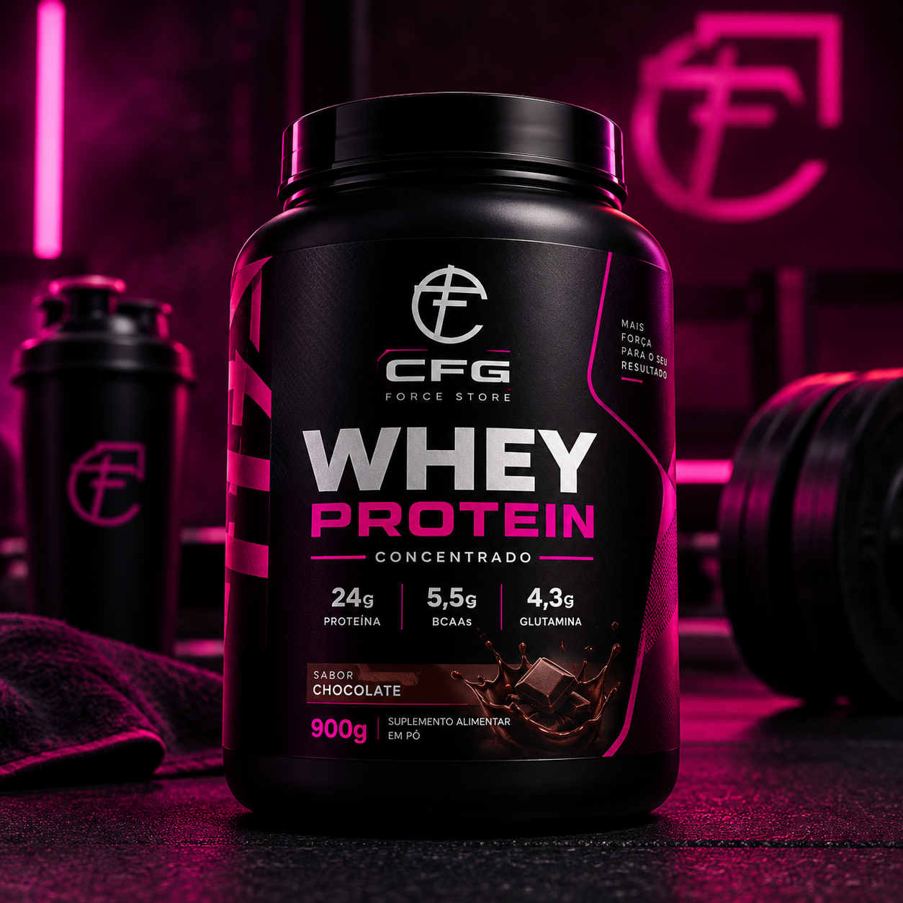  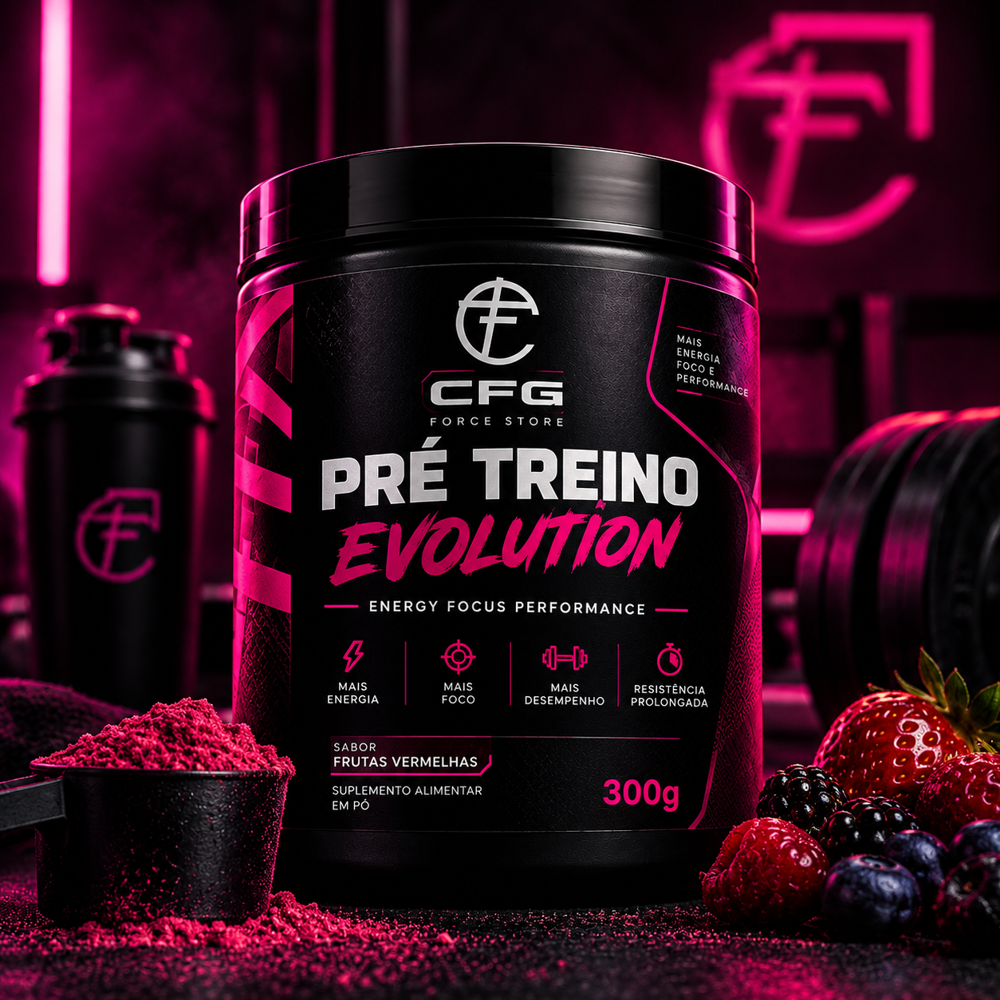 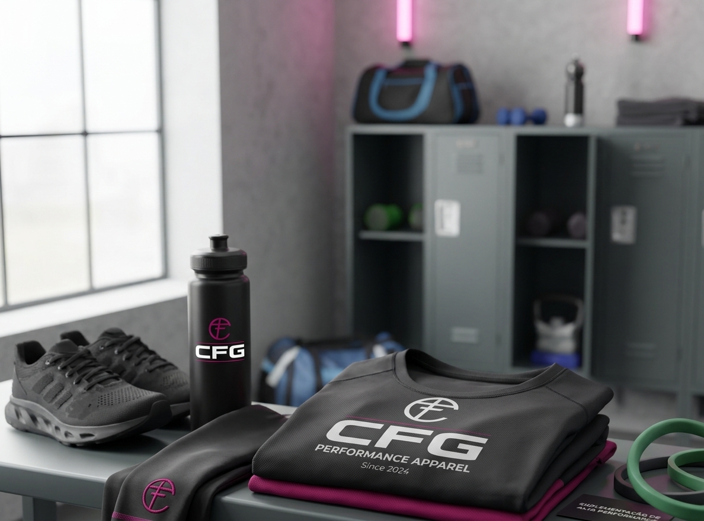 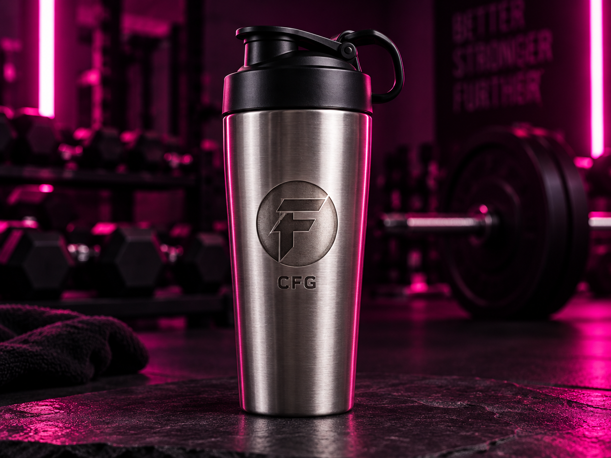

</div>

---

## Como usar este README

Este documento foi escrito para que **cada integrante consiga apresentar a sua parte com segurança**. Ele tem duas camadas:

1. **Parte geral (seções 1 a 6):** todo mundo lê. Explica o que o site faz, como as peças se conectam e quem fez o quê.
2. **Parte de cada bloco (seções 7 a 12):** cada pessoa estuda a **sua**. Todo bloco segue o mesmo roteiro:

| Item do bloco | Para que serve |
|---|---|
| **Em uma frase** | O resumo para abrir a sua fala. |
| **Diagrama** | Uma imagem de como a sua parte funciona. |
| **Conceitos que você precisa dominar** | As ideias que alguém pode perguntar. |
| **Roteiro para apresentar** | O que falar, na ordem, em uns 2 minutos. |
| **Perguntas que podem aparecer** | Perguntas prováveis, já com a resposta (clique para abrir). |
| **Código linha por linha** | Tabelas com **todas as linhas** do seu trecho explicadas. |

> [!TIP]
> Abra o arquivo de código ao lado deste README. O número `L42` na tabela é a **linha 42** do arquivo. No VS Code, `Ctrl + G` leva direto para uma linha. Linhas em branco não aparecem nas tabelas.

---

## Sumário

**Parte geral**

1. [O projeto em 1 minuto](#1-o-projeto-em-1-minuto)
2. [Como rodar](#2-como-rodar)
3. [Imagens do projeto](#3-imagens-do-projeto)
4. [Como as peças se conectam](#4-como-as-peças-se-conectam)
5. [Equipe e divisão em blocos](#5-equipe-e-divisão-em-blocos)
6. [Paleta de cores e tokens](#6-paleta-de-cores-e-tokens)

**Parte de cada bloco**

7. [Bloco 1 · Guilherme Borges · Estrutura HTML](#7-bloco-1--guilherme-borges--estrutura-html)
8. [Bloco 2 · Maycom Wylliam · Estilos base, home e cards](#8-bloco-2--maycom-wylliam--estilos-base-home-e-cards)
9. [Bloco 3 · Vinicius Duarte · Estilos das telas internas](#9-bloco-3--vinicius-duarte--estilos-das-telas-internas)
10. [Bloco 4 · Bruno Schwabe · Menu, avisos, acessibilidade e responsividade](#10-bloco-4--bruno-schwabe--menu-avisos-acessibilidade-e-responsividade)
11. [Bloco 5 · Kevin Patrick · Dados, navegação e catálogo](#11-bloco-5--kevin-patrick--dados-navegação-e-catálogo)
12. [Bloco 6 · Ismael Ramos · Produto, carrinho, carrossel e inicialização](#12-bloco-6--ismael-ramos--produto-carrinho-carrossel-e-inicialização)

**Para fechar**

13. [Fluxos completos: o que acontece quando o usuário clica](#13-fluxos-completos-o-que-acontece-quando-o-usuário-clica)
14. [Perguntas gerais sobre o projeto](#14-perguntas-gerais-sobre-o-projeto)
15. [Limitações conhecidas e ideias de melhoria](#15-limitações-conhecidas-e-ideias-de-melhoria)
16. [Glossário](#16-glossário)

---

## 1. O projeto em 1 minuto

A **C.F.G Force Store** é o protótipo de uma loja online. O layout foi desenhado no **Figma** e depois transformado em código. Com ela dá para:

- ver as **promoções** num carrossel que troca sozinho;
- navegar por **categorias** (Suplementos, Roupas, Equipamentos, Acessórios) e **ordenar** por nota ou por preço;
- abrir a **página de um produto**, escolher tamanho, sabor e quantidade;
- montar um **carrinho**, mudar quantidades, remover itens e finalizar o pedido.

O site tem **5 telas**, mas é **um único arquivo HTML**. O JavaScript só esconde uma tela e mostra outra; a página nunca recarrega. Esse modelo se chama **SPA** (*Single Page Application*, aplicação de página única).

O mapa abaixo mostra **como se vai de uma tela para outra**:

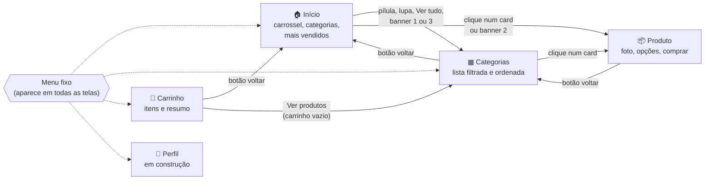

---

## 2. Como rodar

1. Baixe ou clone o repositório.
2. Dê **dois cliques** no arquivo `index.html`. Ele abre no navegador e já funciona.
3. Para ver as versões tablet e desktop, aumente a janela. Para ver a versão celular, aperte `F12` e depois `Ctrl + Shift + M` (modo dispositivo).

Não precisa instalar nada. Não tem `npm`, não tem build, não tem banco de dados.

---

## 3. Imagens do projeto

Todas as imagens ficam na pasta [`img/`](img/). O JavaScript procura cada foto **pelo nome do arquivo**, então o nome precisa ser exatamente o da tabela.

### Produtos

<table>
  <tr>
    <td align="center"><br><sub><b>Whey Isolado 900g</b><br><code>whey.png</code></sub></td>
    <td align="center">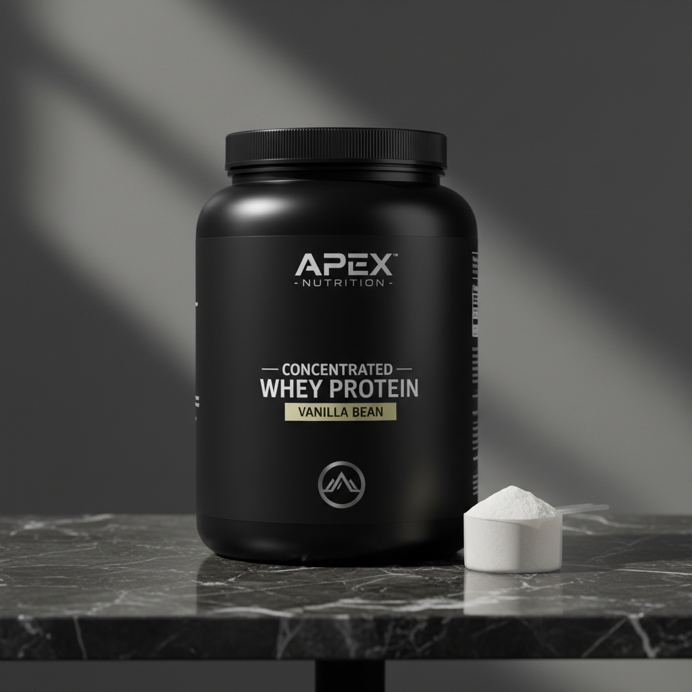<br><sub><b>Whey Concentrado 1kg</b><br><code>whey-concentrado.png</code></sub></td>
    <td align="center">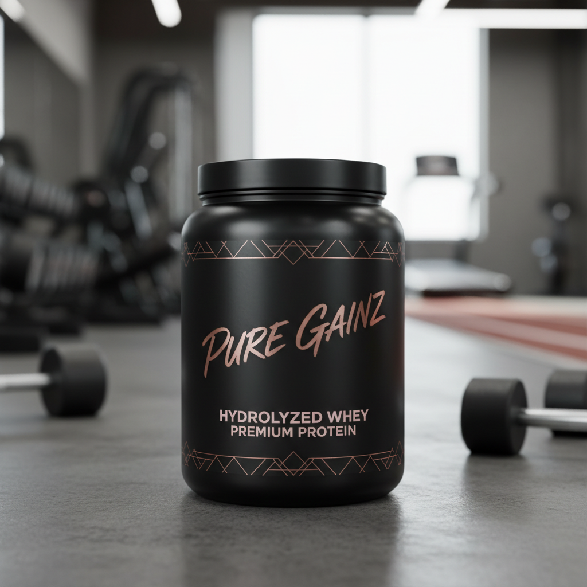<br><sub><b>Whey Hidrolisado 900g</b><br><code>whey-hidrolisado.png</code></sub></td>
    <td align="center">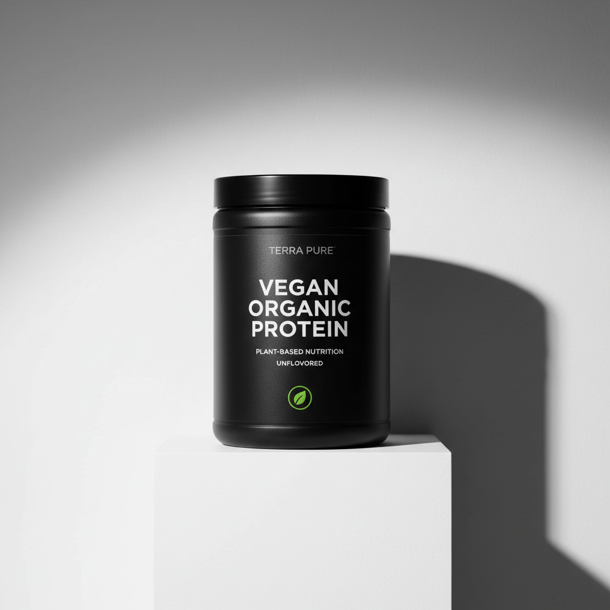<br><sub><b>Proteína Vegana 900g</b><br><code>proteina-vegana.png</code></sub></td>
    <td align="center">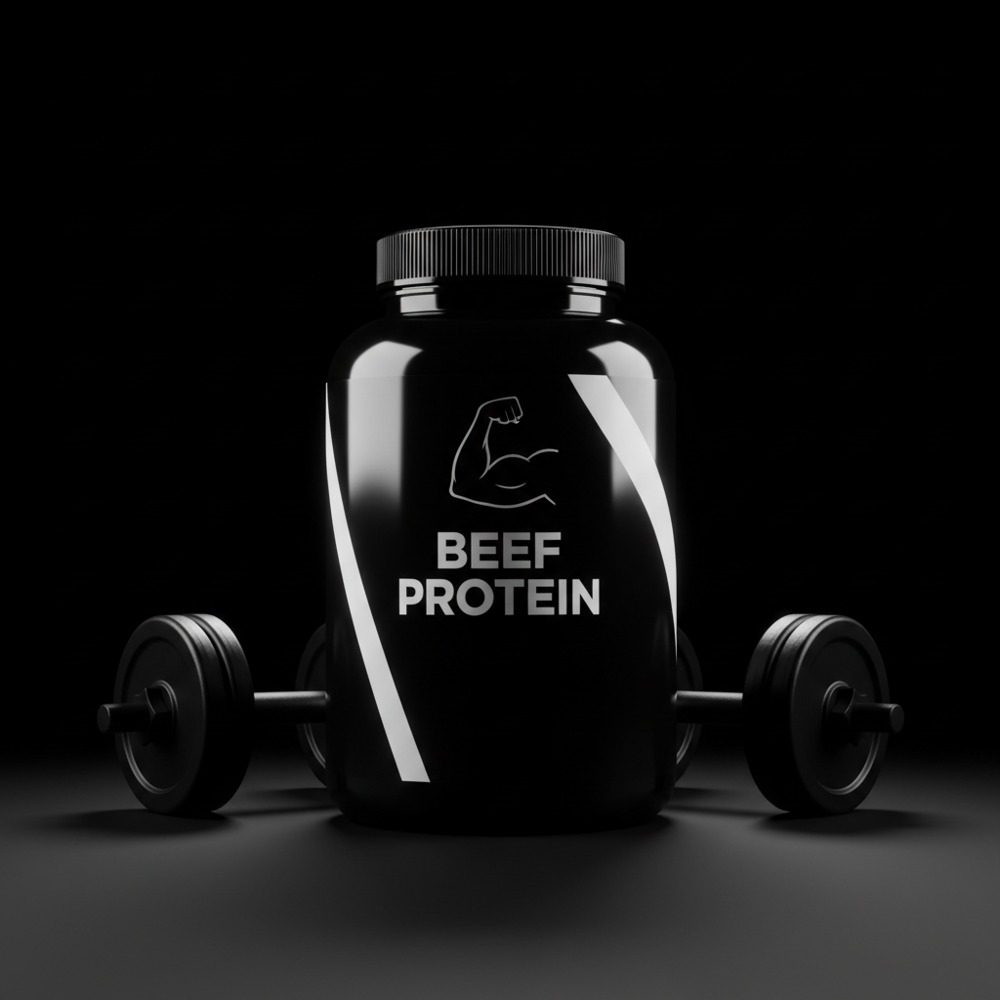<br><sub><b>Beef Protein 900g</b><br><code>beef-protein.png</code></sub></td>
  </tr>
  <tr>
    <td align="center">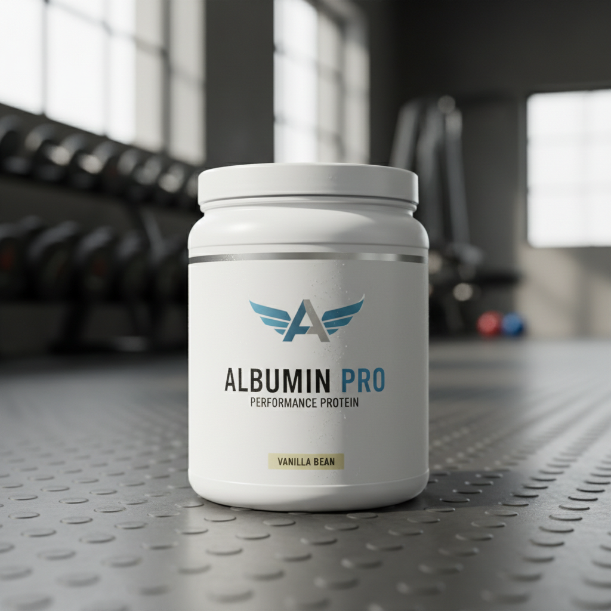<br><sub><b>Albumina 500g</b><br><code>albumina.png</code></sub></td>
    <td align="center"><br><sub><b>Creatina 300g</b><br><code>creatina.png</code></sub></td>
    <td align="center"><br><sub><b>Pré-Treino 300g</b><br><code>pretreino.png</code></sub></td>
    <td align="center"><br><sub><b>Camiseta de Compressão</b><br><code>camiseta.png</code></sub></td>
    <td align="center"><br><sub><b>Coqueteleira Inox</b><br><code>coqueteleira.png</code></sub></td>
  </tr>
</table>

### Banners do carrossel

<table>
  <tr>
    <td align="center">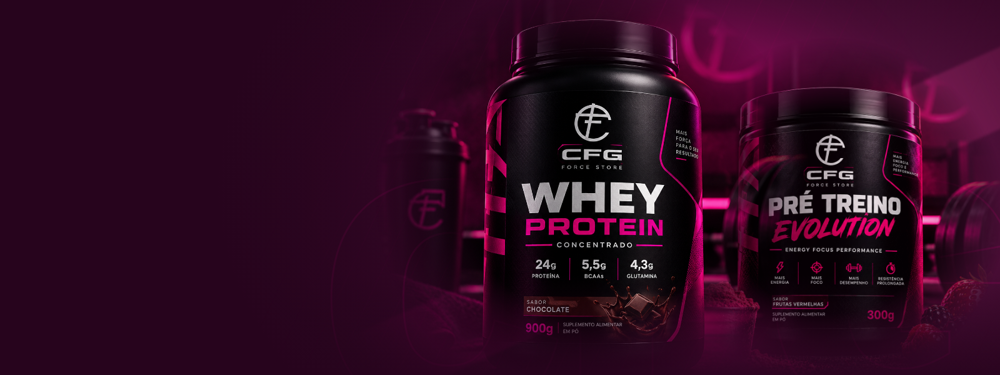<br><sub><b>Slide 1 · Oferta do dia</b><br><code>banner.png</code></sub></td>
    <td align="center">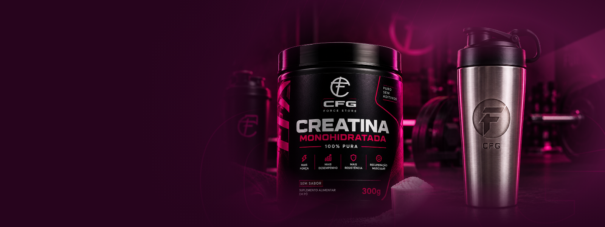<br><sub><b>Slide 2 · Frete grátis</b><br><code>banner-2.png</code></sub></td>
    <td align="center">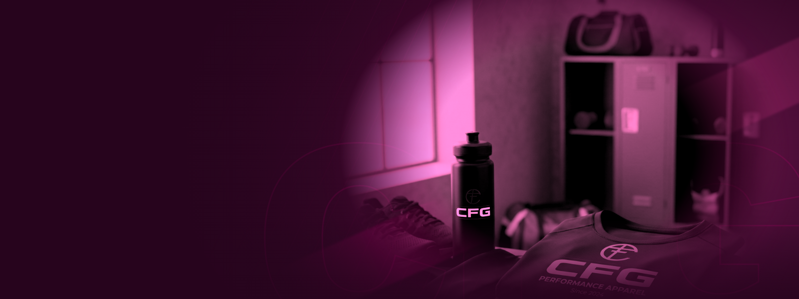<br><sub><b>Slide 3 · Lançamento</b><br><code>banner-3.png</code></sub></td>
  </tr>
</table>

### Como uma foto chega na tela

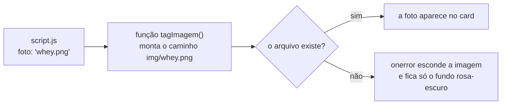

Os banners funcionam diferente: o caminho fica no próprio HTML, numa **variável CSS** (`style="--img: url('img/banner.png')"`), e o CSS usa essa variável como imagem de fundo.

> [!NOTE]
> As fotos são cortadas automaticamente para caber no espaço (`object-fit: cover` e `background-size: cover`). Elas não precisam ter um tamanho exato, mas o produto deve ficar **centralizado**. Nos banners, deixe o **lado esquerdo mais limpo**, porque é onde fica o texto.

### Como adicionar um produto novo

1. Salve a foto em `img/` com um nome **minúsculo e sem espaço**, por exemplo `luva.png`.
2. Em `script.js`, dentro da lista `produtos`, coloque uma **vírgula** depois do último produto e acrescente:

```js
{ id: "luva", nome: "Luva de Treino C.F.G", tipo: "Acessórios", grupo: "acessorios", nota: 4.8, preco: 49.90, foto: "luva.png", opcoes: false,
  descricao: "Luva com palma emborrachada para mais firmeza na pegada." }
```

3. Pronto. Ele aparece sozinho na categoria escrita em `grupo`.

> [!WARNING]
> No Windows, `Whey.png` e `whey.png` funcionam igual. **Na internet (GitHub Pages), não**. Use sempre letras minúsculas. Se uma foto não aparecer, aperte `F12` → **Console** para ver qual arquivo deu `404 (Not Found)`.

---

## 4. Como as peças se conectam

Cada arquivo tem uma função. Uma comparação que ajuda: o site é como um **corpo**.

| Arquivo | Papel | Comparação |
|---|---|---|
| `index.html` | **Estrutura:** o que existe na página (telas, botões, textos). | O **esqueleto** |
| `style.css` | **Aparência:** cores, tamanhos, posições, animações, versões celular/desktop. | A **pele e a roupa** |
| `script.js` | **Comportamento:** dados dos produtos, carrinho, troca de telas. | O **cérebro e os músculos** |

E é assim que os três conversam:

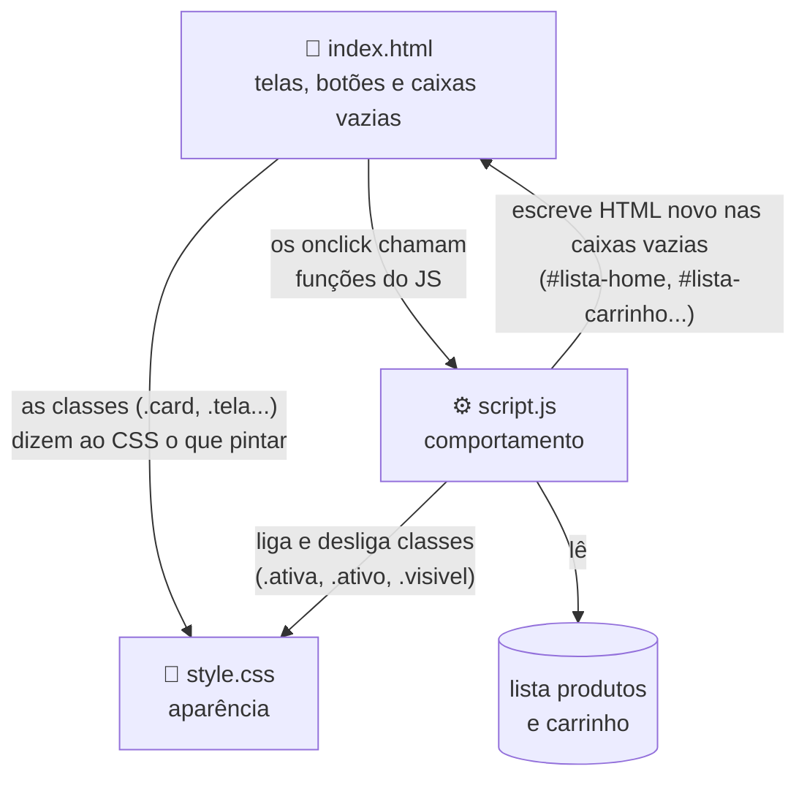

### As 4 ideias que explicam o site inteiro

**1. Só uma tela aparece por vez.**
Todas as telas têm a classe `tela`, e o CSS diz `.tela { display: none }` (escondida). Só a tela que **também** tem a classe `ativa` aparece: `.tela.ativa { display: block }`. A função `mostrarTela()` do JS tira `ativa` de todas e coloca em uma.

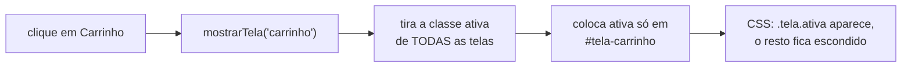

**2. Os produtos não estão escritos no HTML.**
No HTML existem só caixas vazias, como `<div class="grade" id="lista-home"></div>`. Os produtos ficam numa **lista no JavaScript**, e o JS **gera o HTML dos cards** e coloca dentro dessas caixas. Para mudar um preço, muda-se **um lugar só**, o `script.js`.

**3. O HTML chama o JavaScript pelo `onclick`.**
Exemplo: `<button onclick="abrirCategoria('roupas')">`. Ao clicar, a função `abrirCategoria` roda com o valor `'roupas'`.

**4. O JavaScript muda a aparência ligando e desligando classes.**
O JS não pinta nada diretamente. Ele coloca uma classe (`ativo`, `visivel`, `pulso`...) e o **CSS** decide como aquilo fica. Cada arquivo continua cuidando do seu papel.

---

## 5. Equipe e divisão em blocos

O código foi dividido em **6 blocos**, um por integrante:

| Bloco | Responsável | Parte do sistema | Arquivo e linhas |
|:---:|---|---|---|
| **1** | **Guilherme Borges** | Estrutura de todas as telas, ícones e menu | `index.html` L1–L225 |
| **2** | **Maycom Wylliam** | Tokens, reset, topo, carrossel, pílulas e cards | `style.css` L1–L588 |
| **3** | **Vinicius Duarte** | Cabeçalhos, filtros, detalhe do produto e carrinho | `style.css` L590–L1119 |
| **4** | **Bruno Schwabe** | Menu, aviso (toast), hover, acessibilidade e responsividade | `style.css` L1121–L1554 |
| **5** | **Kevin Patrick** | Dados, funções de ajuda, navegação e catálogo | `script.js` L1–L184 |
| **6** | **Ismael Ramos** | Detalhe do produto, carrinho, carrossel e inicialização | `script.js` L186–L493 |

Como os blocos se encaixam:

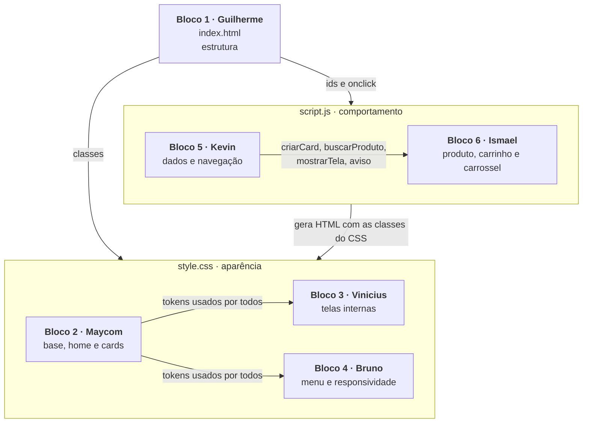

### Como estudar a sua parte

1. Leia as **seções 1 a 6** (parte geral). Qualquer um pode receber uma pergunta sobre o site como um todo.
2. Vá para o **seu bloco** e leia o resumo, o diagrama e os conceitos.
3. Abra o arquivo ao lado e siga a tabela **linha por linha**.
4. Treine o **roteiro para apresentar** em voz alta.
5. Abra as **perguntas que podem aparecer** e tente responder antes de ler a resposta.
6. Veja na seção 13 os **fluxos** em que o seu bloco participa.

---

## 6. Paleta de cores e tokens

As cores vieram do Figma e foram guardadas como **variáveis CSS** (também chamadas de **tokens**) no começo do `style.css`. Em vez de repetir `#cf0179` em 40 lugares, o código escreve `var(--rosa)`. Para trocar o rosa do site inteiro, basta mudar **uma linha**.

| Token | Cor | Onde aparece |
|---|---|---|
| `--fundo` | `#360727` | Fundo do app |
| `--card` | `#4d0f38` | Fundo dos cards e botões redondos |
| `--borda` | `#571642` | Bordas e linhas divisórias |
| `--escuro` | `#27041d` | Menu, resumo do pedido, contador |
| `--rosa` | `#cf0179` | Cor de destaque: botões, preços, aba ativa |
| `--rosa-press` | `#a80061` | Rosa mais escuro ao apertar ou passar o mouse |
| `--rosa-foco` | `#ff419e` | Contorno de foco do teclado |
| `--texto-2` | `#d4b2c8` | Texto secundário |
| `--foto` | `#57002f` | Fundo das fotos enquanto não há imagem |
| `--verde` | `#10b981` | "Grátis" no frete e ✓ do aviso |
| `--fora` | `#1a1a1a` | Fundo em volta do app em telas largas |

Além das cores, também viraram tokens: as **fontes** (`--fonte-titulo` = Outfit, `--fonte-texto` = Geist), os **espaços** (`--margem`, `--toque` = 44px), os **cantos** (`--raio-s` a `--raio-pilula`) e os **tempos de animação** (`--rapido`, `--medio`).

---

## 7. Bloco 1 · Guilherme Borges · Estrutura HTML

> **Responsável:** Guilherme Borges · **Arquivo:** [`index.html`](index.html) (L1–L225, o arquivo inteiro)

### Em uma frase

> *"Eu fiz o **esqueleto** do site: as 5 telas, o menu, os ícones e as caixas vazias que o JavaScript preenche."*

### Diagrama

A árvore de elementos do `index.html`:

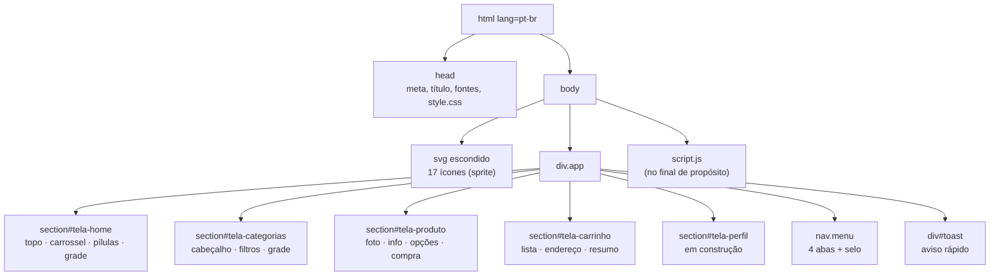

### Conceitos que você precisa dominar

- **Tags semânticas.** `<header>`, `<nav>`, `<section>` e `<article>` dizem **o que** cada parte é, e não só como ela aparece. Leitores de tela e o Google entendem melhor a página.
- **`class` x `id`.** `class` pode se repetir e é usada pelo **CSS** para estilizar (`.card`). `id` é **único** na página e é usado pelo **JS** para achar um elemento (`getElementById("lista-home")`).
- **Caixas vazias.** `#lista-home`, `#lista-categoria`, `#lista-relacionados` e `#lista-carrinho` nascem vazias. O JavaScript escreve os produtos dentro delas.
- **`onclick`.** Atributo que chama uma função do JavaScript quando o elemento é clicado.
- **Sprite SVG.** Os 17 ícones são desenhados **uma vez** num `<svg>` escondido (L16–L34) e reutilizados com `<use href="#i-nome">`. Isso substituiu os emojis e deixa os ícones nítidos e com a cor que o CSS quiser.
- **Acessibilidade (atributos `aria-`).** São instruções para leitores de tela (usados por pessoas cegas):
  - `aria-label` dá **nome** a um botão que só tem ícone ("Voltar", "Buscar");
  - `aria-hidden="true"` **esconde** algo decorativo;
  - `aria-pressed` diz se um botão está **ligado ou desligado** (filtros, favorito, opções);
  - `aria-live` faz o leitor **anunciar** quando um conteúdo muda.
- **`tabindex`.** `tabindex="0"` deixa um elemento que não é botão (o banner) receber foco pelo Tab. `tabindex="-1"` permite que o JS mande o foco para as telas.
- **Script no final do `body`.** Quando o JS roda, todo o HTML já foi lido, então ele consegue encontrar os elementos.

### Roteiro para apresentar

1. "O site é **um HTML só**, com **5 telas** em `<section class="tela">`, e só uma aparece por vez."
2. "No topo do `body` tem um **sprite de ícones**: cada ícone é desenhado uma vez e reaproveitado no site todo."
3. Mostre a **tela Início**: topo, carrossel com 3 slides, pílulas e a grade **vazia** `#lista-home`, que o JS preenche.
4. Mostre a **tela de Produto**: quase tudo tem `id` (`det-nome`, `det-preco`...) porque é o JS que escreve o conteúdo.
5. "O **menu** fica fora das telas, por isso aparece em todas. O `<b id="selo">` é a bolinha do carrinho."
6. "Usei atributos de **acessibilidade**: `aria-label` em botões só com ícone, `aria-pressed` em botões liga/desliga e `aria-live` em textos que mudam."
7. "O `<script>` fica no fim do `body` para o HTML já existir quando o JS rodar."

### Perguntas que podem aparecer

<details>
<summary><b>Por que existem 5 telas num HTML só, e não 5 arquivos?</b></summary>

Porque é uma **SPA**: trocar de tela é só esconder uma `section` e mostrar outra, sem recarregar a página. Fica mais rápido e o carrinho continua na memória.
</details>

<details>
<summary><b>Por que as grades de produto estão vazias no HTML?</b></summary>

Porque os produtos estão numa lista no JavaScript. O JS gera os cards a partir dessa lista. Se os produtos estivessem escritos no HTML, cada mudança de preço teria que ser feita em vários lugares.
</details>

<details>
<summary><b>Qual a diferença entre <code>class</code> e <code>id</code>?</b></summary>

`class` pode se repetir (muitos elementos com `class="card"`) e é usada principalmente pelo CSS. `id` é único (`id="selo"` existe uma vez só) e é usado pelo JS para achar aquele elemento exato.
</details>

<details>
<summary><b>Por que o banner é um <code>div</code> com <code>role="button"</code> e não um <code>button</code>?</b></summary>

Porque ele tem conteúdo grande dentro (título, etiqueta, chamada). `role="button"` faz o leitor de tela anunciar como botão e `tabindex="0"` permite chegar nele com Tab. O JS completa o comportamento: Enter e Espaço funcionam como clique (`script.js` L376–L382).
</details>

<details>
<summary><b>Para que serve o <code>aria-label</code>?</b></summary>

Botões que só têm um ícone (lupa, voltar, coração) não têm texto. O leitor de tela diria só "botão". Com `aria-label="Voltar"`, ele diz "Voltar, botão".
</details>

<details>
<summary><b>Por que o <code>&lt;script&gt;</code> está no final?</b></summary>

O navegador lê o HTML de cima para baixo. Se o script viesse no `<head>`, ele rodaria antes das telas existirem e o `getElementById` não encontraria nada.
</details>

### Código linha por linha

#### 7.1 Cabeçalho do documento (L1–L13)

| Linha | Código | O que faz |
|---|---|---|
| L1 | `<!DOCTYPE html>` | Avisa ao navegador que o arquivo é **HTML5**. Sem essa linha o navegador entra no "modo de compatibilidade" antigo e o layout pode quebrar. |
| L2 | `<html lang="pt-br">` | Abre o documento e diz que o idioma é **português do Brasil**. Ajuda o leitor de tela a pronunciar certo, o tradutor automático e o Google. |
| L3 | `<head>` | Abre o `<head>`: informações **sobre** a página que não aparecem na tela. |
| L4 | `<meta charset="UTF-8">` | Codificação **UTF-8**, para acentos (ç, ã, é) e símbolos (→, ★) aparecerem certinhos. |
| L5 | `<meta name="viewport" content="width=device-width, initial-scale=1.0, viewport-fit=cover">` | Essencial no celular: a página usa a **largura real da tela** e começa sem zoom. O `viewport-fit=cover` deixa o site ocupar também a área do "notch" do iPhone (o CSS cuida das margens com `env(safe-area-inset-...)`). |
| L6 | `<meta name="theme-color" content="#360727">` | Pinta a barra do navegador do celular (onde fica o endereço) com a cor de fundo do app, `#360727`. |
| L7 | `<meta name="color-scheme" content="dark">` | Avisa que o site é **escuro**. O navegador desenha barras de rolagem e campos no tema escuro também. |
| L8 | `<title>C.F.G Force Store</title>` | Texto que aparece na **aba** do navegador. |
| L9 | `<link rel="preconnect" href="https://fonts.googleapis.com">` | Abre a conexão com o Google Fonts **antes** de precisar, para as fontes carregarem mais rápido. |
| L10 | `<link href="https://fonts.googleapis.com/css2?family=Outfit:wght@500;700;800;900&family=Geist:wght@400;600;700 …` | Baixa as duas fontes: **Outfit** (títulos e botões) e **Geist** (texto). `display=swap` mostra o texto na hora com uma fonte reserva e troca quando a fonte chega. |
| L11 | `<link rel="stylesheet" href="style.css">` | Liga o arquivo de estilos **style.css** (toda a aparência). |
| L12 | `</head>` | Fecha o `<head>`. |
| L13 | `<body>` | Abre o `<body>`: tudo daqui para baixo aparece na tela. |

#### 7.2 Sprite de ícones (L15–L34)

| Linha | Código | O que faz |
|---|---|---|
| L15 | `<!-- Ícones (usados com <use href="#i-nome">) -->` | Comentário: avisa que o bloco abaixo guarda os **ícones** do site. |
| L16 | `<svg xmlns="http://www.w3.org/2000/svg" style="display:none">` | Uma "caixa de ícones" invisível (`display:none`). Cada ícone é desenhado uma vez só aqui e reutilizado no site inteiro com `<use href="#i-nome">`. Isso se chama **sprite SVG**. |
| L17 | `<symbol id="i-busca" viewBox="0 0 24 24"><circle cx="11" cy="11" r="7"/><path d="M21 21l-4.35-4.35"/></symbol>` | Ícone **lupa** (`i-busca`): um círculo + uma linha diagonal. `viewBox="0 0 24 24"` = o desenho é feito numa grade de 24×24. |
| L18 | `<symbol id="i-sino" viewBox="0 0 24 24"><path d="M18 8a6 6 0 0 0-12 0c0 7-3 9-3 9h18s-3-2-3-9"/><path d="M13.7 …` | Ícone **sino** (`i-sino`) das notificações. |
| L19 | `<symbol id="i-voltar" viewBox="0 0 24 24"><path d="M15 18l-6-6 6-6"/></symbol>` | Ícone **seta para a esquerda** (`i-voltar`), usado em todos os botões de voltar. |
| L20 | `<symbol id="i-coracao" viewBox="0 0 24 24"><path d="M20.84 4.61a5.5 5.5 0 0 0-7.78 0L12 5.67l-1.06-1.06a5.5 5. …` | Ícone **coração** (`i-coracao`), usado no botão de favoritar. |
| L21 | `<symbol id="i-carrinho" viewBox="0 0 24 24"><circle cx="9" cy="21" r="1"/><circle cx="20" cy="21" r="1"/><path …` | Ícone **carrinho** (`i-carrinho`): duas rodinhas (`circle`) + o corpo (`path`). |
| L22 | `<symbol id="i-casa" viewBox="0 0 24 24"><path d="M3 9.5L12 3l9 6.5V20a1 1 0 0 1-1 1h-5v-6h-6v6H4a1 1 0 0 1-1-1 …` | Ícone **casa** (`i-casa`), aba Início do menu. |
| L23 | `<symbol id="i-grade" viewBox="0 0 24 24"><rect x="3" y="3" width="7" height="7" rx="1.5"/><rect x="14" y="3" w …` | Ícone **grade de 4 quadrados** (`i-grade`), aba Categorias do menu. |
| L24 | `<symbol id="i-usuario" viewBox="0 0 24 24"><path d="M20 21v-2a4 4 0 0 0-4-4H8a4 4 0 0 0-4 4v2"/><circle cx="12 …` | Ícone **pessoa** (`i-usuario`), aba Perfil do menu. |
| L25 | `<symbol id="i-pino" viewBox="0 0 24 24"><path d="M21 10c0 7-9 13-9 13s-9-6-9-13a9 9 0 0 1 18 0z"/><circle cx=" …` | Ícone **alfinete de mapa** (`i-pino`), ao lado do endereço de entrega. |
| L26 | `<symbol id="i-mais" viewBox="0 0 24 24"><path d="M12 5v14M5 12h14"/></symbol>` | Ícone **+** (`i-mais`): uma linha vertical e uma horizontal. |
| L27 | `<symbol id="i-menos" viewBox="0 0 24 24"><path d="M5 12h14"/></symbol>` | Ícone **−** (`i-menos`): só a linha horizontal. |
| L28 | `<symbol id="i-fechar" viewBox="0 0 24 24"><path d="M18 6L6 18M6 6l12 12"/></symbol>` | Ícone **X** (`i-fechar`), botão de remover item do carrinho. |
| L29 | `<symbol id="i-estrela" viewBox="0 0 24 24"><path d="M12 2l3.09 6.26L22 9.27l-5 4.87 1.18 6.88L12 17.77l-6.18 3 …` | Ícone **estrela** (`i-estrela`), nota dos produtos nos cards. |
| L30 | `<symbol id="i-check" viewBox="0 0 24 24"><path d="M20 6L9 17l-5-5"/></symbol>` | Ícone **check ✓** (`i-check`), aparece no aviso rápido (toast). |
| L31 | `<symbol id="i-pausa" viewBox="0 0 24 24"><path d="M9 5v14M15 5v14"/></symbol>` | Ícone **pausa ‖** (`i-pausa`), botão que pausa o carrossel. |
| L32 | `<symbol id="i-play" viewBox="0 0 24 24"><path d="M7 4.5v15l12-7.5z"/></symbol>` | Ícone **play ▶** (`i-play`), aparece no lugar da pausa quando o carrossel está parado. |
| L33 | `<symbol id="i-sacola" viewBox="0 0 24 24"><path d="M6 2L3 6v14a2 2 0 0 0 2 2h14a2 2 0 0 0 2-2V6l-3-4z"/><path …` | Ícone **sacola** (`i-sacola`), mensagem de "categoria vazia". |
| L34 | `</svg>` | Fecha a caixa de ícones. |

#### 7.3 Tela Início: topo (L36–L49)

| Linha | Código | O que faz |
|---|---|---|
| L36 | `<div class="app">` | Caixa que envolve o site inteiro. No CSS ela tem largura máxima (430px no celular, 760px no tablet, 1200px no desktop) e fica **centralizada**. |
| L38 | `<!-- TELA: INÍCIO -->` | Comentário marcador: aqui começa a tela **Início**. |
| L39 | `<section class="tela" id="tela-home" tabindex="-1">` | A tela inicial. A classe `tela` deixa ela **escondida** por padrão; o JS mostra adicionando a classe `ativa`. O `id="tela-home"` é como o JS encontra ela (`"tela-" + "home"`). `tabindex="-1"` permite que o JS mande o **foco** do teclado para a tela, sem ela entrar na ordem do Tab. |
| L40 | `<header class="topo">` | Faixa do topo da home: logo à esquerda, botões à direita. |
| L41 | `<div class="marca">` | Agrupa o quadradinho da logo e o nome da loja, lado a lado. |
| L42 | `<div class="logo" aria-hidden="true">CFG</div>` | A logo "CFG" feita só com CSS (um quadrado com borda rosa). `aria-hidden="true"` esconde do leitor de tela, porque o nome já é lido no `h1` ao lado. |
| L43 | `<h1>C.F.G FORCE STORE</h1>` | O título principal da página. É o **único `h1`**, o que é importante para acessibilidade e SEO. |
| L44 | `</div>` | Fecha `.marca`. |
| L45 | `<div class="acoes">` | Agrupa os botões redondos do topo. |
| L46 | `<button class="btn-redondo" aria-label="Buscar" onclick="abrirCategoria('suplementos')"><svg class="icone" ari …` | Botão **buscar**. Ainda não existe busca de verdade, então ele abre a categoria Suplementos. Como o botão só tem um ícone, o `aria-label="Buscar"` dá um nome para o leitor de tela. O `<svg><use href="#i-busca"/></svg>` puxa o ícone da lupa do sprite. |
| L47 | `<button class="btn-redondo" aria-label="Notificações" onclick="aviso('Você não tem notificações novas.')"><svg …` | Botão **notificações**. Chama `aviso(...)` (função do JS) que mostra a mensagem num balão no rodapé, no lugar do `alert` antigo. |
| L48 | `</div>` | Fecha `.acoes`. |
| L49 | `</header>` | Fecha o topo. |

#### 7.4 Tela Início: carrossel de promoções (L51–L91)

| Linha | Código | O que faz |
|---|---|---|
| L51 | `<!-- CARROSSEL DE PROMOÇÕES (arraste, use as bolinhas ou espere trocar sozinho) -->` | Comentário marcador: o **carrossel de promoções** (troca sozinho, pode ser arrastado ou controlado pelas bolinhas). |
| L52 | `<section class="carrossel" id="carrossel" aria-roledescription="carrossel" aria-label="Promoções">` | A caixa do carrossel. `aria-roledescription="carrossel"` e `aria-label="Promoções"` explicam para o leitor de tela o que é este bloco. |
| L53 | `<div class="carrossel-trilho" id="carrossel-trilho">` | O **trilho**: a faixa que rola para o lado com os 3 slides em fila. O JS usa o `id` para rolar até o slide certo. |
| L55 | `<div class="banner" role="button" tabindex="0" aria-roledescription="slide" aria-label="1 de 3" style="--img: …` | **Slide 1.** É um `div` que funciona como botão: `role="button"` + `tabindex="0"` deixam ele focável e anunciado como botão (o JS faz Enter e Espaço funcionarem). `aria-label="1 de 3"` diz a posição. `style="--img: url('img/banner.png')"` passa a imagem de fundo para o CSS por meio de uma **variável CSS**. O clique abre Suplementos. |
| L56 | `<span class="tag">OFERTA DO DIA</span>` | Etiqueta rosa "OFERTA DO DIA" (classe `tag`). |
| L57 | `<div>` | Agrupa título e chamada, para ficarem juntos na parte de baixo do banner. |
| L58 | `<h2>LINHA MONSTRO COM ATÉ 67% OFF</h2>` | Título do slide 1. |
| L59 | `<p>Comprar Agora →</p>` | Chamada para ação "Comprar Agora →". |
| L60 | `</div>` | Fecha o agrupamento. |
| L61 | `</div>` | Fecha o slide 1. |
| L63 | `<div class="banner" role="button" tabindex="0" aria-roledescription="slide" aria-label="2 de 3" style="--img: …` | **Slide 2.** Mesma estrutura, com `img/banner-2.png`. O clique chama `abrirProduto('creatina')` e leva direto para a página da creatina. |
| L64 | `<span class="tag">FRETE GRÁTIS</span>` | Etiqueta "FRETE GRÁTIS". |
| L65 | `<div>` | Agrupa título e chamada. |
| L66 | `<h2>CREATINA PURA + FRETE GRÁTIS</h2>` | Título do slide 2. |
| L67 | `<p>Aproveitar →</p>` | Chamada "Aproveitar →". |
| L68 | `</div>` | Fecha o agrupamento. |
| L69 | `</div>` | Fecha o slide 2. |
| L71 | `<div class="banner" role="button" tabindex="0" aria-roledescription="slide" aria-label="3 de 3" style="--img: …` | **Slide 3.** Usa `img/banner-3.png` e abre a categoria Roupas. |
| L72 | `<span class="tag">LANÇAMENTO</span>` | Etiqueta "LANÇAMENTO". |
| L73 | `<div>` | Agrupa título e chamada. |
| L74 | `<h2>NOVA LINHA DE ROUPAS C.F.G</h2>` | Título do slide 3. |
| L75 | `<p>Ver Coleção →</p>` | Chamada "Ver Coleção →". |
| L76 | `</div>` | Fecha o agrupamento. |
| L77 | `</div>` | Fecha o slide 3. |
| L79 | `</div>` | Fecha o trilho. |
| L81 | `<div class="carrossel-controles">` | Linha de controles embaixo dos slides (bolinhas + botão de pausa). |
| L82 | `<div class="pontos" id="carrossel-pontos" role="group" aria-label="Escolher promoção">` | Grupo das **bolinhas** (indicadores). `role="group"` + `aria-label` dizem ao leitor de tela que são opções de "Escolher promoção". |
| L83 | `<button aria-label="Promoção 1" aria-current="true" onclick="irParaSlide(0)"></button>` | Bolinha 1: `irParaSlide(0)` vai para o primeiro slide (o JS conta a partir de **zero**). `aria-current="true"` marca que este é o slide atual; o CSS usa isso para desenhar a bolinha comprida e rosa. |
| L84 | `<button aria-label="Promoção 2" onclick="irParaSlide(1)"></button>` | Bolinha 2: vai para o slide de índice 1. |
| L85 | `<button aria-label="Promoção 3" onclick="irParaSlide(2)"></button>` | Bolinha 3: vai para o slide de índice 2. |
| L86 | `</div>` | Fecha as bolinhas. |
| L87 | `<button class="btn-pausa" id="carrossel-pausa" aria-label="Pausar promoções" onclick="alternarPausa()">` | Botão **pausar/continuar** o carrossel. Chama `alternarPausa()`. Existe por acessibilidade: ninguém é obrigado a ver algo se mexendo sozinho. |
| L88 | `<svg class="icone" aria-hidden="true"><use href="#i-pausa"/></svg>` | O ícone de pausa. O JS troca o `href` para `#i-play` quando o carrossel está parado. |
| L89 | `</button>` | Fecha o botão de pausa. |
| L90 | `</div>` | Fecha os controles. |
| L91 | `</section>` | Fecha o carrossel. |

#### 7.5 Tela Início: pílulas e mais vendidos (L93–L105)

| Linha | Código | O que faz |
|---|---|---|
| L93 | `<nav class="pilulas" aria-label="Categorias">` | Linha de "pílulas" de categoria. É um `<nav>` porque são links de navegação; o `aria-label` dá o nome "Categorias". No celular a linha rola para o lado. |
| L94 | `<button onclick="abrirCategoria('suplementos')">Suplementos</button>` | Abre a categoria **Suplementos**. |
| L95 | `<button onclick="abrirCategoria('roupas')">Roupas</button>` | Abre **Roupas**. |
| L96 | `<button onclick="abrirCategoria('equipamentos')">Equipamentos</button>` | Abre **Equipamentos** (ainda sem produtos, então aparece a mensagem de vazio). |
| L97 | `<button onclick="abrirCategoria('acessorios')">Acessórios</button>` | Abre **Acessórios**. O valor vai **sem acento** (`acessorios`) porque é a chave usada no JS. |
| L98 | `</nav>` | Fecha as pílulas. |
| L100 | `<div class="titulo-secao">` | Linha com o título da seção à esquerda e "Ver tudo" à direita. |
| L101 | `<h3>Mais Vendidos</h3>` | Título "Mais Vendidos". |
| L102 | `<button class="link" onclick="abrirCategoria('suplementos')">Ver tudo</button>` | "Ver tudo" parece um link, mas é um `<button>` com a classe `link`. Botão é o certo aqui porque ele **executa uma ação** (abre Suplementos), não leva para outro endereço. |
| L103 | `</div>` | Fecha `.titulo-secao`. |
| L104 | `<div class="grade" id="lista-home"></div>` | Grade **vazia** no HTML. Quando a página abre, o JS (`mostrarHome`) coloca 4 cards de produto aqui dentro. |
| L105 | `</section>` | Fecha a tela Início. |

#### 7.6 Tela Categorias (L107–L122)

| Linha | Código | O que faz |
|---|---|---|
| L107 | `<!-- TELA: CATEGORIAS -->` | Comentário marcador: tela **Categorias**. |
| L108 | `<section class="tela" id="tela-categorias" tabindex="-1">` | Tela que lista os produtos de uma categoria. |
| L109 | `<header class="cabecalho">` | Cabeçalho padrão das telas internas (botão voltar + textos). |
| L110 | `<button class="btn-redondo" aria-label="Voltar" onclick="mostrarTela('home')"><svg class="icone" aria-hidden=" …` | Botão **voltar**: `mostrarTela('home')` volta para o Início. Tem `aria-label="Voltar"` porque só tem ícone. |
| L111 | `<div class="cabecalho-texto">` | Agrupa título e subtítulo. No CSS ocupa todo o espaço que sobra ao lado do botão. |
| L112 | `<h2 id="cat-titulo">Suplementos</h2>` | Nome da categoria. "Suplementos" é só o valor inicial; o JS troca pelo nome da categoria aberta. |
| L113 | `<p id="cat-subtitulo">6 produtos encontrados</p>` | Quantidade de produtos encontrados. O JS também atualiza. |
| L114 | `</div>` | Fecha `.cabecalho-texto`. |
| L115 | `</header>` | Fecha o cabeçalho. |
| L117 | `<div class="filtros" role="group" aria-label="Ordenar">` | Os botões de **ordenação**, agrupados (`role="group"`, nome "Ordenar"). No CSS parecem um "controle segmentado" (duas metades lado a lado). |
| L118 | `<button id="ordem-popular" class="ativo" aria-pressed="true" onclick="ordenar('popular')">Popularidade</button …` | Ordena por **nota** (maior primeiro). Começa ligado: classe `ativo` (fica rosa) e `aria-pressed="true"` (o leitor de tela fala "pressionado"). |
| L119 | `<button id="ordem-preco" aria-pressed="false" onclick="ordenar('preco')">Faixa de Preço</button>` | Ordena por **preço** (menor primeiro). Começa desligado (`aria-pressed="false"`). |
| L120 | `</div>` | Fecha os filtros. |
| L121 | `<div class="grade" id="lista-categoria" aria-live="polite"></div>` | Grade vazia que o JS (`mostrarCategoria`) preenche. `aria-live="polite"` faz o leitor de tela avisar quando a lista muda (ex.: ao reordenar). |
| L122 | `</section>` | Fecha a tela Categorias. |

#### 7.7 Tela Detalhes do Produto (L124–L164)

| Linha | Código | O que faz |
|---|---|---|
| L124 | `<!-- TELA: DETALHES DO PRODUTO -->` | Comentário marcador: tela **Detalhes do Produto**. |
| L125 | `<section class="tela" id="tela-produto" tabindex="-1">` | Tela de um produto. Quase tudo aqui dentro é preenchido pelo JS em `abrirProduto`. |
| L126 | `<header class="cabecalho cabecalho-centro">` | Cabeçalho com duas classes: `cabecalho` (estilo base) + `cabecalho-centro` (3 colunas: voltar, título no meio, favorito). |
| L127 | `<button class="btn-redondo" aria-label="Voltar" onclick="mostrarTela('categorias')"><svg class="icone" aria-hi …` | Voltar para a lista de categorias. |
| L128 | `<h2>Detalhes do Produto</h2>` | Título fixo "Detalhes do Produto". |
| L129 | `<button class="btn-redondo btn-favorito" id="btn-favorito" aria-label="Favoritar" aria-pressed="false" onclick …` | Botão **favoritar** (coração). `aria-pressed="false"` guarda se está marcado ou não; o JS troca para `true` e o CSS pinta o coração de rosa. |
| L130 | `</header>` | Fecha o cabeçalho. |
| L132 | `<div class="foto-grande" id="det-foto"></div>` | Caixa da **foto grande**. O JS coloca a `` e o selo "Top Vendas" aqui dentro. |
| L134 | `<div class="detalhe">` | Caixa com todas as informações do produto. |
| L135 | `<h2 id="det-nome"></h2>` | Nome do produto (preenchido pelo JS). |
| L136 | `<p class="avaliacao" id="det-avaliacao"></p>` | Estrelas + nota + número de avaliações (preenchido pelo JS). |
| L137 | `<p class="preco-grande"><span id="det-preco"></span> <s id="det-preco-antigo"></s></p>` | Preço atual (`<span>`) e preço antigo riscado (`<s>` = texto tachado). O antigo só aparece se o produto tiver um (só o Whey Isolado tem). |
| L138 | `<hr>` | Linha divisória horizontal. |
| L140 | `<div id="det-opcoes">` | Bloco de opções. O JS **esconde o bloco inteiro** em produtos com `opcoes: false` (creatina, camiseta, coqueteleira). |
| L141 | `<h4>Selecione o tamanho</h4>` | Título "Selecione o tamanho". |
| L142 | `<div class="opcoes" id="det-tamanhos" role="group" aria-label="Selecione o tamanho"></div>` | Botões de **tamanho**, criados pelo JS (450g / 900g / 1.8kg). |
| L143 | `<h4>Selecione o sabor</h4>` | Título "Selecione o sabor". |
| L144 | `<div class="opcoes" id="det-sabores" role="group" aria-label="Selecione o sabor"></div>` | Botões de **sabor**, criados pelo JS (Baunilha / Chocolate / Morango). |
| L145 | `</div>` | Fecha `#det-opcoes`. |
| L147 | `<div class="compra">` | Barra de compra: contador de quantidade + botão de adicionar. No celular ela fica **presa** acima do menu enquanto a página rola. |
| L148 | `<div class="contador">` | Contador "− 1 +". |
| L149 | `<button aria-label="Diminuir quantidade" onclick="mudarQtdDetalhe(-1)"><svg class="icone" aria-hidden="true">< …` | Botão **−**: `mudarQtdDetalhe(-1)` diminui 1 (nunca fica abaixo de 1). |
| L150 | `<span id="det-qtd" aria-live="polite">1</span>` | Mostra a quantidade. `aria-live="polite"` faz o leitor de tela falar o número novo. |
| L151 | `<button class="mais" aria-label="Aumentar quantidade" onclick="mudarQtdDetalhe(1)"><svg class="icone" aria-hid …` | Botão **+**: aumenta 1. A classe `mais` deixa ele rosa. |
| L152 | `</div>` | Fecha o contador. |
| L153 | `<button class="btn-principal" onclick="adicionarDetalhe()"><svg class="icone" aria-hidden="true"><use href="#i …` | Botão principal: coloca o produto no carrinho com a quantidade e o sabor escolhidos (`adicionarDetalhe()`). |
| L154 | `</div>` | Fecha `.compra`. |
| L156 | `<div class="caixa">` | Caixa com fundo e borda para a descrição. |
| L157 | `<h4>Descrição do produto</h4>` | Título "Descrição do produto". |
| L158 | `<p id="det-descricao"></p>` | Texto da descrição (preenchido pelo JS). |
| L159 | `</div>` | Fecha `.caixa`. |
| L161 | `<h3 class="titulo-relacionados">Frequentemente Comprados Juntos</h3>` | Título da seção de sugestões. |
| L162 | `<div class="grade" id="lista-relacionados"></div>` | Grade que o JS preenche com creatina e coqueteleira (sem repetir o produto que está aberto). |
| L163 | `</div>` | Fecha `.detalhe`. |
| L164 | `</section>` | Fecha a tela do produto. |

#### 7.8 Tela Carrinho (L166–L194)

| Linha | Código | O que faz |
|---|---|---|
| L166 | `<!-- TELA: CARRINHO -->` | Comentário marcador: tela **Carrinho**. |
| L167 | `<section class="tela" id="tela-carrinho" tabindex="-1">` | Tela do carrinho de compras. |
| L168 | `<header class="cabecalho cabecalho-centro">` | Cabeçalho com 3 colunas (voltar, título, contagem). |
| L169 | `<button class="btn-redondo" aria-label="Voltar" onclick="mostrarTela('home')"><svg class="icone" aria-hidden=" …` | Voltar para o Início. |
| L170 | `<h2>Carrinho</h2>` | Título "Carrinho". |
| L171 | `<span class="contagem" id="carrinho-itens">0 Itens</span>` | "Pílula" com o total de itens. O JS atualiza e usa "Item" no singular quando é 1. |
| L172 | `</header>` | Fecha o cabeçalho. |
| L174 | `<div id="lista-carrinho"></div>` | Lista dos itens, gerada pelo JS (`mostrarCarrinho`). Se o carrinho estiver vazio, aparece uma mensagem e o botão "Ver produtos". |
| L176 | `<div id="area-resumo">` | Agrupa endereço + resumo. O JS **esconde** essa área quando o carrinho está vazio. |
| L177 | `<div class="entrega">` | Linha do endereço de entrega. |
| L178 | `<div class="icone-redondo" aria-hidden="true"><svg class="icone"><use href="#i-pino"/></svg></div>` | Círculo rosa-claro com o ícone de alfinete. É só decoração (`aria-hidden`), não é clicável. |
| L179 | `<div>` | Agrupa os textos do endereço. |
| L180 | `<strong>Entregar em:</strong>` | Rótulo em negrito "Entregar em:". |
| L181 | `<p>R. Visc. de Taunay, 427 - Centro, Joinville - SC</p>` | Endereço fixo, escrito direto no HTML (não vem de cadastro). |
| L182 | `</div>` | Fecha o grupo de textos. |
| L183 | `</div>` | Fecha `.entrega`. |
| L185 | `<div class="resumo">` | Caixa escura com os valores do pedido. |
| L186 | `<h4>Resumo do pedido</h4>` | Título "Resumo do pedido". |
| L187 | `<div class="linha"><span>Subtotal</span><strong id="resumo-subtotal">R$ 0,00</strong></div>` | Linha "Subtotal ...... R$ X". O valor é escrito pelo JS. |
| L188 | `<div class="linha"><span>Frete (Sedex)</span><strong class="verde">Grátis</strong></div>` | Frete sempre **grátis** (texto fixo, em verde pela classe `verde`). |
| L189 | `<hr>` | Divisória. |
| L190 | `<div class="linha total"><span>Total Geral</span><strong id="resumo-total">R$ 0,00</strong></div>` | Total geral com destaque (classe `total`). Como o frete é grátis, é igual ao subtotal. |
| L191 | `<button class="btn-principal" onclick="finalizar()">FINALIZAR COMPRA</button>` | Botão **finalizar**: mostra um aviso de agradecimento e esvazia o carrinho. |
| L192 | `</div>` | Fecha `.resumo`. |
| L193 | `</div>` | Fecha `#area-resumo`. |
| L194 | `</section>` | Fecha a tela Carrinho. |

#### 7.9 Tela Perfil (L196–L204)

| Linha | Código | O que faz |
|---|---|---|
| L196 | `<!-- TELA: PERFIL -->` | Comentário marcador: tela **Perfil**. |
| L197 | `<section class="tela" id="tela-perfil" tabindex="-1">` | Tela de perfil (ainda não implementada). |
| L198 | `<header class="cabecalho">` | Cabeçalho padrão, sem botão voltar. |
| L199 | `<div class="cabecalho-texto">` | Agrupa os textos. |
| L200 | `<h2>Perfil</h2>` | Título "Perfil". |
| L201 | `<p>Esta tela ainda está em construção.</p>` | Aviso de que a tela está em construção. |
| L202 | `</div>` | Fecha `.cabecalho-texto`. |
| L203 | `</header>` | Fecha o cabeçalho. |
| L204 | `</section>` | Fecha a tela Perfil. |

#### 7.10 Menu de navegação (L206–L216)

| Linha | Código | O que faz |
|---|---|---|
| L206 | `<!-- MENU DE BAIXO -->` | Comentário marcador: o **menu de navegação**. |
| L207 | `<nav class="menu" aria-label="Principal">` | Menu principal. Fica **fora** das telas, por isso aparece em todas. No celular fica embaixo; no desktop o CSS joga ele para o topo. |
| L208 | `<div class="marca menu-marca">` | Logo + nome **dentro do menu**. Fica escondido no celular e só aparece no desktop, quando o menu vira barra do topo. |
| L209 | `<div class="logo" aria-hidden="true">CFG</div>` | Quadradinho da logo (mesmo estilo do topo da home). |
| L210 | `<strong>C.F.G FORCE STORE</strong>` | Nome da loja. |
| L211 | `</div>` | Fecha a marca. |
| L212 | `<button id="aba-home" onclick="mostrarTela('home')"><span><svg class="icone" aria-hidden="true"><use href="#i- …` | Aba **Início**. O `id="aba-home"` é usado pelo JS para pintar a aba ativa. O ícone fica num `<span>` separado para o CSS desenhar a "pílula" atrás dele. |
| L213 | `<button id="aba-categorias" onclick="abrirCategoria('suplementos')"><span><svg class="icone" aria-hidden="true …` | Aba **Categorias**: abre Suplementos por padrão. |
| L214 | `<button id="aba-carrinho" onclick="mostrarTela('carrinho')"><span><svg class="icone" aria-hidden="true"><use h …` | Aba **Carrinho**. O `<b id="selo">` é a bolinha rosa com o número de itens, atualizada pelo JS (`atualizarSelo`) e escondida quando é zero. |
| L215 | `<button id="aba-perfil" onclick="mostrarTela('perfil')"><span><svg class="icone" aria-hidden="true"><use href= …` | Aba **Perfil**. |
| L216 | `</nav>` | Fecha o menu. |

#### 7.11 Aviso rápido e final do documento (L218–L225)

| Linha | Código | O que faz |
|---|---|---|
| L218 | `<!-- Aviso rápido (substitui os alert) -->` | Comentário marcador: o aviso rápido que substituiu os `alert()` do navegador. |
| L219 | `<div class="toast" id="toast" role="status" aria-live="polite"><svg class="icone" aria-hidden="true"><use href …` | O **toast**: um balão com ✓ e um texto (`#toast-texto`) que sobe no rodapé por 2,4 segundos. `role="status"` + `aria-live="polite"` fazem o leitor de tela ler a mensagem sem interromper o que a pessoa está fazendo. |
| L221 | `</div>` | Fecha a `div.app` aberta na L36. |
| L223 | `<script src="script.js"></script>` | Carrega o JavaScript. Fica **no final do `body`** de propósito: quando o script roda, todo o HTML já existe e o `getElementById` encontra os elementos. |
| L224 | `</body>` | Fecha o `<body>`. |
| L225 | `</html>` | Fecha o documento. |

---

## 8. Bloco 2 · Maycom Wylliam · Estilos base, home e cards

> **Responsável:** Maycom Wylliam · **Arquivo:** [`style.css`](style.css) (L1–L588)

### Em uma frase

> *"Eu fiz a **base visual** do site: as variáveis de cor e tamanho, o sistema que mostra uma tela por vez, o topo de vidro, o carrossel de promoções e o **card de produto**."*

### Diagrama

Anatomia do **card de produto** (o elemento mais reaproveitado do site):

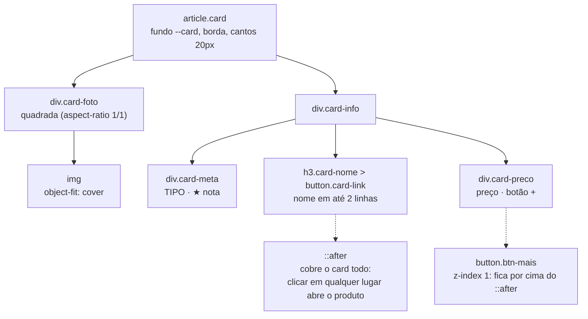

Como o **carrossel** funciona só com CSS (o JS só ajuda a trocar sozinho):

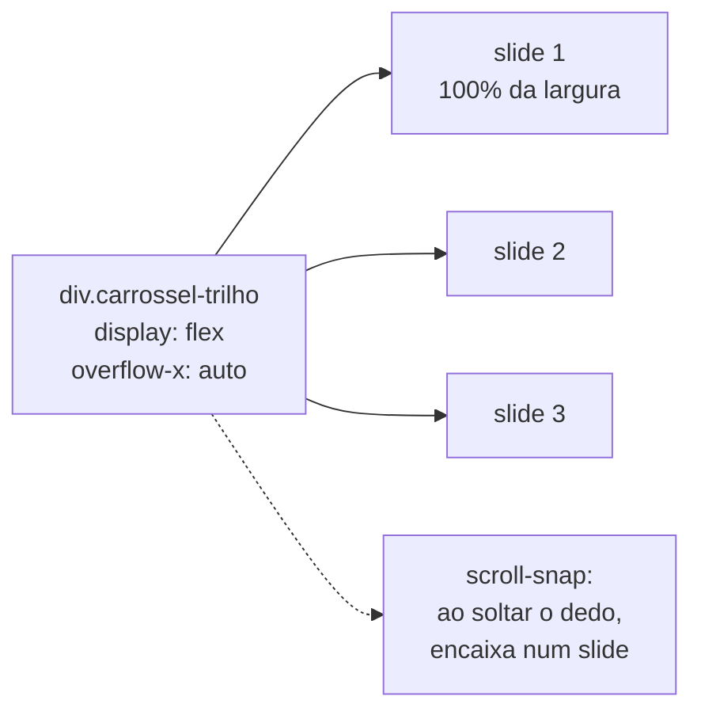

### Conceitos que você precisa dominar

- **Seletor, propriedade e valor.** Em `.card { border-radius: 20px; }`, `.card` é o **seletor** (quem), `border-radius` a **propriedade** (o quê) e `20px` o **valor**. `.` = classe, `#` = id, sem nada = tag.
- **Variáveis CSS (tokens).** Criadas em `:root` com `--nome: valor;` e usadas com `var(--nome)`. Mudam o site inteiro de um lugar só.
- **Reset.** O navegador coloca margens e estilos próprios. O reset (L52–L58) zera tudo para o layout ficar igual em todos os navegadores. `box-sizing: border-box` faz a largura incluir borda e padding.
- **Flexbox** (`display: flex`): organiza em **uma direção** (linha ou coluna). Usado no topo, nas pílulas e dentro dos cards.
- **Grid** (`display: grid`): organiza em **linhas e colunas**. Usado na grade de produtos (`repeat(2, ...)` = 2 colunas).
- **`position: sticky`.** O topo rola normal e **gruda** quando chega no alto da tela.
- **Efeito vidro.** Fundo semitransparente + `backdrop-filter: blur()` desfoca o que passa por trás.
- **Pseudo-elementos `::before` e `::after`.** Elementos "falsos" que o CSS cria. Usados para desenhar as bolinhas do carrossel e para deixar o **card inteiro clicável**.
- **Pseudo-classes.** `:active` (sendo apertado), `:focus-visible` (focado pelo teclado), `:has()` (o elemento que **contém** algo).
- **Animações.** `@keyframes` cria a animação (`entrar`, `aparecer`, `pulo`); `animation` aplica; `transition` suaviza mudanças.
- **Área de toque de 44px.** Todo botão tem pelo menos 44×44px (`--toque`), a recomendação da Apple para dedos.

### Roteiro para apresentar

1. "Comecei pelos **tokens**: todas as cores, espaços, cantos e tempos ficam em variáveis no `:root`. Para mudar o rosa do site, muda uma linha."
2. "O **reset** tira os estilos padrão do navegador."
3. "O sistema de telas é simples: `.tela` é `display: none` e `.tela.ativa` é `display: block`, com uma animação de entrada."
4. "O **topo** é `sticky` com efeito de vidro (`backdrop-filter`), e a linha de baixo só aparece depois de rolar."
5. "O **carrossel** é um flex com rolagem horizontal e `scroll-snap`, que faz cada slide encaixar. O banner tem 3 camadas de fundo: degradê escuro, foto e uma cor de reserva."
6. "O **card** é o componente mais reaproveitado: home, categorias e relacionados. O nome é um botão, e o `::after` dele cobre o card todo, então qualquer lugar do card é clicável."
7. "A grade usa **CSS Grid** com 2 colunas no celular. O Bruno aumenta para 3 e 4 no tablet e desktop."

### Perguntas que podem aparecer

<details>
<summary><b>Por que usar variáveis em vez de escrever as cores direto?</b></summary>

Para manter a consistência e facilitar mudanças. O rosa aparece em dezenas de lugares; com `var(--rosa)`, trocar a cor é mexer em uma linha. Além disso, o Bloco 4 muda `--margem` dentro das media queries e o site inteiro se ajusta.
</details>

<details>
<summary><b>Qual a diferença entre Flexbox e Grid?</b></summary>

Flexbox organiza numa **direção** (uma linha ou uma coluna). Grid organiza em **duas** (linhas e colunas ao mesmo tempo). A grade de produtos é Grid porque precisa de colunas alinhadas; o conteúdo de dentro do card é Flex porque é uma coluna simples.
</details>

<details>
<summary><b>Como o card inteiro fica clicável se só o nome é botão?</b></summary>

O botão do nome tem um `::after` com `position: absolute` e `inset: 0`, que se estica até as bordas do card (que é `position: relative`). Clicar em qualquer lugar do card é clicar nesse `::after`, ou seja, no botão. O "+" tem `z-index: 1` para ficar **por cima** e não abrir o produto.
</details>

<details>
<summary><b>O que é <code>scroll-snap</code>?</b></summary>

É uma propriedade que faz a rolagem **encaixar** em pontos definidos. No carrossel, `scroll-snap-type: x mandatory` no trilho + `scroll-snap-align: start` em cada slide fazem a rolagem sempre parar no começo de um slide.
</details>

<details>
<summary><b>Por que <code>min-height: 100vh</code> e depois <code>100dvh</code>?</b></summary>

No celular, a barra de endereço aparece e some, e `vh` não leva isso em conta. `dvh` (*dynamic viewport height*) leva. A linha com `vh` fica como **reserva**: navegador antigo que não entende `dvh` ignora a segunda linha e usa a primeira.
</details>

<details>
<summary><b>O que o <code>:has()</code> faz?</b></summary>

Seleciona um elemento pelo que ele **tem dentro**. `.card:has(.card-link:active)` = "o card que tem dentro um nome sendo apertado". Assim, apertar o nome faz o card inteiro encolher.
</details>

### Código linha por linha

#### 8.1 Comentário de cores e tokens (L1–L50)

| Linha | Código | O que faz |
|---|---|---|
| L1–L6 | `/* Cores tiradas do Figma:` | Comentário (`/* ... */`) com as cores originais do Figma. Não muda nada no visual; serve de documentação. |
| L8–L11 | `/* ============================================================` | Comentário de título: aqui começam os **tokens**, os valores de design (cores, espaços, cantos, tempos) guardados num lugar só. |
| L12 | `:root {` | `:root` é o elemento raiz da página (o `<html>`). Variáveis criadas aqui valem **no site inteiro**. |
| L13 | `--fundo: #360727;` | `--fundo`: cor de fundo do app (vinho escuro). |
| L14 | `--card: #4d0f38;` | `--card`: fundo dos cards e dos botões redondos. |
| L15 | `--borda: #571642;` | `--borda`: borda dos cards e linhas divisórias. |
| L16 | `--escuro: #27041d;` | `--escuro`: o tom mais escuro (menu, resumo do pedido, contador). |
| L17 | `--rosa: #cf0179;` | `--rosa`: o rosa de destaque da marca (botões, preços, aba ativa). |
| L18 | `--rosa-press: #a80061;` | `--rosa-press`: rosa mais escuro para quando o botão é **apertado** ou está com o mouse em cima. |
| L19 | `--rosa-foco: #ff419e;` | `--rosa-foco`: rosa claro do **contorno de foco** do teclado. |
| L20 | `--texto-2: #d4b2c8;` | `--texto-2`: texto secundário (cinza-rosado), para informações menos importantes. |
| L21 | `--foto: #57002f;` | `--foto`: fundo das fotos enquanto a imagem não carrega (ou se ela não existir). |
| L22 | `--verde: #10b981;` | `--verde`: verde do "Grátis" no frete e do ✓ do aviso. |
| L23 | `--branco: #ffffff;` | `--branco`: cor do texto principal. |
| L24 | `--fora: #1a1a1a;` | `--fora`: cinza quase preto que aparece **fora** do "celular" em telas largas. |
| L26 | `/* "vidro" (material translúcido) feito com as próprias cores da paleta */` | Comentário: as próximas cores são versões **transparentes** da paleta, para o efeito de vidro. |
| L27 | `--vidro-fundo: rgba(54, 7, 39, 0.78);` | `--vidro-fundo`: o fundo com 78% de opacidade, usado nos cabeçalhos presos no topo. |
| L28 | `--vidro-menu: rgba(39, 4, 29, 0.86);` | `--vidro-menu`: o escuro com 86% de opacidade, usado no menu e na barra de compra. |
| L29 | `--brilho-rosa: rgba(207, 1, 121, 0.35);` | `--brilho-rosa`: rosa transparente usado nas **sombras** dos botões rosa (dá um "brilho"). |
| L30 | `--rosa-suave: rgba(207, 1, 121, 0.18);` | `--rosa-suave`: rosa bem clarinho de fundo (pílula atrás da aba ativa, círculo do endereço). |
| L32 | `--fonte-titulo: 'Outfit', system-ui, -apple-system, sans-serif;` | `--fonte-titulo`: Outfit. Se ela não carregar, usa a fonte do sistema (`system-ui`, `-apple-system`) e por último qualquer `sans-serif`. |
| L33 | `--fonte-texto: 'Geist', system-ui, -apple-system, sans-serif;` | `--fonte-texto`: Geist, com as mesmas fontes reserva. |
| L35 | `--margem: 20px;` | `--margem`: espaço lateral das telas (20px no celular; o Bloco 4 aumenta no tablet e no desktop). |
| L36 | `--toque: 44px;          /* área mínima de toque (Apple HIG) */` | `--toque`: **44px**, o tamanho mínimo de área de toque recomendado pela Apple. Todo botão importante tem pelo menos isso. |
| L37 | `--tab-h: 64px;` | `--tab-h`: altura do menu de baixo (64px). |
| L39 | `--raio-s: 12px;` | `--raio-s`: canto arredondado pequeno (12px). |
| L40 | `--raio-m: 16px;` | `--raio-m`: canto médio (16px). |
| L41 | `--raio-l: 20px;` | `--raio-l`: canto grande (20px), usado nos cards. |
| L42 | `--raio-xl: 28px;` | `--raio-xl`: canto extra grande (28px), usado no banner e na foto grande. |
| L43 | `--raio-pilula: 999px;` | `--raio-pilula`: 999px = cantos totalmente redondos (formato de pílula). |
| L45 | `--curva: cubic-bezier(0.2, 0.8, 0.2, 1);` | `--curva`: a **curva de animação** padrão. `cubic-bezier` define a "aceleração": começa rápido e freia suave no final. |
| L46 | `--rapido: 0.18s;` | `--rapido`: 0,18 segundo, para respostas rápidas (apertar botão, trocar cor). |
| L47 | `--medio: 0.32s;` | `--medio`: 0,32 segundo, para animações maiores (entrar tela, aviso). |
| L49 | `--sombra: 0 10px 30px rgba(39, 4, 29, 0.55);` | `--sombra`: sombra escura padrão (desce 10px e espalha 30px). |
| L50 | `}` | Fecha `:root`. |

#### 8.2 Reset e estilos globais (L52–L100)

| Linha | Código | O que faz |
|---|---|---|
| L52–L54 | `* ,` | O `*` seleciona **todos os elementos**; `::before` e `::after` são os "pseudo-elementos" que o CSS pode criar antes e depois de cada um. |
| L55 | `margin: 0;` | Tira as margens que o navegador coloca sozinho (em `h1`, `p`, `body`...). |
| L56 | `padding: 0;` | Tira os espaços internos padrão. |
| L57 | `box-sizing: border-box;` | `box-sizing: border-box`: a largura passa a **incluir** a borda e o padding. Assim, `width: 100px` mede 100px de verdade. |
| L58 | `}` | Fecha a regra. |
| L60 | `html {` | Regras para o `<html>`. |
| L61–L62 | `-webkit-text-size-adjust: 100%;` | Impede o celular (principalmente iPhone) de **aumentar o texto sozinho** quando a tela gira. Uma linha tem o prefixo `-webkit-` (Safari) e a outra é o nome padrão. |
| L63 | `}` | Fecha a regra. |
| L65 | `body {` | Regras para o corpo da página. |
| L66 | `font-family: var(--fonte-texto);` | Fonte padrão do texto: Geist (lida da variável). |
| L67 | `font-size: 1rem;` | Tamanho base: `1rem` = 16px. Os outros tamanhos em `rem` são múltiplos disso. |
| L68 | `line-height: 1.4;` | Altura da linha: 1,4× o tamanho da fonte, para o texto respirar. |
| L69 | `background-color: var(--fora);` | Fundo **fora** do app (cinza escuro), aparece nas laterais em telas largas. |
| L70 | `color: var(--branco);` | Cor padrão do texto: branco. |
| L71–L72 | `-webkit-font-smoothing: antialiased;` | Deixa as letras mais nítidas no Mac (`-webkit-` para Chrome/Safari, `-moz-` para Firefox). |
| L73 | `-webkit-tap-highlight-color: transparent;` | Tira o "flash" azul que o celular mostra ao tocar em algo. |
| L74 | `}` | Fecha a regra. |
| L76 | `h1, h2, h3, h4, button {` | Títulos e botões... |
| L77 | `font-family: var(--fonte-titulo);` | ...usam a fonte de título (Outfit). |
| L78 | `}` | Fecha a regra. |
| L80 | `h1, h2, h3 {` | Os títulos principais... |
| L81 | `letter-spacing: -0.01em;` | ...ficam com as letras um pouco mais **juntas** (fica mais elegante em fonte grande). |
| L82 | `line-height: 1.15;` | ...e com linhas mais coladas (1,15). |
| L83 | `}` | Fecha a regra. |
| L85 | `button {` | Reset dos **botões** (o navegador coloca borda, fundo cinza e outra fonte por padrão). |
| L86 | `font: inherit;` | `font: inherit` faz o botão usar o mesmo tamanho de fonte de quem está em volta. |
| L87 | `font-family: var(--fonte-titulo);` | E a fonte de título. |
| L88 | `cursor: pointer;` | Mostra a "mãozinha" ao passar o mouse. |
| L89 | `border: none;` | Tira a borda padrão. |
| L90 | `background: none;` | Tira o fundo cinza padrão. |
| L91 | `color: var(--branco);` | Texto branco. |
| L92 | `touch-action: manipulation;` | `touch-action: manipulation` tira o atraso de 300ms do toque no celular e impede o zoom com toque duplo no botão. |
| L93 | `-webkit-tap-highlight-color: transparent;` | Tira o "flash" azul no toque. |
| L94 | `transition: background-color var(--rapido), color var(--rapido), transform var(--rapido) var(--curva), box-sha …` | **Transição**: quando a cor de fundo, a cor do texto, o tamanho (`transform`) ou a sombra mudarem, a mudança acontece suave, durante `--rapido` (0,18s). |
| L95 | `}` | Fecha a regra. |
| L97 | `img {` | Regras para todas as imagens. |
| L98 | `display: block;` | `display: block` tira um espacinho que aparece embaixo das imagens. |
| L99 | `max-width: 100%;` | A imagem nunca fica mais larga que a caixa onde está. |
| L100 | `}` | Fecha a regra. |

#### 8.3 Ícones e foco do teclado (L102–L118)

| Linha | Código | O que faz |
|---|---|---|
| L102 | `/* Ícone em traço, herda a cor do texto */` | Comentário: estilo dos ícones SVG. |
| L103 | `.icone {` | A classe `.icone` (todo `<svg class="icone">`). |
| L104 | `width: 1.25em;` | Largura de 1,25 **em**. `em` é relativo ao tamanho da fonte de quem está em volta, então o ícone cresce junto com o texto. |
| L105 | `height: 1.25em;` | Altura igual à largura. |
| L106 | `flex-shrink: 0;` | Não deixa o ícone ser **espremido** dentro de um flex. |
| L107 | `fill: none;` | Sem preenchimento: os ícones são feitos só de **traço** (contorno). |
| L108 | `stroke: currentColor;` | `currentColor` = a cor do traço é a **mesma cor do texto**. Por isso basta mudar `color` para mudar a cor do ícone. |
| L109 | `stroke-width: 2;` | Grossura do traço: 2. |
| L110 | `stroke-linecap: round;` | Pontas das linhas arredondadas. |
| L111 | `stroke-linejoin: round;` | Cantos das linhas arredondados. |
| L112 | `}` | Fecha a regra. |
| L114 | `/* Foco visível para quem usa teclado */` | Comentário: foco visível para quem usa o teclado. |
| L115 | `:focus-visible {` | `:focus-visible` = o elemento recebeu foco **pelo teclado** (Tab). Clique de mouse não mostra o contorno. |
| L116 | `outline: 2px solid var(--rosa-foco);` | Contorno rosa claro de 2px. |
| L117 | `outline-offset: 2px;` | Afasta o contorno 2px do elemento. |
| L118 | `}` | Fecha a regra. |

#### 8.4 O app e o sistema de telas (L120–L152)

| Linha | Código | O que faz |
|---|---|---|
| L120 | `/* O "celular" no meio da tela */` | Comentário: a caixa do app no meio da tela. |
| L121 | `.app {` | A `div.app` que envolve tudo. |
| L122 | `max-width: 430px;` | No celular, largura máxima de **430px** (tamanho de um celular grande). |
| L123 | `min-height: 100vh;` | Altura mínima = 100% da altura da janela (`vh`)... |
| L124 | `min-height: 100dvh;` | ...e, nos navegadores que entendem, `dvh`, que desconta a barra de endereço do celular que aparece e some. A linha de cima fica como **reserva** para navegadores antigos. |
| L125 | `margin: 0 auto;` | `margin: 0 auto` centraliza a caixa na horizontal. |
| L126 | `background-color: var(--fundo);` | Fundo vinho do app. |
| L127 | `position: relative;` | `position: relative` serve de referência para elementos posicionados dentro dela. |
| L128 | `}` | Fecha a regra. |
| L130 | `.tela {` | Todas as telas (`<section class="tela">`). |
| L131 | `display: none;` | **Escondidas por padrão.** É isto que faz só uma tela aparecer por vez. |
| L132 | `padding-bottom: calc(var(--tab-h) + env(safe-area-inset-bottom) + 32px);` | Espaço embaixo de cada tela, para o conteúdo não ficar escondido **atrás do menu** de baixo. `calc` soma altura do menu + área segura do iPhone (`env(safe-area-inset-bottom)`) + 32px. |
| L133 | `}` | Fecha a regra. |
| L135 | `.tela:focus {` | Quando o JS manda o foco para a tela... |
| L136 | `outline: none;` | ...não desenha contorno nela (o foco é só para o leitor de tela saber onde está). |
| L137 | `}` | Fecha a regra. |
| L139 | `.tela.ativa {` | A tela que tem as **duas** classes, `tela` e `ativa`... |
| L140 | `display: block;` | ...aparece (`display: block`). O JS troca qual tela tem a classe `ativa`. |
| L141 | `animation: entrar var(--medio) var(--curva) both;` | E entra com a animação `entrar`, durando `--medio`, com a curva padrão. `both` mantém o primeiro quadro antes de começar e o último depois de acabar. |
| L142 | `}` | Fecha a regra. |
| L144 | `@keyframes entrar {` | Cria a animação `entrar`. |
| L145 | `from { opacity: 0; transform: translateY(10px); }` | Começa invisível e 10px mais para baixo... |
| L146 | `to   { opacity: 1; transform: none; }` | ...e termina visível, no lugar certo. Resultado: a tela "sobe" suave. |
| L147 | `}` | Fecha a animação. |
| L149 | `@keyframes aparecer {` | Cria a animação `aparecer`. |
| L150 | `from { opacity: 0; }` | Começa invisível... |
| L151 | `to   { opacity: 1; }` | ...e fica visível (só um fade, sem movimento). |
| L152 | `}` | Fecha a animação. |

#### 8.5 Barra de topo, marca e botões redondos (L154–L241)

| Linha | Código | O que faz |
|---|---|---|
| L154 | `/* ---------- Barra de topo (fica presa e vira "vidro" ao rolar) ---------- */` | Comentário: barra de topo que fica presa e vira "vidro" ao rolar. |
| L155–L156 | `.topo,` | Vale para o topo da home (`.topo`) **e** para o cabeçalho das telas internas (`.cabecalho`). |
| L157 | `position: sticky;` | `position: sticky`: rola normal até chegar no topo da janela e então **gruda** ali. |
| L158 | `top: 0;` | Gruda a 0px do topo. |
| L159 | `z-index: 5;` | `z-index: 5` deixa a barra **por cima** do conteúdo que passa por baixo. |
| L160 | `display: flex;` | Flexbox: os filhos ficam em linha. |
| L161 | `align-items: center;` | Centraliza os filhos na vertical. |
| L162 | `gap: 12px;` | 12px de espaço entre os filhos. |
| L163 | `padding: calc(12px + env(safe-area-inset-top)) var(--margem) 12px;` | Espaço interno. Em cima: 12px **mais** a área do notch do iPhone; dos lados: a margem padrão; embaixo: 12px. |
| L164 | `background-color: var(--vidro-fundo);` | Fundo vinho semitransparente... |
| L165–L166 | `-webkit-backdrop-filter: saturate(160%) blur(20px);` | ...com **desfoque** de 20px no que passa por trás e saturação de 160%. É o efeito de "vidro fosco". Uma linha é para Safari (`-webkit-`), a outra é a padrão. |
| L167 | `border-bottom: 1px solid transparent;` | Borda de baixo **transparente** (invisível) por enquanto. |
| L168 | `transition: border-color var(--rapido);` | Quando a cor da borda mudar, muda suave. |
| L169 | `}` | Fecha a regra. |
| L171 | `.rolou .tela.ativa > header {` | Quando o `body` tem a classe `rolou` (o JS coloca depois de rolar 4px), o `header` filho direto (`>`) da tela ativa... |
| L172 | `border-bottom-color: var(--borda);` | ...ganha a cor da borda. Resultado: a linha embaixo do cabeçalho só aparece depois que a página rola. |
| L173 | `}` | Fecha a regra. |
| L175 | `.topo {` | No topo da home... |
| L176 | `justify-content: space-between;` | ...a logo vai para a esquerda e os botões para a direita (`space-between` espalha os filhos). |
| L177 | `}` | Fecha a regra. |
| L179 | `.marca {` | Logo + nome da loja. |
| L180 | `display: flex;` | Em linha (flex). |
| L181 | `align-items: center;` | Centralizados na vertical. |
| L182 | `gap: 12px;` | 12px entre a logo e o nome. |
| L183 | `min-width: 0;` | `min-width: 0` deixa esse bloco **encolher** se faltar espaço (sem isso o texto não corta com "..."). |
| L184 | `}` | Fecha a regra. |
| L186 | `.logo {` | A logo "CFG". |
| L187 | `width: 36px;` | 36px de largura... |
| L188 | `height: 36px;` | ...e 36px de altura (um quadrado). |
| L189 | `flex-shrink: 0;` | Não deixa ela ser espremida. |
| L190 | `border: 2px solid var(--rosa);` | Borda de 2px rosa. |
| L191 | `border-radius: 8px;` | Cantos levemente arredondados. |
| L192–L194 | `display: flex;` | Flex + centraliza o texto "CFG" na horizontal e na vertical. |
| L195 | `font-family: var(--fonte-titulo);` | Fonte de título. |
| L196 | `font-weight: 900;` | Peso 900 (o mais grosso). |
| L197 | `font-size: 0.75rem;` | Texto pequeno (0,75rem = 12px). |
| L198 | `letter-spacing: 0.02em;` | Afasta um pouco as letras. |
| L199 | `}` | Fecha a regra. |
| L201 | `.marca h1 {` | O nome da loja (`h1`) dentro de `.marca`. |
| L202 | `font-size: 1.125rem;` | 18px. |
| L203 | `font-weight: 800;` | Negrito forte (800). |
| L204 | `white-space: nowrap;` | Não quebra linha. |
| L205 | `overflow: hidden;` | Esconde o que passar da caixa... |
| L206 | `text-overflow: ellipsis;` | ...e coloca "..." no final se o nome não couber. |
| L207 | `}` | Fecha a regra. |
| L209 | `.acoes {` | Os botões redondos do topo. |
| L210 | `display: flex;` | Em linha. |
| L211 | `gap: 8px;` | 8px entre eles. |
| L212 | `}` | Fecha a regra. |
| L214 | `.btn-redondo {` | O **botão redondo** (usado no topo, no voltar e no favoritar). |
| L215 | `width: var(--toque);` | Largura = 44px (área de toque mínima). |
| L216 | `height: var(--toque);` | Altura = 44px. |
| L217 | `flex-shrink: 0;` | Não deixa ser espremido. |
| L218 | `border-radius: 50%;` | `border-radius: 50%` transforma o quadrado num **círculo**. |
| L219 | `background-color: var(--card);` | Fundo da cor dos cards. |
| L220 | `border: 1px solid var(--borda);` | Borda fina da paleta. |
| L221–L223 | `display: inline-flex;` | `inline-flex` + centralização: o ícone fica exatamente no meio do círculo. |
| L224 | `}` | Fecha a regra. |
| L226 | `.btn-redondo:active {` | Enquanto o botão está sendo **apertado** (`:active`)... |
| L227 | `transform: scale(0.92);` | ...ele encolhe para 92%. Dá a sensação de "apertar" de verdade. |
| L228 | `}` | Fecha a regra. |
| L230 | `.btn-favorito[aria-pressed="true"] {` | Botão favorito **marcado** (seletor de atributo: `aria-pressed="true"`, que o JS controla). |
| L231 | `color: var(--rosa);` | Fica rosa. |
| L232 | `}` | Fecha a regra. |
| L234 | `.btn-favorito[aria-pressed="true"] .icone {` | O ícone do favorito marcado... |
| L235 | `fill: currentColor;` | ...ganha **preenchimento** com a cor atual (o coração fica cheio)... |
| L236 | `animation: pulo 0.35s var(--curva);` | ...e faz a animação `pulo`. |
| L237 | `}` | Fecha a regra. |
| L239 | `@keyframes pulo {` | Cria a animação `pulo`. |
| L240 | `40% { transform: scale(1.25); }` | Aos 40% do tempo o elemento está 25% maior; no começo e no fim, tamanho normal. Resultado: um "pulinho". |
| L241 | `}` | Fecha a animação. |

#### 8.6 Carrossel de promoções (L243–L323)

| Linha | Código | O que faz |
|---|---|---|
| L243 | `/* ---------- Banner ---------- */` | Comentário antigo de seção (sobrou do banner único). |
| L244 | `/* ---------- Carrossel de promoções ---------- */` | Comentário: o carrossel de promoções. |
| L245 | `.carrossel {` | A caixa do carrossel. |
| L246 | `margin-top: 8px;` | 8px de espaço acima. |
| L247 | `}` | Fecha a regra. |
| L249 | `.carrossel-trilho {` | O **trilho**, a faixa que rola de lado. |
| L250 | `display: flex;` | Flex: os slides ficam em fila, um do lado do outro. |
| L251 | `gap: 12px;` | 12px entre os slides. |
| L252 | `padding: 0 var(--margem);` | Margem lateral, para o primeiro slide não colar na borda. |
| L253 | `overflow-x: auto;` | Permite **rolar na horizontal** quando os slides não cabem. |
| L254 | `scroll-snap-type: x mandatory;` | **Scroll snap**: ao soltar o dedo, a rolagem sempre "encaixa" num slide (`mandatory` = obrigatório). |
| L255 | `scroll-padding-inline: var(--margem);` | Onde o encaixe acontece: respeitando a margem lateral. |
| L256 | `overscroll-behavior-x: contain;` | Quando o trilho chega no fim, a rolagem **não passa** para a página (evita "puxar" a página junto). |
| L257 | `scrollbar-width: none;` | Esconde a barra de rolagem no Firefox. |
| L258 | `}` | Fecha a regra. |
| L260 | `.carrossel-trilho::-webkit-scrollbar {` | Esconde a barra de rolagem no Chrome/Safari (eles usam o pseudo-elemento `::-webkit-scrollbar`). |
| L261 | `display: none;` | `display: none` = não mostra. |
| L262 | `}` | Fecha a regra. |
| L264 | `.carrossel-trilho .banner {` | Cada slide (`.banner`) dentro do trilho. |
| L265 | `flex: 0 0 100%;` | `flex: 0 0 100%`: não cresce, não encolhe e ocupa **100%** da largura. Ou seja, um slide por vez na tela. |
| L266 | `scroll-snap-align: start;` | O slide encaixa pelo **começo** (lado esquerdo). |
| L267 | `scroll-snap-stop: always;` | `always`: mesmo arrastando rápido, para em **cada** slide (não pula dois de uma vez). |
| L268 | `}` | Fecha a regra. |
| L270 | `.carrossel-controles {` | A linha de controles (bolinhas + pausa). |
| L271 | `display: flex;` | Em linha. |
| L272 | `align-items: center;` | Centraliza na vertical. |
| L273 | `justify-content: center;` | Centraliza na horizontal. |
| L274 | `gap: 4px;` | 4px entre bolinhas e pausa. |
| L275 | `padding: 2px var(--margem) 0;` | Pequeno espaço em cima e nas laterais. |
| L276 | `}` | Fecha a regra. |
| L278 | `.pontos {` | O grupo de bolinhas. |
| L279 | `display: flex;` | Em linha. |
| L280 | `}` | Fecha a regra. |
| L282 | `/* bolinha pequena, mas com área de toque de 44x44 */` | Comentário: a bolinha é pequena, mas a área de toque continua grande. |
| L283 | `.pontos button {` | Cada botão de bolinha. |
| L284 | `width: 28px;` | 28px de largura... |
| L285 | `height: var(--toque);` | ...e 44px de altura: fácil de acertar com o dedo. |
| L286–L288 | `display: inline-flex;` | Centraliza o desenho da bolinha dentro do botão. |
| L289 | `}` | Fecha a regra. |
| L291 | `.pontos button::before {` | O desenho da bolinha é o **`::before`**, um pseudo-elemento criado pelo CSS dentro do botão. |
| L292 | `content: "";` | `content: ""` é obrigatório para o `::before` existir (vazio, sem texto). |
| L293 | `width: 8px;` | 8px de largura... |
| L294 | `height: 8px;` | ...8px de altura. |
| L295 | `border-radius: var(--raio-pilula);` | Cantos redondos: vira um círculo. |
| L296 | `background-color: var(--borda);` | Cor da borda (bolinha "apagada"). |
| L297 | `transition: width var(--medio) var(--curva), background-color var(--medio);` | Quando a largura ou a cor mudar, anima suave. |
| L298 | `}` | Fecha a regra. |
| L300 | `/* a atual vira uma "pílula" (diferença de forma, não só de cor) */` | Comentário: a bolinha atual vira uma pílula (muda a **forma**, não só a cor, para quem não enxerga cores bem). |
| L301 | `.pontos button[aria-current="true"]::before {` | A bolinha cujo botão tem `aria-current="true"` (o JS controla)... |
| L302 | `width: 22px;` | ...fica comprida (22px)... |
| L303 | `background-color: var(--rosa);` | ...e rosa. |
| L304 | `}` | Fecha a regra. |
| L306 | `.btn-pausa {` | Botão de **pausa** do carrossel. |
| L307 | `width: var(--toque);` | 44px de largura. |
| L308 | `height: var(--toque);` | 44px de altura. |
| L309 | `border-radius: 50%;` | Redondo. |
| L310 | `color: var(--texto-2);` | Cor secundária (mais discreta que o branco). |
| L311–L313 | `display: inline-flex;` | Centraliza o ícone. |
| L314 | `}` | Fecha a regra. |
| L316 | `.btn-pausa .icone {` | O ícone dentro do botão de pausa... |
| L317 | `width: 1rem;` | ...fica menor (16px)... |
| L318 | `height: 1rem;` | ...de largura e altura. |
| L319 | `}` | Fecha a regra. |
| L321 | `.btn-pausa .icone use[href="#i-play"] {` | Quando o `<use>` aponta para `#i-play` (carrossel parado)... |
| L322 | `fill: currentColor;` | ...o triângulo do play fica **preenchido**. |
| L323 | `}` | Fecha a regra. |

#### 8.7 Banner, etiqueta e chamada (L325–L382)

| Linha | Código | O que faz |
|---|---|---|
| L325 | `.banner {` | Cada **banner** (slide). |
| L326 | `margin: 0;` | Sem margem externa. |
| L327 | `min-height: 200px;` | Altura mínima de 200px. |
| L328 | `padding: 22px;` | 22px de espaço interno. |
| L329 | `border-radius: var(--raio-xl);` | Cantos bem arredondados (28px). |
| L330 | `border: 1px solid var(--borda);` | Borda fina. |
| L331 | `background-color: var(--card);` | Cor de fundo de reserva. |
| L332 | `/* a imagem de cada slide vem da variável --img (definida no HTML) */` | Comentário: a imagem de cada slide vem da variável `--img`, definida no HTML. |
| L333 | `background-image:` | O fundo tem **3 camadas**, uma por cima da outra (a primeira da lista fica na frente): |
| L334 | `linear-gradient(90deg, rgba(39, 4, 29, 0.85) 0%, rgba(54, 7, 39, 0.35) 60%, rgba(54, 7, 39, 0) 100%),` | Camada 1 (na frente): um **degradê** da esquerda para a direita, escuro (85%) do lado esquerdo até transparente. Deixa o texto legível sobre a foto. |
| L335 | `var(--img, none),` | Camada 2: a **foto** do slide (`var(--img, none)`: se a variável não existir, não usa imagem). |
| L336 | `linear-gradient(120deg, #360727 30%, #7a0c52);` | Camada 3 (atrás): degradê vinho → rosa-escuro, aparece se a foto não carregar. |
| L337 | `background-size: cover;` | `cover`: a imagem cobre o banner inteiro, cortando o que sobrar. |
| L338 | `background-position: 72% center;` | Posiciona a foto um pouco para a direita (72%) e no meio da altura, porque o texto fica à esquerda. |
| L339 | `display: flex;` | Flex... |
| L340 | `flex-direction: column;` | ...em **coluna** (de cima para baixo). |
| L341 | `justify-content: space-between;` | `space-between`: a etiqueta vai para cima e o título para baixo. |
| L342 | `align-items: flex-start;` | Alinha tudo à esquerda. |
| L343 | `gap: 24px;` | 24px entre os itens. |
| L344 | `cursor: pointer;` | "Mãozinha", porque o banner é clicável. |
| L345 | `box-shadow: var(--sombra);` | Sombra padrão. |
| L346 | `transition: transform var(--rapido) var(--curva);` | Anima o `transform` (encolher ao apertar). |
| L347 | `}` | Fecha a regra. |
| L349 | `.banner:active {` | Banner apertado... |
| L350 | `transform: scale(0.98);` | ...encolhe para 98%. |
| L351 | `}` | Fecha a regra. |
| L353 | `.tag {` | A **etiqueta** rosa ("OFERTA DO DIA", etc.). |
| L354 | `background-color: var(--rosa);` | Fundo rosa. |
| L355 | `padding: 5px 12px;` | 5px em cima/embaixo, 12px dos lados. |
| L356 | `border-radius: var(--raio-pilula);` | Formato de pílula. |
| L357 | `font-family: var(--fonte-titulo);` | Fonte de título. |
| L358 | `font-weight: 800;` | Negrito 800. |
| L359 | `font-size: 0.75rem;` | 12px. |
| L360 | `letter-spacing: 0.04em;` | Letras um pouco afastadas. |
| L361 | `}` | Fecha a regra. |
| L363 | `.banner h2 {` | Título do banner. |
| L364 | `font-size: 1.625rem;` | 26px. |
| L365 | `font-weight: 900;` | Peso 900. |
| L366 | `max-width: 9em;` | Largura máxima de 9 "em" (≈ 9 letras largas), para quebrar em 2 ou 3 linhas e não cobrir a foto. |
| L367 | `margin-bottom: 12px;` | 12px abaixo do título. |
| L368 | `}` | Fecha a regra. |
| L370 | `.banner p {` | A chamada ("Comprar Agora →"), desenhada como um botão-pílula. |
| L371 | `display: inline-flex;` | `inline-flex`: ocupa só a largura do texto. |
| L372 | `align-items: center;` | Centraliza o texto na vertical. |
| L373 | `min-height: 36px;` | Altura mínima 36px. |
| L374 | `padding: 0 14px;` | 14px nas laterais. |
| L375 | `border-radius: var(--raio-pilula);` | Formato de pílula. |
| L376 | `background-color: rgba(39, 4, 29, 0.55);` | Fundo escuro semitransparente. |
| L377 | `border: 1px solid var(--borda);` | Borda fina. |
| L378 | `font-family: var(--fonte-titulo);` | Fonte de título. |
| L379 | `font-size: 0.875rem;` | 14px. |
| L380 | `font-weight: 700;` | Negrito. |
| L381 | `color: var(--texto-2);` | Cor de texto secundária. |
| L382 | `}` | Fecha a regra. |

#### 8.8 Pílulas de categoria e título de seção (L384–L435)

| Linha | Código | O que faz |
|---|---|---|
| L384 | `/* ---------- Pílulas de categoria ---------- */` | Comentário: pílulas de categoria. |
| L385 | `.pilulas {` | A linha de pílulas. |
| L386 | `display: flex;` | Em linha. |
| L387 | `gap: 8px;` | 8px entre elas. |
| L388 | `padding: 16px var(--margem) 24px;` | 16px em cima, margem nas laterais, 24px embaixo. |
| L389 | `overflow-x: auto;` | Rola de lado se não couber (no celular não cabe). |
| L390 | `scroll-snap-type: x proximity;` | Encaixe suave (`proximity` = só encaixa se estiver perto, diferente do carrossel, que é obrigatório). |
| L391 | `scroll-padding-inline: var(--margem);` | Encaixe respeitando a margem. |
| L392 | `scrollbar-width: none;` | Esconde a barra de rolagem (Firefox). |
| L393 | `}` | Fecha a regra. |
| L395 | `.pilulas::-webkit-scrollbar {` | Esconde a barra de rolagem (Chrome/Safari). |
| L396 | `display: none;` | Não mostra. |
| L397 | `}` | Fecha a regra. |
| L399 | `.pilulas button {` | Cada pílula. |
| L400 | `min-height: var(--toque);` | Altura mínima 44px (toque). |
| L401 | `padding: 0 18px;` | 18px nas laterais. |
| L402 | `background-color: var(--card);` | Fundo de card. |
| L403 | `border: 1px solid var(--borda);` | Borda fina. |
| L404 | `border-radius: var(--raio-pilula);` | Formato de pílula. |
| L405 | `font-size: 0.875rem;` | 14px. |
| L406 | `font-weight: 700;` | Negrito. |
| L407 | `white-space: nowrap;` | Não quebra o texto em duas linhas. |
| L408 | `scroll-snap-align: start;` | Ponto de encaixe da rolagem. |
| L409 | `}` | Fecha a regra. |
| L411 | `.pilulas button:active {` | Pílula apertada... |
| L412 | `transform: scale(0.96);` | ...encolhe um pouco... |
| L413 | `background-color: var(--rosa);` | ...e fica rosa. |
| L414 | `}` | Fecha a regra. |
| L416 | `/* ---------- Título de seção ---------- */` | Comentário: título de seção ("Mais Vendidos"). |
| L417 | `.titulo-secao {` | A linha título + "Ver tudo". |
| L418 | `display: flex;` | Flex. |
| L419 | `justify-content: space-between;` | Título na esquerda, "Ver tudo" na direita. |
| L420 | `align-items: center;` | Centralizados na vertical. |
| L421 | `padding: 0 var(--margem) 8px;` | Margem nas laterais e 8px embaixo. |
| L422 | `}` | Fecha a regra. |
| L424 | `.titulo-secao h3 {` | O `h3` "Mais Vendidos". |
| L425 | `font-size: 1.25rem;` | 20px. |
| L426 | `font-weight: 800;` | Negrito 800. |
| L427 | `}` | Fecha a regra. |
| L429 | `.link {` | Botão com cara de **link** (`.link`, o "Ver tudo"). |
| L430 | `min-height: var(--toque);` | Altura de toque 44px (mesmo parecendo só texto). |
| L431 | `padding: 0 4px;` | Pouco espaço lateral. |
| L432 | `color: var(--rosa);` | Texto rosa. |
| L433 | `font-size: 0.9375rem;` | 15px. |
| L434 | `font-weight: 700;` | Negrito. |
| L435 | `}` | Fecha a regra. |

#### 8.9 Grade e card de produto (L437–L588)

| Linha | Código | O que faz |
|---|---|---|
| L437 | `/* ---------- Grade e cards de produto ---------- */` | Comentário: grade e cards de produto. |
| L438 | `.grade {` | A **grade** de produtos (home, categorias, relacionados). |
| L439 | `display: grid;` | `display: grid`: layout em **linhas e colunas**. |
| L440 | `grid-template-columns: repeat(2, minmax(0, 1fr));` | **2 colunas** iguais. `minmax(0, 1fr)` = cada coluna pode ir de 0 até 1 fração do espaço (o `0` impede que um nome comprido estoure a coluna). |
| L441 | `gap: 12px;` | 12px entre os cards. |
| L442 | `padding: 0 var(--margem);` | Margem nas laterais. |
| L443 | `}` | Fecha a regra. |
| L445 | `.card {` | O **card** de produto. |
| L446 | `position: relative;` | `relative` é a referência para o `::after` do nome (que cobre o card todo, ver L538). |
| L447 | `display: flex;` | Flex... |
| L448 | `flex-direction: column;` | ...em coluna: foto em cima, informações embaixo. |
| L449 | `background-color: var(--card);` | Fundo de card. |
| L450 | `border: 1px solid var(--borda);` | Borda fina. |
| L451 | `border-radius: var(--raio-l);` | Cantos de 20px. |
| L452 | `overflow: hidden;` | Esconde o que passar dos cantos (a foto fica arredondada também). |
| L453 | `transition: transform var(--rapido) var(--curva), border-color var(--rapido), box-shadow var(--rapido);` | Anima tamanho, cor da borda e sombra. |
| L454 | `}` | Fecha a regra. |
| L456 | `.card:has(.card-link:active) {` | `:has()` = "o card que **tem dentro** um `.card-link` sendo apertado"... |
| L457 | `transform: scale(0.98);` | ...encolhe para 98%. Assim, apertar o nome faz o card inteiro reagir. |
| L458 | `}` | Fecha a regra. |
| L460 | `.card:has(.card-link:focus-visible) {` | O card que tem dentro um `.card-link` com foco de teclado... |
| L461 | `outline: 2px solid var(--rosa-foco);` | ...ganha o contorno rosa de foco **no card inteiro**... |
| L462 | `outline-offset: 2px;` | ...afastado 2px. |
| L463 | `}` | Fecha a regra. |
| L465 | `.card-foto {` | A caixa da foto do card. |
| L466 | `aspect-ratio: 1 / 1;` | `aspect-ratio: 1 / 1`: sempre **quadrada**, qualquer que seja a largura. |
| L467 | `background-color: var(--foto);` | Fundo rosa-escuro (aparece se a foto não existir). |
| L468 | `overflow: hidden;` | Esconde o que passar. |
| L469 | `}` | Fecha a regra. |
| L471 | `.card-foto img {` | A imagem dentro da caixa. |
| L472 | `width: 100%;` | Ocupa toda a largura... |
| L473 | `height: 100%;` | ...e toda a altura. |
| L474 | `object-fit: cover;` | `object-fit: cover`: preenche a caixa sem deformar, cortando o que sobrar. |
| L475 | `}` | Fecha a regra. |
| L477 | `.card-info {` | A parte de informações do card. |
| L478 | `flex: 1;` | `flex: 1`: ocupa toda a altura que sobrar (cards da mesma linha ficam do mesmo tamanho). |
| L479 | `padding: 12px 14px 14px;` | Espaço interno. |
| L480 | `display: flex;` | Flex... |
| L481 | `flex-direction: column;` | ...em coluna. |
| L482 | `gap: 6px;` | 6px entre as linhas de informação. |
| L483 | `}` | Fecha a regra. |
| L485 | `.card-meta {` | Linha de cima do card: tipo ("ISOLADOS") e nota. |
| L486 | `display: flex;` | Flex. |
| L487 | `justify-content: space-between;` | Tipo na esquerda, nota na direita. |
| L488 | `align-items: center;` | Centralizados na vertical. |
| L489 | `gap: 8px;` | 8px entre eles. |
| L490 | `font-size: 0.75rem;` | 12px. |
| L491 | `font-weight: 600;` | Peso 600. |
| L492 | `letter-spacing: 0.04em;` | Letras afastadas. |
| L493 | `color: var(--texto-2);` | Cor secundária. |
| L494 | `text-transform: uppercase;` | Tudo em **MAIÚSCULAS** (sem precisar escrever maiúsculo no texto). |
| L495 | `}` | Fecha a regra. |
| L497 | `.card-meta span {` | O tipo do produto... |
| L498 | `white-space: nowrap;` | ...não quebra linha... |
| L499 | `overflow: hidden;` | ...esconde o que sobrar... |
| L500 | `text-overflow: ellipsis;` | ...e põe "..." se não couber. |
| L501 | `}` | Fecha a regra. |
| L503 | `.card-meta b {` | A nota (`<b>` com estrela + número). |
| L504 | `display: inline-flex;` | `inline-flex` para alinhar estrela e número. |
| L505 | `align-items: center;` | Centralizados na vertical. |
| L506 | `gap: 3px;` | 3px entre estrela e número. |
| L507 | `font-size: 0.8125rem;` | 13px. |
| L508 | `color: var(--branco);` | Branco (mais destaque que o tipo). |
| L509 | `letter-spacing: 0;` | Sem espaço extra entre letras. |
| L510 | `}` | Fecha a regra. |
| L512 | `.estrela {` | A estrela da nota. |
| L513 | `width: 0.9em;` | Um pouco menor que o texto... |
| L514 | `height: 0.9em;` | ...na largura e na altura. |
| L515 | `color: var(--rosa);` | Rosa. |
| L516 | `fill: currentColor;` | **Preenchida** (os outros ícones são só traço). |
| L517 | `}` | Fecha a regra. |
| L519 | `.card-nome {` | O nome do produto (`h3`). |
| L520 | `font-size: 0.9375rem;` | 15px. |
| L521 | `font-weight: 700;` | Negrito. |
| L522 | `line-height: 1.25;` | Linhas de 1,25×. |
| L523 | `}` | Fecha a regra. |
| L525 | `/* O nome é o botão; o ::after estica a área clicável pelo card inteiro */` | Comentário: o nome é o botão; o `::after` estica a área clicável pelo card inteiro. |
| L526 | `.card-link {` | O botão do nome (`.card-link`). |
| L527–L529 | `display: -webkit-box;` | Truque para **limitar o texto a 2 linhas** e pôr "..." no fim (`-webkit-line-clamp: 2`). Precisa dessas três propriedades juntas. |
| L530 | `overflow: hidden;` | Esconde o texto que passar das 2 linhas. |
| L531 | `min-height: 2.5em;` | Altura mínima de 2 linhas, para todos os cards ficarem alinhados mesmo com nome curto. |
| L532 | `width: 100%;` | Ocupa a largura toda. |
| L533 | `text-align: left;` | Texto alinhado à esquerda (botão centraliza por padrão). |
| L534 | `font-weight: inherit;` | Herda o negrito do `h3`. |
| L535 | `line-height: inherit;` | Herda a altura de linha. |
| L536 | `}` | Fecha a regra. |
| L538 | `.card-link::after {` | O **pseudo-elemento `::after`** do nome... |
| L539 | `content: "";` | ...existe (vazio)... |
| L540 | `position: absolute;` | ...com posição absoluta (relativa ao `.card`, que é `relative`)... |
| L541 | `inset: 0;` | ...`inset: 0` = cola em cima, embaixo, esquerda e direita: **cobre o card inteiro**. Então clicar em qualquer lugar do card é clicar no nome. |
| L542 | `border-radius: inherit;` | Mesmos cantos do card. |
| L543 | `}` | Fecha a regra. |
| L545 | `.card-link:focus-visible {` | O foco no nome... |
| L546 | `outline: none;` | ...não desenha contorno (quem desenha é o card, na L460). |
| L547 | `}` | Fecha a regra. |
| L549 | `.card-preco {` | Linha de baixo do card: preço + botão "+". |
| L550 | `margin-top: auto;` | `margin-top: auto` empurra essa linha para o **fundo** do card. |
| L551 | `display: flex;` | Flex. |
| L552 | `justify-content: space-between;` | Preço na esquerda, "+" na direita. |
| L553 | `align-items: center;` | Centralizados na vertical. |
| L554 | `font-family: var(--fonte-titulo);` | Fonte de título. |
| L555 | `font-size: 1.0625rem;` | 17px. |
| L556 | `font-weight: 800;` | Negrito 800. |
| L557 | `font-variant-numeric: tabular-nums;` | `tabular-nums`: todos os números têm a mesma largura, para os preços alinharem. |
| L558 | `}` | Fecha a regra. |
| L560 | `.btn-mais {` | O botão **"+"** de adicionar rápido. |
| L561 | `position: relative;` | `relative`... |
| L562 | `z-index: 1;` | ...com `z-index: 1`: fica **por cima** do `::after` que cobre o card. Sem isso, clicar no "+" abriria o produto. |
| L563 | `width: 36px;` | 36px de largura... |
| L564 | `height: 36px;` | ...36px de altura. |
| L565 | `border-radius: 50%;` | Redondo. |
| L566 | `background-color: var(--rosa);` | Rosa. |
| L567–L569 | `display: inline-flex;` | Centraliza o ícone "+". |
| L570 | `box-shadow: 0 4px 12px var(--brilho-rosa);` | Sombra rosa (brilho). |
| L571 | `}` | Fecha a regra. |
| L573 | `/* amplia a área de toque para 44x44 sem mudar o visual */` | Comentário: aumenta a área de toque para 44×44 sem mudar o visual. |
| L574–L575 | `.btn-mais::before,` | O `::before` do "+" do card **e** dos botões do contador... |
| L576 | `content: "";` | ...existe (vazio)... |
| L577 | `position: absolute;` | ...posição absoluta... |
| L578 | `inset: -4px;` | ...`inset: -4px` = 4px **para fora** de cada lado. O botão de 36px ganha uma área clicável invisível de 44px. |
| L579 | `}` | Fecha a regra. |
| L581 | `.btn-mais:active {` | "+" apertado... |
| L582 | `transform: scale(0.88);` | ...encolhe para 88%... |
| L583 | `background-color: var(--rosa-press);` | ...e fica rosa mais escuro. |
| L584 | `}` | Fecha a regra. |
| L586 | `.btn-mais.ok {` | "+" com a classe `ok` (o JS coloca depois de adicionar)... |
| L587 | `animation: pulo 0.35s var(--curva);` | ...faz o "pulinho". |
| L588 | `}` | Fecha a regra. |

---

## 9. Bloco 3 · Vinicius Duarte · Estilos das telas internas

> **Responsável:** Vinicius Duarte · **Arquivo:** [`style.css`](style.css) (L590–L1119)

### Em uma frase

> *"Eu fiz a aparência das telas **de dentro** da loja: cabeçalhos, filtros, mensagem de vazio, a página do produto e o carrinho."*

### Diagrama

A **tela de produto** no celular, de cima para baixo:

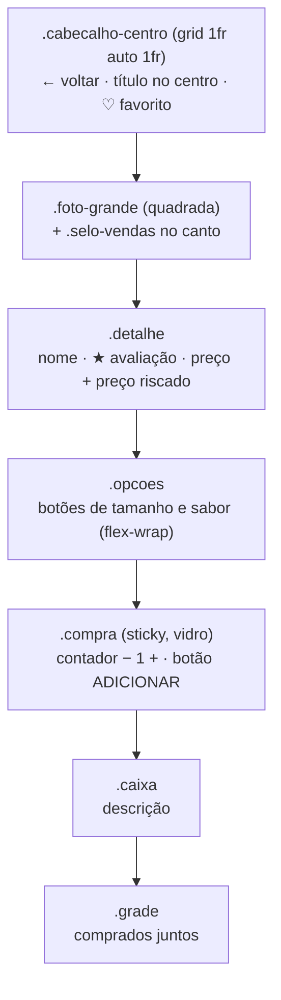

Um **item do carrinho**:

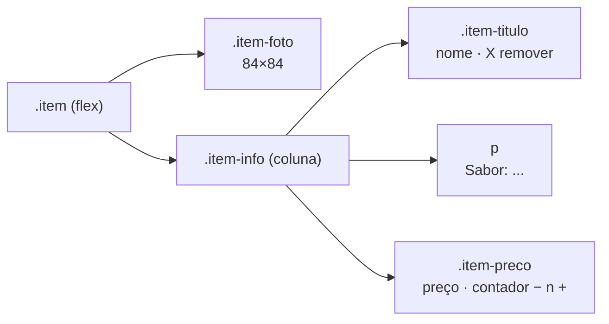

### Conceitos que você precisa dominar

- **Título centralizado com Grid.** `grid-template-columns: 1fr auto 1fr` cria 3 colunas: as laterais dividem o espaço igualmente, então a do meio fica **exatamente no centro**, mesmo com botões de tamanhos diferentes nos lados.
- **Controle segmentado.** Os filtros são dois botões dentro de uma caixa escura; o ativo fica rosa. `flex: 1` divide meio a meio.
- **`grid-column: 1 / -1`.** Faz um elemento ocupar **todas as colunas** da grade (usado na mensagem de vazio).
- **`position: absolute` dentro de `relative`.** O selo "Top Vendas" fica no canto da foto porque a foto é `relative`.
- **Barra de compra `sticky`.** No celular, contador e botão ficam grudados acima do menu enquanto a pessoa lê.
- **Margem negativa.** `.compra` usa `margin: 0 -8px` para compensar o próprio padding. `.remover` usa margens negativas para ter área de 44px sem empurrar o layout.
- **Limitar texto a 2 linhas.** `-webkit-line-clamp: 2` + `display: -webkit-box` + `-webkit-box-orient: vertical` + `overflow: hidden`.
- **Não depender só da cor.** A opção marcada ganha cor **e** um contorno interno (`box-shadow: inset`), para quem não distingue bem as cores.
- **`font-variant-numeric: tabular-nums`.** Todos os números com a mesma largura: preços e contadores não "dançam".

### Roteiro para apresentar

1. "As telas internas usam um **cabeçalho padrão**. No produto e no carrinho, uso Grid com 3 colunas para o título ficar exatamente no centro."
2. "Os **filtros** são um controle segmentado: dois botões que dividem a caixa, e o ativo fica rosa."
3. "Quando não há produtos, aparece um **estado vazio** com ícone e mensagem, ocupando a grade toda."
4. "Na **página do produto**: foto quadrada com o selo 'Top Vendas', preço grande em rosa com o antigo riscado, e os botões de opção. A opção marcada muda de cor e ganha contorno."
5. "A **barra de compra** é `sticky` com efeito vidro: fica sempre à mão no celular."
6. "No **carrinho**, cada item é um flex com foto e informações. O nome corta em 2 linhas e o X tem área de toque grande."
7. "O **resumo** usa linhas com `space-between`: rótulo na esquerda e valor na direita. O total fica maior e rosa."

### Perguntas que podem aparecer

<details>
<summary><b>Por que usar Grid no cabeçalho e não Flexbox?</b></summary>

Com Flex e `space-between`, o título só fica centralizado se os dois lados tiverem a mesma largura. O botão voltar (44px) e a pílula "3 Itens" (mais larga) são diferentes, então o título ficaria torto. O Grid `1fr auto 1fr` garante colunas laterais iguais.
</details>

<details>
<summary><b>Como o selo "Top Vendas" fica no canto da foto?</b></summary>

`.foto-grande` tem `position: relative`, e `.selo-vendas` tem `position: absolute; top: 14px; left: 14px`. Um elemento `absolute` se posiciona em relação ao ancestral `relative` mais próximo.
</details>

<details>
<summary><b>O que é a barra de compra "grudada"?</b></summary>

É `position: sticky` com `bottom` igual à altura do menu + 12px. Enquanto a pessoa rola a descrição, contador e botão ficam visíveis logo acima do menu. No desktop, o Bloco 4 desliga isso (`position: static`), porque lá tem espaço.
</details>

<details>
<summary><b>Por que a opção marcada tem contorno além da cor?</b></summary>

Acessibilidade: cerca de 8% dos homens têm algum tipo de daltonismo. Se a única diferença fosse a cor, parte das pessoas não perceberia qual opção está marcada.
</details>

<details>
<summary><b>Para que servem as margens negativas no botão X?</b></summary>

O X tem 44×44px para ser fácil de tocar, mas visualmente deveria ficar colado no canto. A margem negativa deixa ele "invadir" o espaço interno do item sem empurrar o nome para baixo.
</details>

### Código linha por linha

#### 9.1 Cabeçalhos das telas internas e contagem (L590–L632)

| Linha | Código | O que faz |
|---|---|---|
| L590 | `/* ---------- Cabeçalho das outras telas ---------- */` | Comentário: cabeçalho das outras telas. |
| L591 | `.cabecalho-centro {` | Cabeçalho **centralizado** (produto e carrinho). |
| L592 | `display: grid;` | Troca o flex por **grid**... |
| L593 | `grid-template-columns: 1fr auto 1fr;` | ...com 3 colunas: `1fr auto 1fr`. As laterais dividem o espaço igualmente e o meio tem o tamanho do título. É isso que deixa o título **exatamente no centro**. |
| L594 | `}` | Fecha a regra. |
| L596 | `.cabecalho-centro > :last-child {` | O **último filho** do cabeçalho (favorito ou contagem)... |
| L597 | `justify-self: end;` | ...encosta na direita da sua coluna. |
| L598 | `}` | Fecha a regra. |
| L600 | `.cabecalho-centro h2 {` | O título no meio... |
| L601 | `font-size: 1.0625rem;` | ...17px... |
| L602 | `font-weight: 800;` | ...negrito 800... |
| L603 | `text-align: center;` | ...centralizado. |
| L604 | `}` | Fecha a regra. |
| L606 | `.cabecalho-texto {` | Bloco de título + subtítulo (categorias e perfil). |
| L607 | `flex: 1;` | `flex: 1`: ocupa todo o espaço que sobra ao lado do botão voltar. |
| L608 | `min-width: 0;` | Deixa encolher se faltar espaço. |
| L609 | `}` | Fecha a regra. |
| L611 | `.cabecalho-texto h2 {` | O título grande ("Suplementos", "Perfil")... |
| L612 | `font-size: 1.75rem;` | ...28px... |
| L613 | `font-weight: 800;` | ...negrito 800. |
| L614 | `}` | Fecha a regra. |
| L616 | `.cabecalho-texto p {` | O subtítulo ("6 produtos encontrados")... |
| L617 | `margin-top: 2px;` | ...2px abaixo do título... |
| L618 | `font-size: 0.875rem;` | ...14px... |
| L619 | `color: var(--texto-2);` | ...cor secundária. |
| L620 | `}` | Fecha a regra. |
| L622 | `.contagem {` | A pílula de contagem do carrinho ("3 Itens"). |
| L623 | `background-color: var(--card);` | Fundo de card. |
| L624 | `border: 1px solid var(--borda);` | Borda fina. |
| L625 | `color: var(--rosa);` | Texto rosa. |
| L626 | `font-family: var(--fonte-titulo);` | Fonte de título. |
| L627 | `font-size: 0.8125rem;` | 13px. |
| L628 | `font-weight: 700;` | Negrito. |
| L629 | `padding: 6px 12px;` | Espaço interno. |
| L630 | `border-radius: var(--raio-pilula);` | Formato de pílula. |
| L631 | `white-space: nowrap;` | Não quebra linha. |
| L632 | `}` | Fecha a regra. |

#### 9.2 Filtros (L634–L659)

| Linha | Código | O que faz |
|---|---|---|
| L634 | `/* ---------- Filtros (controle segmentado) ---------- */` | Comentário: filtros no estilo "controle segmentado" (duas opções numa caixa só). |
| L635 | `.filtros {` | A caixa dos filtros. |
| L636 | `display: flex;` | Em linha. |
| L637 | `gap: 4px;` | 4px entre os botões. |
| L638 | `margin: 4px var(--margem) 20px;` | 4px em cima, margem nas laterais, 20px embaixo. |
| L639 | `padding: 4px;` | 4px de espaço interno (o "trilho" em volta dos botões). |
| L640 | `background-color: var(--escuro);` | Fundo bem escuro. |
| L641 | `border: 1px solid var(--borda);` | Borda fina. |
| L642 | `border-radius: 14px;` | Cantos de 14px. |
| L643 | `}` | Fecha a regra. |
| L645 | `.filtros button {` | Cada botão do filtro. |
| L646 | `flex: 1;` | `flex: 1`: os dois botões dividem a largura **meio a meio**. |
| L647 | `min-height: var(--toque);` | Altura de toque 44px. |
| L648 | `padding: 0 12px;` | 12px nas laterais. |
| L649 | `border-radius: 10px;` | Cantos de 10px (um pouco menores que a caixa, para encaixar dentro). |
| L650 | `font-size: 0.875rem;` | 14px. |
| L651 | `font-weight: 700;` | Negrito. |
| L652 | `color: var(--texto-2);` | Cor secundária (desligado). |
| L653 | `}` | Fecha a regra. |
| L655 | `.filtros button.ativo {` | O botão **ligado** (classe `ativo`, colocada pelo JS)... |
| L656 | `background-color: var(--rosa);` | ...fundo rosa... |
| L657 | `color: var(--branco);` | ...texto branco... |
| L658 | `box-shadow: 0 4px 12px var(--brilho-rosa);` | ...e brilho rosa. |
| L659 | `}` | Fecha a regra. |

#### 9.3 Estado vazio (L661–L690)

| Linha | Código | O que faz |
|---|---|---|
| L661 | `/* Estado vazio (estilo "ContentUnavailableView") */` | Comentário: estado vazio (inspirado no "ContentUnavailableView" do iPhone). |
| L662–L663 | `.vazio,` | Vale para a mensagem de categoria vazia **e** de carrinho vazio. |
| L664 | `grid-column: 1 / -1;` | `grid-column: 1 / -1`: dentro da grade, ocupa **todas** as colunas (da primeira até a última). |
| L665 | `display: flex;` | Flex... |
| L666 | `flex-direction: column;` | ...em coluna (ícone, texto, botão). |
| L667 | `align-items: center;` | Centralizados. |
| L668 | `gap: 12px;` | 12px entre eles. |
| L669 | `text-align: center;` | Texto centralizado. |
| L670 | `color: var(--texto-2);` | Cor secundária. |
| L671 | `padding: 56px 24px;` | Bastante espaço em volta. |
| L672 | `}` | Fecha a regra. |
| L674–L675 | `.vazio .icone,` | O ícone grande das duas mensagens de vazio. |
| L676 | `width: 48px;` | 48px... |
| L677 | `height: 48px;` | ...de largura e altura. |
| L678 | `stroke-width: 1.5;` | Traço mais fino (1,5), porque o ícone é grande. |
| L679 | `color: var(--borda);` | Cor da borda (bem discreto). |
| L680 | `}` | Fecha a regra. |
| L682 | `.carrinho-vazio button {` | O botão "Ver produtos" do carrinho vazio. |
| L683 | `margin-top: 4px;` | 4px acima. |
| L684 | `min-height: var(--toque);` | Altura de toque. |
| L685 | `background-color: var(--rosa);` | Rosa. |
| L686 | `padding: 0 24px;` | 24px nas laterais. |
| L687 | `border-radius: var(--raio-pilula);` | Pílula. |
| L688 | `font-weight: 800;` | Negrito 800. |
| L689 | `box-shadow: 0 6px 18px var(--brilho-rosa);` | Brilho rosa. |
| L690 | `}` | Fecha a regra. |

#### 9.4 Detalhe do produto: foto, nome, preço e opções (L692–L803)

| Linha | Código | O que faz |
|---|---|---|
| L692 | `/* ---------- Detalhe do produto ---------- */` | Comentário: detalhe do produto. |
| L693 | `.foto-grande {` | A **foto grande**. |
| L694 | `margin: 8px var(--margem) 4px;` | 8px em cima, margem nas laterais, 4px embaixo. |
| L695 | `aspect-ratio: 1 / 1;` | Quadrada. |
| L696 | `max-height: 460px;` | Mas nunca passa de 460px de altura (em telas largas). |
| L697 | `width: calc(100% - var(--margem) * 2);` | Largura = 100% menos as duas margens laterais. |
| L698 | `border-radius: var(--raio-xl);` | Cantos de 28px. |
| L699 | `border: 1px solid var(--borda);` | Borda fina. |
| L700 | `background-color: var(--foto);` | Fundo rosa-escuro (aparece se a foto não existir). |
| L701 | `overflow: hidden;` | Esconde o que passar dos cantos. |
| L702 | `position: relative;` | `relative`: referência para o selo "Top Vendas" (que é `absolute`). |
| L703 | `}` | Fecha a regra. |
| L705 | `.foto-grande img {` | A imagem dentro da foto grande... |
| L706 | `width: 100%;` | ...largura toda... |
| L707 | `height: 100%;` | ...altura toda... |
| L708 | `object-fit: cover;` | ...preenchendo sem deformar. |
| L709 | `}` | Fecha a regra. |
| L711 | `.selo-vendas {` | O selo **"Top Vendas"**. |
| L712 | `position: absolute;` | Posição absoluta, em relação à foto grande. |
| L713 | `top: 14px;` | 14px do topo... |
| L714 | `left: 14px;` | ...e 14px da esquerda. |
| L715 | `background-color: var(--rosa);` | Rosa. |
| L716 | `font-family: var(--fonte-titulo);` | Fonte de título. |
| L717 | `font-weight: 800;` | Negrito 800. |
| L718 | `font-size: 0.75rem;` | 12px. |
| L719 | `letter-spacing: 0.02em;` | Letras um pouco afastadas. |
| L720 | `padding: 6px 12px;` | Espaço interno. |
| L721 | `border-radius: var(--raio-pilula);` | Pílula. |
| L722 | `box-shadow: 0 4px 12px var(--brilho-rosa);` | Brilho rosa. |
| L723 | `}` | Fecha a regra. |
| L725 | `.detalhe {` | A caixa de informações do produto. |
| L726 | `padding: 16px var(--margem);` | 16px em cima/embaixo, margem nas laterais. |
| L727 | `}` | Fecha a regra. |
| L729 | `.detalhe h2 {` | O nome do produto... |
| L730 | `font-size: 1.625rem;` | ...26px... |
| L731 | `font-weight: 900;` | ...peso 900... |
| L732 | `margin-bottom: 8px;` | ...8px abaixo. |
| L733 | `}` | Fecha a regra. |
| L735 | `.avaliacao {` | A linha de avaliação. |
| L736 | `font-size: 0.875rem;` | 14px. |
| L737 | `font-weight: 600;` | Peso 600. |
| L738 | `color: var(--texto-2);` | Cor secundária. |
| L739 | `margin-bottom: 12px;` | 12px abaixo. |
| L740 | `}` | Fecha a regra. |
| L742 | `.avaliacao .estrelas {` | As estrelas ★★★★★... |
| L743 | `color: var(--rosa);` | ...rosa... |
| L744 | `letter-spacing: 1px;` | ...com 1px entre elas. |
| L745 | `}` | Fecha a regra. |
| L747 | `.preco-grande {` | O preço grande. |
| L748 | `font-family: var(--fonte-titulo);` | Fonte de título. |
| L749 | `font-size: 1.875rem;` | 30px. |
| L750 | `font-weight: 900;` | Peso 900. |
| L751 | `color: var(--rosa);` | Rosa. |
| L752 | `font-variant-numeric: tabular-nums;` | Números de largura igual. |
| L753 | `}` | Fecha a regra. |
| L755 | `.preco-grande s {` | O preço antigo (riscado, `<s>`) dentro do preço grande... |
| L756 | `font-family: var(--fonte-texto);` | ...volta para a fonte de texto... |
| L757 | `font-size: 1rem;` | ...16px... |
| L758 | `font-weight: 400;` | ...peso normal... |
| L759 | `color: var(--texto-2);` | ...cor secundária... |
| L760 | `margin-left: 8px;` | ...8px de distância do preço atual. |
| L761 | `}` | Fecha a regra. |
| L763 | `hr {` | As linhas divisórias (`<hr>`). |
| L764 | `border: none;` | Tira a borda padrão (que é dupla e cinza). |
| L765 | `border-top: 1px solid var(--borda);` | Coloca só uma linha de 1px em cima, na cor da borda. |
| L766 | `margin: 20px 0;` | 20px de espaço em cima e embaixo. |
| L767 | `}` | Fecha a regra. |
| L769 | `.detalhe h4 {` | Os subtítulos ("SELECIONE O TAMANHO", "DESCRIÇÃO DO PRODUTO"). |
| L770 | `font-size: 0.875rem;` | 14px. |
| L771 | `font-weight: 800;` | Negrito 800. |
| L772 | `letter-spacing: 0.04em;` | Letras afastadas. |
| L773 | `text-transform: uppercase;` | Maiúsculas. |
| L774 | `margin-bottom: 10px;` | 10px abaixo. |
| L775 | `}` | Fecha a regra. |
| L777 | `.opcoes {` | Caixa dos botões de opção (tamanho/sabor). |
| L778 | `display: flex;` | Em linha... |
| L779 | `flex-wrap: wrap;` | ...**quebrando linha** se não couber (`wrap`). |
| L780 | `gap: 8px;` | 8px entre eles. |
| L781 | `margin-bottom: 20px;` | 20px abaixo. |
| L782 | `}` | Fecha a regra. |
| L784 | `.opcoes button {` | Cada botão de opção. |
| L785 | `min-height: var(--toque);` | Altura de toque. |
| L786 | `background-color: var(--card);` | Fundo de card. |
| L787 | `border: 1px solid var(--borda);` | Borda fina. |
| L788 | `padding: 0 16px;` | 16px nas laterais. |
| L789 | `border-radius: var(--raio-s);` | Cantos de 12px. |
| L790 | `font-size: 0.875rem;` | 14px. |
| L791 | `font-weight: 700;` | Negrito. |
| L792 | `}` | Fecha a regra. |
| L794 | `.opcoes button:active {` | Opção apertada... |
| L795 | `transform: scale(0.96);` | ...encolhe um pouco. |
| L796 | `}` | Fecha a regra. |
| L798 | `/* além da cor, a opção marcada ganha um contorno claro (não depende só da cor) */` | Comentário: a opção marcada ganha um contorno claro, além da cor (não depende só da cor). |
| L799 | `.opcoes button.ativo {` | A opção marcada (classe `ativo`)... |
| L800 | `background-color: var(--rosa);` | ...fundo rosa... |
| L801 | `border-color: var(--rosa);` | ...borda rosa... |
| L802 | `box-shadow: inset 0 0 0 2px rgba(255, 255, 255, 0.35);` | ...e uma sombra **interna** (`inset`) branca transparente de 2px, que funciona como um contorno por dentro. |
| L803 | `}` | Fecha a regra. |

#### 9.5 Detalhe do produto: barra de compra, contador e botão principal (L805–L903)

| Linha | Código | O que faz |
|---|---|---|
| L805 | `/* Barra de compra: no celular fica presa acima do menu */` | Comentário: no celular a barra de compra fica presa acima do menu. |
| L806 | `.compra {` | A **barra de compra** (contador + botão). |
| L807 | `position: sticky;` | `sticky`: rola normal e gruda quando chega perto do fundo da tela. |
| L808 | `bottom: calc(var(--tab-h) + env(safe-area-inset-bottom) + 12px);` | Gruda acima do menu: altura do menu + área segura do iPhone + 12px. |
| L809 | `z-index: 4;` | Fica por cima do conteúdo (mas abaixo do cabeçalho, que é 5). |
| L810 | `display: flex;` | Em linha. |
| L811 | `align-items: center;` | Centralizado na vertical. |
| L812 | `gap: 10px;` | 10px entre contador e botão. |
| L813 | `margin: 0 -8px 24px;` | Margem lateral **negativa** de 8px: a barra fica 8px mais larga de cada lado, compensando o padding de 8px da L814. Assim o conteúdo dela fica alinhado com o resto da página. |
| L814 | `padding: 8px;` | 8px de espaço interno. |
| L815 | `border-radius: var(--raio-pilula);` | Pílula. |
| L816 | `background-color: var(--vidro-menu);` | Fundo escuro semitransparente... |
| L817–L818 | `-webkit-backdrop-filter: saturate(160%) blur(20px);` | ...com desfoque de vidro. |
| L819 | `border: 1px solid var(--borda);` | Borda fina. |
| L820 | `box-shadow: var(--sombra);` | Sombra padrão. |
| L821 | `}` | Fecha a regra. |
| L823 | `.contador {` | O **contador** "− 1 +" (usado no produto e no carrinho). |
| L824 | `display: flex;` | Em linha. |
| L825 | `align-items: center;` | Centralizado na vertical. |
| L826 | `gap: 8px;` | 8px entre os itens. |
| L827 | `flex-shrink: 0;` | Não encolhe. |
| L828 | `background-color: var(--card);` | Fundo de card. |
| L829 | `border: 1px solid var(--borda);` | Borda fina. |
| L830 | `border-radius: var(--raio-pilula);` | Pílula. |
| L831 | `height: var(--toque);` | Altura de 44px. |
| L832 | `padding: 0 4px;` | 4px nas laterais. |
| L833 | `font-family: var(--fonte-titulo);` | Fonte de título. |
| L834 | `font-weight: 700;` | Negrito. |
| L835 | `font-variant-numeric: tabular-nums;` | Números de largura igual (o contador não "pula" quando muda de 9 para 10). |
| L836 | `}` | Fecha a regra. |
| L838 | `.contador span {` | O número do contador... |
| L839 | `min-width: 1.5em;` | ...tem largura mínima (não fica dançando)... |
| L840 | `text-align: center;` | ...e fica centralizado. |
| L841 | `}` | Fecha a regra. |
| L843 | `.contador button {` | Os botões − e + do contador. |
| L844 | `position: relative;` | `relative`, para o `::before` de 44px (L574) funcionar. |
| L845 | `width: 34px;` | 34px... |
| L846 | `height: 34px;` | ...de largura e altura. |
| L847 | `border-radius: 50%;` | Redondos. |
| L848 | `background-color: var(--escuro);` | Fundo bem escuro. |
| L849–L851 | `display: inline-flex;` | Centraliza o ícone. |
| L852 | `}` | Fecha a regra. |
| L854 | `.contador button .icone {` | O ícone dentro desses botões... |
| L855 | `width: 1rem;` | ...16px... |
| L856 | `height: 1rem;` | ...de largura e altura... |
| L857 | `stroke-width: 2.5;` | ...com traço mais grosso (2,5) para ficar visível pequeno. |
| L858 | `}` | Fecha a regra. |
| L860 | `.contador button.mais {` | O botão "+" do contador... |
| L861 | `background-color: var(--rosa);` | ...é rosa. |
| L862 | `}` | Fecha a regra. |
| L864 | `.contador button:active {` | Botão do contador apertado... |
| L865 | `transform: scale(0.88);` | ...encolhe para 88%. |
| L866 | `}` | Fecha a regra. |
| L868 | `.btn-principal {` | O **botão principal** (rosa grande: adicionar, finalizar). |
| L869 | `display: inline-flex;` | `inline-flex`... |
| L870 | `align-items: center;` | ...centralizado na vertical... |
| L871 | `justify-content: center;` | ...e na horizontal. |
| L872 | `gap: 8px;` | 8px entre ícone e texto. |
| L873 | `min-height: 52px;` | Altura mínima de 52px. |
| L874 | `padding: 0 20px;` | 20px nas laterais. |
| L875 | `background-color: var(--rosa);` | Rosa. |
| L876 | `border-radius: var(--raio-pilula);` | Pílula. |
| L877 | `font-size: 1rem;` | 16px. |
| L878 | `font-weight: 800;` | Negrito 800. |
| L879 | `letter-spacing: 0.02em;` | Letras levemente afastadas. |
| L880 | `box-shadow: 0 8px 24px var(--brilho-rosa);` | Brilho rosa forte. |
| L881 | `}` | Fecha a regra. |
| L883 | `.btn-principal:active {` | Botão principal apertado... |
| L884 | `transform: scale(0.97);` | ...encolhe um pouco... |
| L885 | `background-color: var(--rosa-press);` | ...e fica rosa escuro. |
| L886 | `}` | Fecha a regra. |
| L888 | `.compra .btn-principal {` | O botão principal **dentro da barra de compra**... |
| L889 | `flex: 1;` | ...ocupa todo o espaço que sobra ao lado do contador... |
| L890 | `min-width: 0;` | ...pode encolher... |
| L891 | `min-height: var(--toque);` | ...altura de 44px (menor que o normal, para caber na barra)... |
| L892 | `padding: 0 12px;` | ...12px nas laterais... |
| L893 | `font-size: 0.875rem;` | ...14px... |
| L894 | `letter-spacing: 0;` | ...sem espaço extra entre letras... |
| L895 | `white-space: nowrap;` | ...e não quebra linha. |
| L896 | `}` | Fecha a regra. |
| L898 | `/* telas estreitas: some o ícone para o texto caber em uma linha */` | Comentário: em telas estreitas, o ícone some para o texto caber em uma linha. |
| L899 | `@media (max-width: 420px) {` | **Media query**: as regras abaixo só valem em telas de até 420px de largura. |
| L900 | `.compra .btn-principal .icone {` | O ícone do carrinho no botão da barra de compra... |
| L901 | `display: none;` | ...some. |
| L902 | `}` | Fecha a regra. |
| L903 | `}` | Fecha o `@media`. |

#### 9.6 Detalhe do produto: descrição e relacionados (L905–L927)

| Linha | Código | O que faz |
|---|---|---|
| L905 | `.caixa {` | A **caixa** da descrição. |
| L906 | `background-color: var(--card);` | Fundo de card. |
| L907 | `border: 1px solid var(--borda);` | Borda fina. |
| L908 | `border-radius: var(--raio-l);` | Cantos de 20px. |
| L909 | `padding: 18px;` | 18px de espaço interno. |
| L910 | `margin-bottom: 28px;` | 28px abaixo. |
| L911 | `}` | Fecha a regra. |
| L913 | `.caixa p {` | O texto da descrição... |
| L914 | `font-size: 0.9375rem;` | ...15px... |
| L915 | `line-height: 1.55;` | ...linhas mais espaçadas (1,55), confortável para ler... |
| L916 | `color: var(--texto-2);` | ...cor secundária. |
| L917 | `}` | Fecha a regra. |
| L919 | `.titulo-relacionados {` | Título "Frequentemente Comprados Juntos". |
| L920 | `font-size: 1.25rem;` | 20px. |
| L921 | `font-weight: 800;` | Negrito 800. |
| L922 | `margin-bottom: 14px;` | 14px abaixo. |
| L923 | `}` | Fecha a regra. |
| L925 | `.detalhe .grade {` | A grade de relacionados (dentro de `.detalhe`)... |
| L926 | `padding: 0;` | ...não tem margem lateral própria, porque `.detalhe` já tem. |
| L927 | `}` | Fecha a regra. |

#### 9.7 Carrinho: lista e itens (L929–L1025)

| Linha | Código | O que faz |
|---|---|---|
| L929 | `/* ---------- Carrinho ---------- */` | Comentário: carrinho. |
| L930 | `#lista-carrinho {` | A lista de itens (`#lista-carrinho`). |
| L931 | `display: flex;` | Flex... |
| L932 | `flex-direction: column;` | ...em coluna (um item embaixo do outro). |
| L933 | `gap: 12px;` | 12px entre os itens. |
| L934 | `padding: 4px var(--margem) 0;` | Espaço em cima e margem nas laterais. |
| L935 | `}` | Fecha a regra. |
| L937 | `.item {` | Cada **item** do carrinho. |
| L938 | `display: flex;` | Em linha: foto à esquerda, informações à direita. |
| L939 | `align-items: center;` | Centralizado na vertical. |
| L940 | `gap: 14px;` | 14px entre foto e informações. |
| L941 | `background-color: var(--card);` | Fundo de card. |
| L942 | `border: 1px solid var(--borda);` | Borda fina. |
| L943 | `border-radius: var(--raio-l);` | Cantos de 20px. |
| L944 | `padding: 12px;` | 12px de espaço interno. |
| L945 | `animation: aparecer var(--medio) var(--curva) both;` | Entra com um fade (animação `aparecer`). |
| L946 | `}` | Fecha a regra. |
| L948 | `.item-foto {` | A foto do item. |
| L949 | `width: 84px;` | 84px... |
| L950 | `height: 84px;` | ...por 84px. |
| L951 | `border-radius: var(--raio-m);` | Cantos de 16px. |
| L952 | `background-color: var(--foto);` | Fundo rosa-escuro (se não houver foto). |
| L953 | `overflow: hidden;` | Esconde o que passar dos cantos. |
| L954 | `flex-shrink: 0;` | Não encolhe. |
| L955 | `}` | Fecha a regra. |
| L957 | `.item-foto img {` | A imagem dentro dela... |
| L958 | `width: 100%;` | ...largura toda... |
| L959 | `height: 100%;` | ...altura toda... |
| L960 | `object-fit: cover;` | ...sem deformar. |
| L961 | `}` | Fecha a regra. |
| L963 | `.item-info {` | A coluna de informações do item. |
| L964 | `flex: 1;` | Ocupa o espaço que sobra. |
| L965 | `min-width: 0;` | Pode encolher (para o nome cortar com "..."). |
| L966 | `display: flex;` | Flex... |
| L967 | `flex-direction: column;` | ...em coluna. |
| L968 | `gap: 4px;` | 4px entre as linhas. |
| L969 | `}` | Fecha a regra. |
| L971 | `.item-titulo {` | Linha do nome + botão X. |
| L972 | `display: flex;` | Flex. |
| L973 | `justify-content: space-between;` | Nome na esquerda, X na direita. |
| L974 | `align-items: flex-start;` | Alinhados pelo **topo** (se o nome tiver 2 linhas, o X fica em cima). |
| L975 | `gap: 4px;` | 4px entre eles. |
| L976 | `}` | Fecha a regra. |
| L978 | `.item-titulo h4 {` | O nome do item... |
| L979 | `padding-top: 2px;` | ...2px de espaço em cima... |
| L980 | `font-size: 0.9375rem;` | ...15px... |
| L981 | `font-weight: 800;` | ...negrito 800... |
| L982 | `line-height: 1.25;` | ...linhas de 1,25×... |
| L983–L985 | `display: -webkit-box;` | ...o mesmo truque do card para **limitar a 2 linhas**... |
| L986 | `overflow: hidden;` | ...escondendo o resto. |
| L987 | `}` | Fecha a regra. |
| L989 | `.remover {` | O botão **remover** (X). |
| L990 | `width: var(--toque);` | 44px... |
| L991 | `height: var(--toque);` | ...de largura e altura. |
| L992 | `margin: -10px -10px -6px 0;` | Margens negativas: o botão "invade" o padding do item. Fica com área de toque grande sem empurrar o layout. |
| L993 | `flex-shrink: 0;` | Não encolhe. |
| L994 | `border-radius: 50%;` | Redondo. |
| L995 | `color: var(--texto-2);` | Cor secundária. |
| L996–L998 | `display: inline-flex;` | Centraliza o X. |
| L999 | `}` | Fecha a regra. |
| L1001 | `.remover .icone {` | O X... |
| L1002 | `width: 1.1rem;` | ...um pouco menor (≈ 18px)... |
| L1003 | `height: 1.1rem;` | ...de largura e altura. |
| L1004 | `}` | Fecha a regra. |
| L1006 | `.remover:active {` | X apertado... |
| L1007 | `background-color: var(--escuro);` | ...ganha fundo escuro. |
| L1008 | `}` | Fecha a regra. |
| L1010 | `.item-info p {` | O texto extra do item ("Sabor: Chocolate Suíço")... |
| L1011 | `font-size: 0.8125rem;` | ...13px... |
| L1012 | `color: var(--texto-2);` | ...cor secundária. |
| L1013 | `}` | Fecha a regra. |
| L1015 | `.item-preco {` | A linha preço + contador do item. |
| L1016 | `margin-top: 4px;` | 4px acima. |
| L1017 | `display: flex;` | Flex. |
| L1018 | `justify-content: space-between;` | Preço na esquerda, contador na direita. |
| L1019 | `align-items: center;` | Centralizados na vertical. |
| L1020 | `gap: 8px;` | 8px entre eles. |
| L1021 | `font-family: var(--fonte-titulo);` | Fonte de título. |
| L1022 | `font-weight: 800;` | Negrito 800. |
| L1023 | `font-size: 1rem;` | 16px. |
| L1024 | `font-variant-numeric: tabular-nums;` | Números de largura igual. |
| L1025 | `}` | Fecha a regra. |

#### 9.8 Carrinho: entrega e resumo do pedido (L1027–L1119)

| Linha | Código | O que faz |
|---|---|---|
| L1027 | `.entrega {` | A caixa do **endereço de entrega**. |
| L1028 | `display: flex;` | Em linha (ícone + texto). |
| L1029 | `align-items: center;` | Centralizado na vertical. |
| L1030 | `gap: 12px;` | 12px entre eles. |
| L1031 | `margin: 20px var(--margem) 12px;` | 20px em cima, margem nas laterais, 12px embaixo. |
| L1032 | `padding: 14px;` | 14px de espaço interno. |
| L1033 | `background-color: var(--card);` | Fundo de card. |
| L1034 | `border: 1px solid var(--borda);` | Borda fina. |
| L1035 | `border-radius: var(--raio-l);` | Cantos de 20px. |
| L1036 | `}` | Fecha a regra. |
| L1038 | `.icone-redondo {` | O círculo do ícone de alfinete. |
| L1039 | `width: var(--toque);` | 44px... |
| L1040 | `height: var(--toque);` | ...por 44px. |
| L1041 | `flex-shrink: 0;` | Não encolhe. |
| L1042 | `border-radius: 50%;` | Redondo. |
| L1043 | `background-color: var(--rosa-suave);` | Fundo rosa bem suave. |
| L1044 | `color: var(--rosa);` | Ícone rosa. |
| L1045–L1047 | `display: flex;` | Centraliza o ícone. |
| L1048 | `}` | Fecha a regra. |
| L1050 | `.entrega strong {` | "Entregar em:"... |
| L1051 | `font-family: var(--fonte-titulo);` | ...fonte de título... |
| L1052 | `font-size: 0.875rem;` | ...14px. |
| L1053 | `}` | Fecha a regra. |
| L1055 | `.entrega p {` | O endereço... |
| L1056 | `font-size: 0.8125rem;` | ...13px... |
| L1057 | `color: var(--texto-2);` | ...cor secundária. |
| L1058 | `}` | Fecha a regra. |
| L1060 | `.resumo {` | A caixa do **resumo do pedido**. |
| L1061 | `background-color: var(--escuro);` | Fundo bem escuro. |
| L1062 | `border: 1px solid var(--borda);` | Borda fina. |
| L1063 | `border-radius: 24px;` | Cantos de 24px. |
| L1064 | `padding: 20px;` | 20px de espaço interno. |
| L1065 | `margin: 0 var(--margem);` | Margem nas laterais. |
| L1066 | `display: flex;` | Flex... |
| L1067 | `flex-direction: column;` | ...em coluna. |
| L1068 | `gap: 12px;` | 12px entre as linhas. |
| L1069 | `}` | Fecha a regra. |
| L1071 | `.resumo h4 {` | O título "RESUMO DO PEDIDO"... |
| L1072 | `font-size: 0.875rem;` | ...14px... |
| L1073 | `font-weight: 800;` | ...negrito 800... |
| L1074 | `letter-spacing: 0.04em;` | ...letras afastadas... |
| L1075 | `text-transform: uppercase;` | ...maiúsculas. |
| L1076 | `}` | Fecha a regra. |
| L1078 | `.resumo hr {` | A divisória dentro do resumo... |
| L1079 | `margin: 4px 0;` | ...com menos espaço (4px) do que a padrão (20px). |
| L1080 | `}` | Fecha a regra. |
| L1082 | `.resumo .btn-principal {` | O botão "Finalizar compra" dentro do resumo... |
| L1083 | `margin-top: 8px;` | ...ganha 8px a mais em cima. |
| L1084 | `}` | Fecha a regra. |
| L1086 | `.linha {` | Cada **linha** do resumo ("Subtotal ..... R$ X"). |
| L1087 | `display: flex;` | Flex. |
| L1088 | `justify-content: space-between;` | Rótulo na esquerda, valor na direita. |
| L1089 | `font-size: 0.9375rem;` | 15px. |
| L1090 | `color: var(--texto-2);` | Cor secundária. |
| L1091 | `}` | Fecha a regra. |
| L1093 | `.linha strong {` | O valor da linha... |
| L1094 | `color: var(--branco);` | ...branco... |
| L1095 | `font-weight: 600;` | ...peso 600... |
| L1096 | `font-variant-numeric: tabular-nums;` | ...números de largura igual. |
| L1097 | `}` | Fecha a regra. |
| L1099 | `.linha .verde {` | O "Grátis"... |
| L1100 | `color: var(--verde);` | ...verde. |
| L1101 | `}` | Fecha a regra. |
| L1103 | `.linha.total {` | A linha do **total**... |
| L1104 | `align-items: center;` | ...centralizada na vertical (os textos têm tamanhos diferentes). |
| L1105 | `}` | Fecha a regra. |
| L1107 | `.linha.total span {` | O rótulo "Total Geral"... |
| L1108 | `font-family: var(--fonte-titulo);` | ...fonte de título... |
| L1109 | `font-size: 1.0625rem;` | ...17px... |
| L1110 | `font-weight: 800;` | ...negrito 800... |
| L1111 | `color: var(--branco);` | ...branco. |
| L1112 | `}` | Fecha a regra. |
| L1114 | `.linha.total strong {` | O valor total... |
| L1115 | `font-family: var(--fonte-titulo);` | ...fonte de título... |
| L1116 | `font-size: 1.375rem;` | ...22px... |
| L1117 | `font-weight: 900;` | ...peso 900... |
| L1118 | `color: var(--rosa);` | ...rosa. |
| L1119 | `}` | Fecha a regra. |

---

## 10. Bloco 4 · Bruno Schwabe · Menu, avisos, acessibilidade e responsividade

> **Responsável:** Bruno Schwabe · **Arquivo:** [`style.css`](style.css) (L1121–L1554)

### Em uma frase

> *"Eu fiz o **menu**, o **aviso rápido**, os cuidados de **acessibilidade** e a parte **responsiva**: o mesmo site vira layout de celular, tablet ou desktop dependendo da largura da tela."*

### Diagrama

As **media queries** decidem qual layout vale. O CSS é escrito primeiro para o celular (*mobile first*) e cada faixa maior **soma** ajustes:

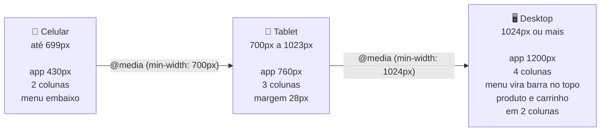

O menu muda de lugar **só com CSS**:

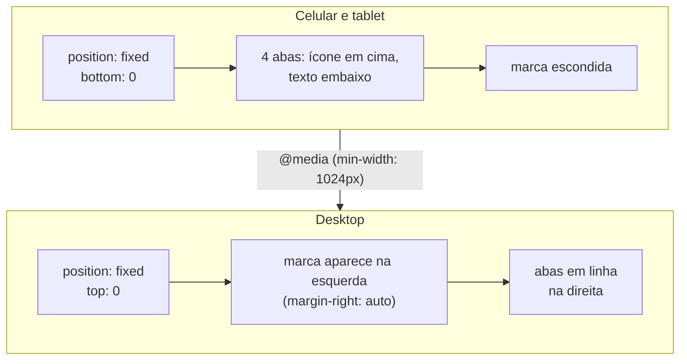

### Conceitos que você precisa dominar

- **Media query (`@media`).** Bloco de regras que só vale em certas condições, como `(min-width: 1024px)` = "telas com 1024px ou mais".
- **Mobile first.** O CSS base é o do celular; as media queries com `min-width` **acrescentam** ajustes para telas maiores.
- **Mudar tokens dentro da media query.** Basta `--margem: 32px` no `:root` do desktop e todas as margens do site mudam juntas.
- **`position: fixed`.** O menu fica preso na **janela** e não rola com a página. Centralizado com `left: 50%` + `transform: translateX(-50%)`.
- **Área segura (`env(safe-area-inset-bottom)`).** Espaço da barrinha do iPhone, para o menu não ficar embaixo dela.
- **`z-index`.** Quem fica por cima: conteúdo < cabeçalho (5) < menu (10) < aviso (20).
- **Toast.** O aviso começa invisível (`opacity: 0`) e 16px abaixo; com a classe `visivel` ele sobe e aparece. A `transition` faz o movimento.
- **`@media (hover: hover)`.** Efeitos de mouse só em aparelhos com mouse. No celular, o hover "grudaria" depois do toque.
- **`@media (prefers-reduced-motion: reduce)`.** Respeita quem configurou o sistema para **reduzir movimento**: as animações viram fade ou somem.
- **Layout de 2 colunas no desktop.** Produto (foto | informações) e carrinho (itens | resumo de 400px) viram Grid, com a foto e o resumo `sticky`.

### Roteiro para apresentar

1. "O **menu** é `position: fixed` no fundo, com efeito de vidro e cantos de cima arredondados. A aba ativa fica rosa e ganha uma pílula atrás do ícone."
2. "O **selo** do carrinho é posicionado em cima do ícone com `position: absolute` e dá um pulinho quando o número muda."
3. "O **toast** substituiu o `alert()`: é um balão que sobe no rodapé por 2,4 segundos, sem travar a página."
4. "Para acessibilidade: hover só onde existe mouse e **movimento reduzido** para quem pediu isso no sistema."
5. "Na **responsividade**, o CSS é mobile first. A partir de 700px vira tablet: 3 colunas e app de 760px."
6. "A partir de 1024px vira **desktop**: o menu vai para o topo e mostra a marca, a grade tem 4 colunas, os cards sobem no hover e o produto e o carrinho viram 2 colunas."
7. "Tudo isso só com CSS: o HTML é o mesmo para os três tamanhos."

### Perguntas que podem aparecer

<details>
<summary><b>O que é responsividade?</b></summary>

É o site se adaptar ao tamanho da tela. Aqui, é o mesmo HTML com regras de CSS diferentes conforme a largura, usando media queries.
</details>

<details>
<summary><b>Por que <code>min-width</code> e não <code>max-width</code>?</b></summary>

Porque o projeto é **mobile first**: a base é o celular e cada faixa maior acrescenta coisas. Com `min-width: 1024px`, o desktop herda tudo do tablet e muda só o que precisa.
</details>

<details>
<summary><b>Como o menu vai de baixo para cima sem mudar o HTML?</b></summary>

No desktop, a media query troca `bottom: 0` por `top: 0`, tira o `transform` de centralizar e deixa a largura total. A marca (`.menu-marca`), que estava com `display: none`, passa para `display: flex`, e `margin-right: auto` empurra as abas para a direita.
</details>

<details>
<summary><b>O que é o <code>prefers-reduced-motion</code>?</b></summary>

Uma configuração do sistema (Windows, iPhone, Android) para quem sente enjoo ou desconforto com animações. Quando ela está ligada, o CSS praticamente zera as animações e o JS começa o carrossel pausado.
</details>

<details>
<summary><b>Por que o toast em vez do <code>alert()</code>?</b></summary>

O `alert()` trava a página até a pessoa clicar em OK e tem a aparência do navegador, não da loja. O toast aparece, some sozinho, segue a identidade visual e é lido pelo leitor de tela (`role="status"`).
</details>

<details>
<summary><b>Como o carrinho sabe ocupar a tela toda quando está vazio no desktop?</b></summary>

O JS esconde o resumo com `style="display: none"`. O seletor `#tela-carrinho:has(#area-resumo[style*="none"])` detecta isso e faz a lista ocupar as duas colunas.
</details>

### Código linha por linha

#### 10.1 Menu de baixo e selo do carrinho (L1121–L1211)

| Linha | Código | O que faz |
|---|---|---|
| L1121 | `/* ---------- Menu de baixo (tab bar) ---------- */` | Comentário: menu de baixo ("tab bar", como nos apps de celular). |
| L1122 | `.menu {` | O **menu** (`<nav class="menu">`). |
| L1123 | `position: fixed;` | `position: fixed`: preso na **janela**. Não rola com a página. |
| L1124 | `bottom: 0;` | Colado no fundo. |
| L1125 | `left: 50%;` | Começa no meio da tela (50% da esquerda)... |
| L1126 | `transform: translateX(-50%);` | ...e volta metade da própria largura para a esquerda. Resultado: **centralizado** (é o truque clássico `left: 50%` + `translateX(-50%)`). |
| L1127 | `width: 100%;` | Ocupa a largura toda... |
| L1128 | `max-width: 430px;` | ...mas no máximo 430px (mesma largura do app). |
| L1129 | `height: calc(var(--tab-h) + env(safe-area-inset-bottom));` | Altura: 64px + a área segura do iPhone (a barrinha de baixo). |
| L1130 | `padding: 6px 8px env(safe-area-inset-bottom);` | 6px em cima, 8px nas laterais e a área segura embaixo. |
| L1131 | `background-color: var(--vidro-menu);` | Fundo escuro semitransparente... |
| L1132–L1133 | `-webkit-backdrop-filter: saturate(160%) blur(24px);` | ...com desfoque de vidro (24px). |
| L1134 | `border-top: 1px solid var(--borda);` | Linha fina em cima. |
| L1135 | `border-radius: 24px 24px 0 0;` | Cantos de cima arredondados (24px), cantos de baixo retos. |
| L1136 | `display: flex;` | Flex. |
| L1137 | `justify-content: space-around;` | As abas ficam espalhadas igualmente. |
| L1138 | `align-items: stretch;` | `stretch`: as abas ocupam a altura toda do menu. |
| L1139 | `z-index: 10;` | `z-index: 10`: o menu fica por cima de tudo (menos do aviso, que é 20). |
| L1140 | `}` | Fecha a regra. |
| L1142 | `.menu button {` | Cada **aba** do menu. |
| L1143 | `flex: 1;` | `flex: 1`: as 4 abas dividem a largura igualmente. |
| L1144 | `min-height: var(--toque);` | Altura de toque. |
| L1145 | `display: flex;` | Flex... |
| L1146 | `flex-direction: column;` | ...em **coluna**: ícone em cima, texto embaixo. |
| L1147 | `align-items: center;` | Centralizados na horizontal... |
| L1148 | `justify-content: center;` | ...e na vertical. |
| L1149 | `gap: 2px;` | 2px entre ícone e texto. |
| L1150 | `font-size: 0.75rem;` | 12px. |
| L1151 | `font-weight: 600;` | Peso 600. |
| L1152 | `color: var(--texto-2);` | Cor secundária (aba desligada). |
| L1153 | `}` | Fecha a regra. |
| L1155 | `.menu button span {` | O `<span>` que envolve o ícone de cada aba. |
| L1156 | `position: relative;` | `relative`: referência para o selo do carrinho (L1184). |
| L1157–L1159 | `display: inline-flex;` | Centraliza o ícone. |
| L1160 | `width: 52px;` | 52px de largura... |
| L1161 | `height: 30px;` | ...30px de altura: o tamanho da "pílula" que aparece atrás do ícone da aba ativa. |
| L1162 | `border-radius: var(--raio-pilula);` | Pílula. |
| L1163 | `transition: background-color var(--rapido);` | A cor de fundo muda suave. |
| L1164 | `}` | Fecha a regra. |
| L1166 | `.menu button:active span {` | Aba apertada: o span... |
| L1167 | `transform: scale(0.9);` | ...encolhe para 90%. |
| L1168 | `}` | Fecha a regra. |
| L1170 | `/* aba ativa: cor + "pílula" atrás do ícone (não depende só da cor) */` | Comentário: a aba ativa muda de cor **e** ganha uma pílula atrás do ícone (não depende só da cor). |
| L1171 | `.menu button.ativo {` | A aba **ativa** (classe `ativo`, colocada pelo JS)... |
| L1172 | `color: var(--rosa);` | ...fica rosa... |
| L1173 | `font-weight: 800;` | ...e em negrito. |
| L1174 | `}` | Fecha a regra. |
| L1176 | `.menu button.ativo span {` | O span da aba ativa... |
| L1177 | `background-color: var(--rosa-suave);` | ...ganha o fundo rosa suave (a pílula). |
| L1178 | `}` | Fecha a regra. |
| L1180 | `.menu button.ativo .icone {` | O ícone da aba ativa... |
| L1181 | `stroke-width: 2.4;` | ...fica com traço mais grosso. |
| L1182 | `}` | Fecha a regra. |
| L1184 | `.menu b {` | O **selo** do carrinho (`<b id="selo">`). |
| L1185 | `position: absolute;` | Posição absoluta, em relação ao span do ícone. |
| L1186 | `top: -5px;` | 5px **acima** do span. |
| L1187 | `left: calc(50% + 3px);` | Começa um pouco à direita do meio (fica no "ombro" do ícone). |
| L1188 | `background-color: var(--rosa);` | Rosa. |
| L1189 | `color: var(--branco);` | Texto branco. |
| L1190 | `font-family: var(--fonte-titulo);` | Fonte de título. |
| L1191 | `font-size: 0.6875rem;` | 11px. |
| L1192 | `font-weight: 800;` | Negrito 800. |
| L1193 | `min-width: 18px;` | Largura mínima de 18px (com 1 dígito vira um círculo; com 2 dígitos estica). |
| L1194 | `height: 18px;` | Altura de 18px. |
| L1195 | `padding: 0 4px;` | 4px nas laterais. |
| L1196 | `border-radius: 9px;` | Cantos de 9px (metade da altura = bem redondo). |
| L1197 | `border: 2px solid var(--escuro);` | Borda de 2px na cor do menu: separa o selo do ícone. |
| L1198–L1200 | `display: flex;` | Centraliza o número. |
| L1201 | `box-sizing: content-box;` | Aqui o tamanho **não inclui** borda e padding (`content-box`), para os 18px serem só do miolo. |
| L1202 | `}` | Fecha a regra. |
| L1204 | `.menu b.pulso {` | Selo com a classe `pulso` (o JS coloca quando o número muda)... |
| L1205 | `animation: pulo 0.35s var(--curva);` | ...faz o "pulinho". |
| L1206 | `}` | Fecha a regra. |
| L1208 | `/* Marca dentro do menu: só aparece na versão web */` | Comentário: a marca dentro do menu só aparece na versão web. |
| L1209 | `.menu-marca {` | A logo + nome dentro do menu... |
| L1210 | `display: none;` | ...ficam escondidos no celular e tablet. |
| L1211 | `}` | Fecha a regra. |

#### 10.2 Aviso rápido (toast) (L1213–L1245)

| Linha | Código | O que faz |
|---|---|---|
| L1213 | `/* ---------- Aviso rápido (toast) ---------- */` | Comentário: aviso rápido (toast). |
| L1214 | `.toast {` | O **toast**. |
| L1215 | `position: fixed;` | Preso na janela. |
| L1216 | `left: 50%;` | Começa no meio da tela (centralizado junto com o `translate` da L1233). |
| L1217 | `bottom: calc(var(--tab-h) + env(safe-area-inset-bottom) + 16px);` | Fica 16px acima do menu. |
| L1218 | `z-index: 20;` | `z-index: 20`: por cima de **tudo**, inclusive do menu. |
| L1219 | `display: flex;` | Em linha (✓ + texto). |
| L1220 | `align-items: center;` | Centralizado na vertical. |
| L1221 | `gap: 10px;` | 10px entre eles. |
| L1222 | `max-width: min(400px, calc(100% - 32px));` | Largura máxima: o **menor** entre 400px e a largura da tela menos 32px (`min()`). |
| L1223 | `padding: 12px 18px;` | Espaço interno. |
| L1224 | `border-radius: var(--raio-pilula);` | Pílula. |
| L1225 | `background-color: var(--escuro);` | Fundo bem escuro. |
| L1226 | `border: 1px solid var(--borda);` | Borda fina. |
| L1227 | `box-shadow: var(--sombra);` | Sombra. |
| L1228 | `font-family: var(--fonte-titulo);` | Fonte de título. |
| L1229 | `font-size: 0.9375rem;` | 15px. |
| L1230 | `font-weight: 700;` | Negrito. |
| L1231 | `opacity: 0;` | **Invisível** por padrão. |
| L1232 | `pointer-events: none;` | E não recebe cliques enquanto está invisível. |
| L1233 | `transform: translate(-50%, 16px);` | Centralizado (−50% na horizontal) e 16px **mais para baixo** que o lugar final. |
| L1234 | `transition: opacity var(--medio) var(--curva), transform var(--medio) var(--curva);` | Opacidade e posição mudam suave quando ele aparece e some. |
| L1235 | `}` | Fecha a regra. |
| L1237 | `.toast .icone {` | O ✓ do aviso... |
| L1238 | `color: var(--verde);` | ...verde... |
| L1239 | `stroke-width: 2.6;` | ...com traço grosso. |
| L1240 | `}` | Fecha a regra. |
| L1242 | `.toast.visivel {` | Toast com a classe `visivel` (o JS coloca e tira depois de 2,4s)... |
| L1243 | `opacity: 1;` | ...fica visível... |
| L1244 | `transform: translate(-50%, 0);` | ...e sobe para o lugar final. Junto com a L1234, o aviso "sobe e aparece". |
| L1245 | `}` | Fecha a regra. |

#### 10.3 Hover só com mouse (L1247–L1278)

| Linha | Código | O que faz |
|---|---|---|
| L1247 | `/* Efeitos de hover só onde existe mouse */` | Comentário: efeitos de hover só onde existe mouse. |
| L1248 | `@media (hover: hover) {` | `@media (hover: hover)`: só vale em aparelhos com **mouse**. No celular, o "hover" fica grudado depois do toque; assim isso não acontece. |
| L1249–L1251 | `.btn-redondo:hover,` | Botão redondo, pílula de categoria e opção **não marcada** (`:not(.ativo)`) com o mouse em cima... |
| L1252 | `background-color: var(--borda);` | ...ganham fundo mais claro. |
| L1253 | `}` | Fecha a regra. |
| L1255 | `.filtros button:not(.ativo):hover {` | Botão de filtro desligado com o mouse em cima... |
| L1256 | `color: var(--branco);` | ...fica com texto branco. |
| L1257 | `}` | Fecha a regra. |
| L1259 | `.btn-pausa:hover {` | Botão de pausa com o mouse em cima... |
| L1260 | `color: var(--branco);` | ...texto branco... |
| L1261 | `background-color: var(--card);` | ...e fundo de card. |
| L1262 | `}` | Fecha a regra. |
| L1264–L1266 | `.btn-mais:hover,` | O "+" do card, o botão principal e o "Ver produtos" com o mouse em cima... |
| L1267 | `background-color: var(--rosa-press);` | ...ficam rosa escuro. |
| L1268 | `}` | Fecha a regra. |
| L1270 | `.link:hover {` | O "Ver tudo" com o mouse em cima... |
| L1271 | `text-decoration: underline;` | ...ganha sublinhado (cara de link). |
| L1272 | `}` | Fecha a regra. |
| L1274 | `.remover:hover {` | O X de remover com o mouse em cima... |
| L1275 | `color: var(--branco);` | ...texto branco... |
| L1276 | `background-color: var(--escuro);` | ...e fundo escuro. |
| L1277 | `}` | Fecha a regra. |
| L1278 | `}` | Fecha o `@media`. |

#### 10.4 Movimento reduzido (L1280–L1296)

| Linha | Código | O que faz |
|---|---|---|
| L1280 | `/* Movimento reduzido: troca deslizes por um fade simples */` | Comentário: para quem pediu menos movimento, troca o deslize por um fade simples. |
| L1281 | `@media (prefers-reduced-motion: reduce) {` | `prefers-reduced-motion: reduce`: a pessoa ativou "reduzir movimento" no sistema (Windows, iPhone, Android). Animações podem causar enjoo em algumas pessoas. |
| L1282 | `.tela.ativa {` | A tela que entra... |
| L1283 | `animation-name: aparecer;` | ...usa a animação `aparecer` (só fade) no lugar de `entrar` (que sobe). |
| L1284 | `}` | Fecha a regra. |
| L1286–L1288 | `*,` | **Todos** os elementos e pseudo-elementos... |
| L1289 | `transition-duration: 0.01ms !important;` | ...têm as transições praticamente zeradas (0,01ms). `!important` ganha de qualquer outra regra. |
| L1290 | `animation-duration: 0.01ms !important;` | ...e as animações também. |
| L1291 | `}` | Fecha a regra. |
| L1293 | `.toast {` | O toast... |
| L1294 | `transform: translate(-50%, 0);` | ...já fica na posição final (sem subir). |
| L1295 | `}` | Fecha a regra. |
| L1296 | `}` | Fecha o `@media`. |

#### 10.5 Tablet, a partir de 700px (L1298–L1334)

| Linha | Código | O que faz |
|---|---|---|
| L1298–L1300 | `/* ============================================================` | Comentário de título: daqui para baixo, as regras da versão **web / responsiva**. |
| L1302 | `/* ---------- Tablet (a partir de 700px) ---------- */` | Comentário: tablet, a partir de 700px. |
| L1303 | `@media (min-width: 700px) {` | `@media (min-width: 700px)`: só vale em telas com **700px ou mais**. É o que o celular já tinha + estes ajustes. |
| L1304 | `:root {` | Muda os tokens... |
| L1305 | `--margem: 28px;` | ...a margem lateral passa para 28px. Como tudo usa `var(--margem)`, o site inteiro se ajusta com **uma linha**. |
| L1306 | `}` | Fecha a regra. |
| L1308 | `.app {` | O app... |
| L1309 | `max-width: 760px;` | ...fica com até 760px de largura. |
| L1310 | `}` | Fecha a regra. |
| L1312 | `.menu {` | O menu... |
| L1313 | `max-width: 760px;` | ...acompanha: até 760px. |
| L1314 | `}` | Fecha a regra. |
| L1316 | `.grade {` | A grade de produtos... |
| L1317 | `grid-template-columns: repeat(3, minmax(0, 1fr));` | ...passa para **3 colunas**... |
| L1318 | `gap: 16px;` | ...com 16px entre os cards. |
| L1319 | `}` | Fecha a regra. |
| L1321 | `.banner {` | O banner... |
| L1322 | `min-height: 260px;` | ...fica mais alto (260px)... |
| L1323 | `padding: 32px;` | ...com mais espaço interno. |
| L1324 | `}` | Fecha a regra. |
| L1326 | `.banner h2 {` | O título do banner... |
| L1327 | `font-size: 2.25rem;` | ...cresce para 36px. |
| L1328 | `}` | Fecha a regra. |
| L1330 | `.compra {` | A barra de compra... |
| L1331 | `margin-left: 0;` | ...perde a margem negativa da esquerda... |
| L1332 | `margin-right: 0;` | ...e da direita. |
| L1333 | `}` | Fecha a regra. |
| L1334 | `}` | Fecha o `@media` do tablet. |

#### 10.6 Desktop: base e menu no topo (L1336–L1427)

| Linha | Código | O que faz |
|---|---|---|
| L1336 | `/* ---------- Desktop (a partir de 1024px) ---------- */` | Comentário: desktop, a partir de 1024px. |
| L1337 | `@media (min-width: 1024px) {` | `@media (min-width: 1024px)`: só vale em telas com **1024px ou mais**. As regras do tablet continuam valendo e estas são somadas. |
| L1338 | `:root {` | Muda os tokens... |
| L1339 | `--margem: 32px;` | ...margem lateral de 32px... |
| L1340 | `--barra-topo: 72px;` | ...e cria `--barra-topo`: 72px, a altura do menu quando ele vira barra no topo. |
| L1341 | `}` | Fecha a regra. |
| L1343 | `body {` | O corpo... |
| L1344 | `background-color: var(--fundo);` | ...passa a ter o fundo vinho também (no desktop não faz sentido mostrar o "celular" com cinza em volta). |
| L1345 | `}` | Fecha a regra. |
| L1347 | `.app {` | O app... |
| L1348 | `max-width: 1200px;` | ...fica com até 1200px... |
| L1349 | `padding-top: var(--barra-topo); /* espaço do menu fixo no topo */` | ...e ganha espaço em cima do tamanho do menu, que agora fica no topo. |
| L1350 | `}` | Fecha a regra. |
| L1352 | `.tela {` | As telas... |
| L1353 | `padding-bottom: 64px;` | ...não precisam mais do espaço para o menu embaixo; ficam só com 64px. |
| L1354 | `}` | Fecha a regra. |
| L1356–L1357 | `.topo,` | O topo da home e os cabeçalhos... |
| L1358 | `top: var(--barra-topo);` | ...grudam **abaixo** da barra do menu (e não no topo da janela). |
| L1359 | `padding-top: 16px;` | 16px em cima... |
| L1360 | `padding-bottom: 16px;` | ...e embaixo. |
| L1361 | `}` | Fecha a regra. |
| L1363 | `/* Menu vira barra de navegação no topo */` | Comentário: o menu vira barra de navegação no topo. |
| L1364 | `.menu {` | O menu no desktop: |
| L1365 | `top: 0;` | Gruda no **topo**... |
| L1366 | `bottom: auto;` | ...e solta do fundo (`auto`). |
| L1367 | `left: 0;` | Começa na esquerda... |
| L1368 | `transform: none;` | ...sem o `translate` de centralizar... |
| L1369 | `max-width: none;` | ...sem largura máxima (ocupa a janela toda)... |
| L1370 | `height: var(--barra-topo);` | ...72px de altura. |
| L1371 | `padding: 0 max(var(--margem), calc((100% - 1200px) / 2 + var(--margem)));` | Padding lateral calculado para o conteúdo do menu **alinhar com o app de 1200px**: `(largura da tela − 1200px) / 2 + margem`. O `max()` garante que nunca fique menor que a margem. |
| L1372 | `border-top: none;` | Tira a linha de cima... |
| L1373 | `border-bottom: 1px solid var(--borda);` | ...e coloca uma linha embaixo. |
| L1374 | `border-radius: 0;` | Sem cantos arredondados. |
| L1375 | `justify-content: flex-start;` | As abas vão para o começo (a marca empurra elas para a direita, ver L1382). |
| L1376 | `align-items: center;` | Centraliza na vertical. |
| L1377 | `gap: 4px;` | 4px entre as abas. |
| L1378 | `}` | Fecha a regra. |
| L1380 | `.menu-marca {` | A marca dentro do menu... |
| L1381 | `display: flex;` | ...**aparece**... |
| L1382 | `margin-right: auto;` | ...e `margin-right: auto` empurra todo o resto (as abas) para a **direita**. |
| L1383 | `}` | Fecha a regra. |
| L1385 | `.menu-marca strong {` | O nome da loja no menu... |
| L1386 | `font-family: var(--fonte-titulo);` | ...fonte de título... |
| L1387 | `font-size: 1.125rem;` | ...18px... |
| L1388 | `font-weight: 800;` | ...negrito 800... |
| L1389 | `color: var(--branco);` | ...branco. |
| L1390 | `}` | Fecha a regra. |
| L1392 | `.menu button {` | As abas no desktop: |
| L1393 | `flex: 0 0 auto;` | Não esticam mais (`0 0 auto` = tamanho do conteúdo). |
| L1394 | `flex-direction: row;` | Ícone e texto **lado a lado** (linha, não coluna). |
| L1395 | `gap: 6px;` | 6px entre eles. |
| L1396 | `padding: 0 16px 0 8px;` | Espaço interno. |
| L1397 | `border-radius: var(--raio-pilula);` | Pílula. |
| L1398 | `font-size: 0.9375rem;` | 15px. |
| L1399 | `}` | Fecha a regra. |
| L1401 | `.menu button span {` | O span do ícone... |
| L1402 | `width: 32px;` | ...32px... |
| L1403 | `height: 32px;` | ...por 32px... |
| L1404 | `background: none !important;` | ...e **sem** a pílula de fundo (o `!important` vence a regra da aba ativa da L1176). |
| L1405 | `}` | Fecha a regra. |
| L1407 | `.menu button.ativo {` | Na aba ativa, a pílula fica atrás da aba **inteira**... |
| L1408 | `background-color: var(--card);` | ...com fundo de card. |
| L1409 | `}` | Fecha a regra. |
| L1411 | `.menu button:hover {` | Aba com o mouse em cima... |
| L1412 | `background-color: var(--card);` | ...ganha fundo de card... |
| L1413 | `color: var(--branco);` | ...e texto branco. |
| L1414 | `}` | Fecha a regra. |
| L1416 | `.menu button.ativo:hover {` | Mas a aba ativa com o mouse em cima... |
| L1417 | `color: var(--rosa);` | ...continua rosa. |
| L1418 | `}` | Fecha a regra. |
| L1420 | `.toast {` | O toast... |
| L1421 | `bottom: 32px;` | ...fica 32px acima do fundo (não tem mais menu embaixo). |
| L1422 | `}` | Fecha a regra. |
| L1424 | `/* A marca já está no menu, então some do topo da home */` | Comentário: a marca já está no menu, então some do topo da home. |
| L1425 | `.topo .marca {` | A marca do topo da home... |
| L1426 | `visibility: hidden;` | ...fica **invisível**, mas continua ocupando espaço (`visibility: hidden`, diferente de `display: none`). Assim os botões continuam à direita. |
| L1427 | `}` | Fecha a regra. |

#### 10.7 Desktop: home e categorias (L1429–L1467)

| Linha | Código | O que faz |
|---|---|---|
| L1429 | `/* Home */` | Comentário: home. |
| L1430 | `.banner {` | O banner... |
| L1431 | `min-height: 360px;` | ...360px de altura... |
| L1432 | `padding: 44px;` | ...44px de espaço interno. |
| L1433 | `}` | Fecha a regra. |
| L1435 | `.banner h2 {` | O título do banner... |
| L1436 | `font-size: 3rem;` | ...48px. |
| L1437 | `}` | Fecha a regra. |
| L1439 | `.banner p {` | A chamada do banner... |
| L1440 | `min-height: 44px;` | ...44px de altura... |
| L1441 | `padding: 0 20px;` | ...20px nas laterais... |
| L1442 | `font-size: 1rem;` | ...16px. |
| L1443 | `}` | Fecha a regra. |
| L1445 | `.pilulas {` | As pílulas... |
| L1446 | `flex-wrap: wrap;` | ...quebram linha se precisar... |
| L1447 | `overflow: visible;` | ...e não rolam mais de lado (tem espaço). |
| L1448 | `}` | Fecha a regra. |
| L1450 | `.titulo-secao h3 {` | O título de seção... |
| L1451 | `font-size: 1.5rem;` | ...24px. |
| L1452 | `}` | Fecha a regra. |
| L1454 | `.grade {` | A grade... |
| L1455 | `grid-template-columns: repeat(4, minmax(0, 1fr));` | ...**4 colunas**... |
| L1456 | `gap: 24px;` | ...com 24px entre os cards. |
| L1457 | `}` | Fecha a regra. |
| L1459 | `.card:hover {` | Card com o mouse em cima... |
| L1460 | `transform: translateY(-4px);` | ...sobe 4px... |
| L1461 | `border-color: var(--rosa);` | ...ganha borda rosa... |
| L1462 | `box-shadow: var(--sombra);` | ...e sombra. Efeito de "card levantando". |
| L1463 | `}` | Fecha a regra. |
| L1465 | `.cabecalho-texto h2 {` | O título grande das categorias... |
| L1466 | `font-size: 2.125rem;` | ...34px. |
| L1467 | `}` | Fecha a regra. |

#### 10.8 Desktop: produto em duas colunas (L1469–L1520)

| Linha | Código | O que faz |
|---|---|---|
| L1469 | `/* Detalhe do produto: foto à esquerda, informações à direita */` | Comentário: no produto, foto à esquerda e informações à direita. |
| L1470 | `#tela-produto.ativa {` | A tela do produto **quando está ativa**... |
| L1471 | `display: grid;` | ...vira **grid**... |
| L1472 | `grid-template-columns: 1fr 1fr;` | ...com 2 colunas iguais. |
| L1473 | `align-items: start;` | Os itens alinham pelo topo. |
| L1474 | `column-gap: 16px;` | 16px entre as colunas. |
| L1475 | `}` | Fecha a regra. |
| L1477 | `#tela-produto .cabecalho {` | O cabeçalho do produto... |
| L1478 | `grid-column: 1 / -1;` | ...ocupa as 2 colunas (`1 / -1` = da primeira à última). |
| L1479 | `}` | Fecha a regra. |
| L1481 | `#tela-produto .foto-grande {` | A foto grande no desktop... |
| L1482 | `max-height: none;` | ...sem limite de altura... |
| L1483 | `position: sticky;` | ...e **gruda** ao rolar: a foto fica parada enquanto as informações rolam ao lado. |
| L1484 | `top: calc(var(--barra-topo) + 96px);` | Gruda abaixo do menu + cabeçalho (72px + 96px). |
| L1485 | `}` | Fecha a regra. |
| L1487 | `#tela-produto .detalhe {` | As informações do produto... |
| L1488 | `padding-top: 8px;` | ...com 8px em cima. |
| L1489 | `}` | Fecha a regra. |
| L1491 | `.detalhe h2 {` | O nome do produto... |
| L1492 | `font-size: 2.25rem;` | ...36px. |
| L1493 | `}` | Fecha a regra. |
| L1495 | `#tela-produto .detalhe .grade {` | A grade de relacionados (na coluna da direita)... |
| L1496 | `grid-template-columns: repeat(2, minmax(0, 1fr));` | ...fica com 2 colunas... |
| L1497 | `gap: 16px;` | ...e 16px entre elas. |
| L1498 | `}` | Fecha a regra. |
| L1500 | `/* No desktop a barra de compra volta para o fluxo normal */` | Comentário: no desktop a barra de compra volta para o fluxo normal. |
| L1501 | `.compra {` | A barra de compra no desktop: |
| L1502 | `position: static;` | Não gruda mais (`static` = posição normal). |
| L1503 | `margin: 0 0 28px;` | Margem só embaixo. |
| L1504 | `padding: 0;` | Sem padding. |
| L1505 | `background: none;` | Sem fundo... |
| L1506 | `border: none;` | ...sem borda... |
| L1507 | `box-shadow: none;` | ...sem sombra... |
| L1508–L1509 | `-webkit-backdrop-filter: none;` | ...e sem desfoque. Vira uma linha simples com contador + botão. |
| L1510 | `gap: 16px;` | 16px entre eles. |
| L1511 | `}` | Fecha a regra. |
| L1513 | `.compra .contador {` | O contador na barra... |
| L1514 | `height: 52px;` | ...52px de altura. |
| L1515 | `}` | Fecha a regra. |
| L1517 | `.compra .btn-principal {` | O botão principal na barra... |
| L1518 | `min-height: 52px;` | ...52px de altura... |
| L1519 | `font-size: 0.9375rem;` | ...15px. |
| L1520 | `}` | Fecha a regra. |

#### 10.9 Desktop: carrinho em duas colunas (L1522–L1554)

| Linha | Código | O que faz |
|---|---|---|
| L1522 | `/* Carrinho: itens à esquerda, resumo à direita */` | Comentário: no carrinho, itens à esquerda e resumo à direita. |
| L1523 | `#tela-carrinho.ativa {` | A tela do carrinho quando está ativa... |
| L1524 | `display: grid;` | ...vira grid... |
| L1525 | `grid-template-columns: 1fr 400px;` | ...com 2 colunas: a primeira flexível e a segunda com 400px fixos (o resumo). |
| L1526 | `align-items: start;` | Alinha pelo topo. |
| L1527 | `}` | Fecha a regra. |
| L1529 | `#tela-carrinho .cabecalho {` | O cabeçalho do carrinho... |
| L1530 | `grid-column: 1 / -1;` | ...ocupa as 2 colunas. |
| L1531 | `}` | Fecha a regra. |
| L1533 | `#tela-carrinho:has(#area-resumo[style*="none"]) #lista-carrinho {` | Se o carrinho estiver vazio (o JS escreve `display: none` no `style` do `#area-resumo`, e `[style*="none"]` procura esse texto), a lista... |
| L1534 | `grid-column: 1 / -1;` | ...ocupa as 2 colunas, para a mensagem de vazio ficar centralizada. |
| L1535 | `}` | Fecha a regra. |
| L1537 | `#area-resumo {` | O resumo... |
| L1538 | `position: sticky;` | ...gruda ao rolar... |
| L1539 | `top: calc(var(--barra-topo) + 96px);` | ...abaixo do menu + cabeçalho. |
| L1540 | `}` | Fecha a regra. |
| L1542 | `#area-resumo .entrega {` | O endereço dentro do resumo... |
| L1543 | `margin-top: 4px;` | ...com só 4px em cima (alinha com o primeiro item da lista). |
| L1544 | `}` | Fecha a regra. |
| L1546 | `.item {` | Cada item... |
| L1547 | `padding: 16px;` | ...com mais espaço interno. |
| L1548 | `}` | Fecha a regra. |
| L1550 | `.item-foto {` | A foto do item... |
| L1551 | `width: 104px;` | ...104px... |
| L1552 | `height: 104px;` | ...por 104px. |
| L1553 | `}` | Fecha a regra. |
| L1554 | `}` | Fecha o `@media` do desktop. |

---

## 11. Bloco 5 · Kevin Patrick · Dados, navegação e catálogo

> **Responsável:** Kevin Patrick · **Arquivo:** [`script.js`](script.js) (L1–L184)

### Em uma frase

> *"Eu fiz a **base do JavaScript**: a lista de produtos, as funções de ajuda que todo mundo usa, a troca de telas e o catálogo, que desenha os cards e filtra e ordena as categorias."*

### Diagrama

Como **os dados viram cards na tela**:

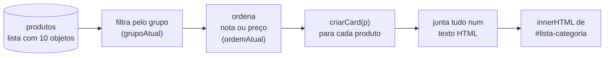

O que acontece ao clicar na pílula **"Roupas"**:

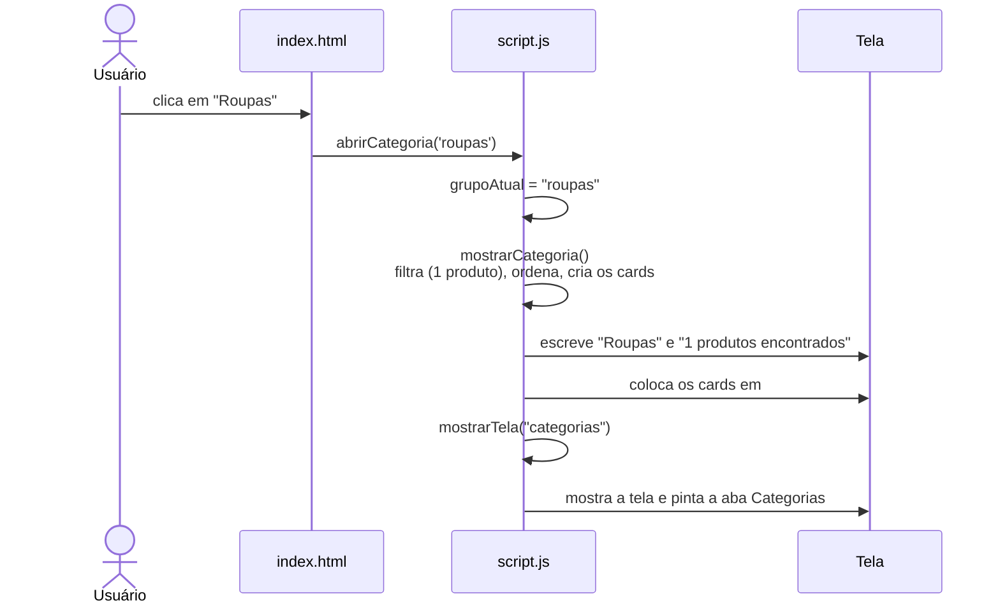

### Conceitos que você precisa dominar

- **Variável (`var`).** Uma "caixa" com nome que guarda um valor.
- **Array (lista) e objeto.** `[ ]` é uma lista em ordem; `{ chave: valor }` é um objeto com campos. `produtos` é uma **lista de objetos**.
- **Função.** Um bloco de código com nome, que roda quando é chamado e pode **devolver** um valor (`return`).
- **Laço `for`.** Repete um código para cada posição de uma lista (`i` vai de 0 até o tamanho − 1).
- **Estado.** As variáveis que mudam enquanto a pessoa usa: `carrinho`, `produtoAtual`, `grupoAtual`, `ordemAtual`.
- **DOM.** A "árvore" do HTML que o JS consegue ler e mudar:
  - `getElementById("x")` acha um elemento pelo id;
  - `querySelectorAll(".tela")` acha todos que combinam com um seletor;
  - `innerHTML` escreve **HTML**; `innerText` escreve **texto puro**;
  - `classList.add` / `classList.remove` liga e desliga classes;
  - `setAttribute` muda um atributo (ex.: `aria-pressed`).
- **Gerar HTML com texto.** `criarCard` junta pedaços de texto com `+` e devolve o HTML pronto.
- **`sort` com função de comparação.** `(a, b) => b.nota - a.nota` coloca a maior nota primeiro.
- **Operador ternário.** `condição ? seSim : seNão`, um `if/else` em uma linha.
- **`setTimeout`.** Roda algo **depois** de um tempo (o aviso some depois de 2,4 s).

### Roteiro para apresentar

1. "Os produtos ficam numa **lista de objetos**. Cada produto tem id, nome, categoria, nota, preço e o nome da foto. É o nosso banco de dados."
2. "O **estado** guarda o que muda: carrinho, produto aberto, categoria e ordem."
3. "Criei **funções de ajuda** usadas por todo o código: `dinheiro` formata em reais, `buscarProduto` acha pelo id, `tagImagem` monta a foto (e esconde se não existir), `icone` monta o SVG e `aviso` mostra o toast."
4. "A **navegação** é a `mostrarTela`: tira `ativa` de todas as telas, coloca na escolhida, pinta a aba do menu e manda o foco para a tela."
5. "O **catálogo**: `criarCard` transforma um produto em HTML; `mostrarHome` desenha os 4 mais vendidos; `mostrarCategoria` filtra pelo grupo, ordena por nota ou preço e desenha."
6. "Se a categoria está vazia, como Equipamentos, aparece uma mensagem no lugar."

### Perguntas que podem aparecer

<details>
<summary><b>Por que os produtos estão no JavaScript e não num banco de dados?</b></summary>

É um protótipo sem servidor. A lista no JS faz o papel do banco. Numa versão real, esses dados viriam de uma API (com `fetch`), e o resto do código continuaria praticamente igual.
</details>

<details>
<summary><b>O que faz a função <code>dinheiro</code>?</b></summary>

Recebe um número (`189.9`), deixa com 2 casas (`"189.90"`), troca o ponto por vírgula (`"189,90"`) e coloca `"R$ "` na frente.
</details>

<details>
<summary><b>Como funciona o <code>mostrarTela</code>?</b></summary>

Tira a classe `ativa` de todas as telas e coloca só na escolhida. O CSS esconde quem não tem `ativa`. Depois faz o mesmo com as abas do menu (classe `ativo`), rola para o topo e coloca o foco na tela nova.
</details>

<details>
<summary><b>Como é feita a ordenação?</b></summary>

Com `lista.sort(função)`. A função recebe dois produtos `a` e `b` e devolve um número: se for negativo, `a` vem antes; se for positivo, `b` vem antes. `b.nota - a.nota` ordena da maior nota para a menor; `a.preco - b.preco`, do menor preço para o maior.
</details>

<details>
<summary><b>Qual a diferença entre <code>innerHTML</code> e <code>innerText</code>?</b></summary>

`innerHTML` interpreta o texto como HTML (cria tags). `innerText` coloca como texto puro. O código usa `innerHTML` para os cards (que são HTML) e `innerText` para nomes, preços e descrições (que são só texto, e assim fica mais seguro).
</details>

<details>
<summary><b>O que acontece se a foto do produto não existir?</b></summary>

A `` tem `onerror="this.style.display='none'"`: se der erro ao carregar, a imagem se esconde e fica só o fundo rosa-escuro da caixa. O site não quebra.
</details>

### Código linha por linha

#### 11.1 Dados dos produtos (L1–L33)

| Linha | Código | O que faz |
|---|---|---|
| L1–L4 | `// ------------------------------------------------------------` | Comentário de seção (`//` = comentário de uma linha): os dados dos produtos, iguais aos do Figma, com as fotos na pasta `img`. |
| L5 | `var produtos = [` | Cria a variável `produtos`: uma **lista** (array, entre `[ ]`) de **objetos** (entre `{ }`). Cada objeto é um produto. É o "banco de dados" da loja. |
| L6 | `{ id: "whey", nome: "Whey Protein Isolado 900g", tipo: "Isolados", grupo: "suplementos", nota: 4.9, preco: 189 …` | Produto **Whey Isolado**. Os campos: `id` (nome único, usado pelo código), `nome` (o que aparece na tela), `tipo` (texto pequeno no card), `grupo` (em qual categoria ele aparece), `nota` (estrelas), `preco`, `antigo` (preço riscado; só este produto tem), `foto` (arquivo em `img/`) e `opcoes` (`true` = mostra tamanho e sabor). |
| L7 | `descricao: "O Whey Protein Isolado C.F. oferece a mais pura dose de proteína para maximizar seu ganho muscular …` | A `descricao` do whey, mostrada na tela de detalhes. |
| L8 | `{ id: "concentrado", nome: "Whey Concentrado 1kg", tipo: "Concentrados", grupo: "suplementos", nota: 4.7, prec …` | **Whey Concentrado**: mesmos campos, sem `antigo`. |
| L9 | `descricao: "Proteína de alto valor biológico para quem quer ganhar massa magra com um ótimo custo-benefício." …` | Descrição dele. |
| L10 | `{ id: "hidrolisado", nome: "Whey Hidrolisado 900g", tipo: "Hidrolisados", grupo: "suplementos", nota: 5.0, pre …` | **Whey Hidrolisado** (nota 5.0). |
| L11 | `descricao: "Proteína hidrolisada de absorção mais rápida, ideal para tomar logo depois do treino." },` | Descrição. |
| L12 | `{ id: "vegana", nome: "Proteína Vegana C.F.G 900g", tipo: "Veganos", grupo: "suplementos", nota: 4.6, preco: 1 …` | **Proteína Vegana**. |
| L13 | `descricao: "Proteína de origem vegetal, sem lactose, para quem segue uma alimentação vegana." },` | Descrição. |
| L14 | `{ id: "beef", nome: "Beef Protein Carnívoro 900g", tipo: "Isolados", grupo: "suplementos", nota: 4.8, preco: 1 …` | **Beef Protein**. |
| L15 | `descricao: "Proteína isolada de carne bovina, sem lactose e com bastante proteína por dose." },` | Descrição. |
| L16 | `{ id: "albumina", nome: "Albumina Premium 500g", tipo: "Outros", grupo: "suplementos", nota: 4.5, preco: 79.90 …` | **Albumina**. |
| L17 | `descricao: "Proteína do ovo de digestão lenta, boa para consumir ao longo do dia." },` | Descrição. |
| L18 | `{ id: "creatina", nome: "Creatina Monohidratada 300g", tipo: "Suplementos", grupo: "suplementos", nota: 4.8, p …` | **Creatina**: `opcoes: false`, então a tela de detalhes não mostra tamanho e sabor. |
| L19 | `descricao: "Creatina pura importada para mais força e desempenho nos treinos." },` | Descrição. |
| L20 | `{ id: "pretreino", nome: "Pré-Treino Apocalypse 300g", tipo: "Suplementos", grupo: "suplementos", nota: 5.0, p …` | **Pré-Treino**. |
| L21 | `descricao: "Energia e foco para treinar com intensidade do começo ao fim." },` | Descrição. |
| L22 | `{ id: "camiseta", nome: "Camiseta de Compressão C.F.G", tipo: "Roupas", grupo: "roupas", nota: 4.7, preco: 119 …` | **Camiseta**: `grupo: "roupas"`, é o único produto da categoria Roupas. |
| L23 | `descricao: "Camiseta de compressão dry fit, leve e confortável para treinar." },` | Descrição. |
| L24 | `{ id: "coqueteleira", nome: "Coqueteleira Inox C.F.G", tipo: "Acessórios", grupo: "acessorios", nota: 4.9, pre …` | **Coqueteleira**: `grupo: "acessorios"`. É o último da lista, por isso **não tem vírgula** depois do `}`. |
| L25 | `descricao: "Coqueteleira de inox que mantém sua bebida gelada por mais tempo." }` | Descrição. |
| L26 | `];` | Fecha a lista de produtos. |
| L28 | `var nomesGrupos = {` | Objeto que "traduz" a chave da categoria (sem acento, usada no código) para o **nome bonito** que aparece no título. |
| L29 | `suplementos: "Suplementos",` | `suplementos` → "Suplementos". |
| L30 | `roupas: "Roupas",` | `roupas` → "Roupas". |
| L31 | `equipamentos: "Equipamentos",` | `equipamentos` → "Equipamentos". |
| L32 | `acessorios: "Acessórios"` | `acessorios` → "Acessórios" (com acento). |
| L33 | `};` | Fecha o objeto. |

#### 11.2 Estado do site (L35–L43)

| Linha | Código | O que faz |
|---|---|---|
| L35 | `// Estado do site` | Comentário: o **estado** do site, as variáveis que mudam enquanto a pessoa usa. |
| L36 | `var carrinho = [` | O **carrinho**: uma lista de itens. Cada item guarda só o `id` do produto, a quantidade (`qtd`) e um texto `extra` (o sabor). Preço, nome e foto são buscados na lista `produtos` quando precisa. |
| L37 | `{ id: "whey", qtd: 1, extra: "Sabor: Chocolate Suíço" },` | Item de exemplo 1: 1 Whey de Chocolate. |
| L38 | `{ id: "creatina", qtd: 2, extra: "Pura Importada" }` | Item de exemplo 2: 2 Creatinas. Por isso o site já abre com "3" no selo do carrinho. |
| L39 | `];` | Fecha o carrinho. |
| L40 | `var produtoAtual = null;` | `produtoAtual`: o produto aberto na tela de detalhes. Começa `null` (nenhum). |
| L41 | `var qtdDetalhe = 1;` | `qtdDetalhe`: o número do contador na tela de detalhes. Começa em 1. |
| L42 | `var grupoAtual = "suplementos";` | `grupoAtual`: a categoria aberta. Começa em "suplementos". |
| L43 | `var ordemAtual = "popular";` | `ordemAtual`: a ordenação escolhida ("popular" ou "preco"). |

#### 11.3 Funções de ajuda (L45–L82)

| Linha | Código | O que faz |
|---|---|---|
| L45–L47 | `// ------------------------------------------------------------` | Comentário de seção: funções de ajuda (pequenas, usadas em vários lugares). |
| L48 | `function dinheiro(valor) {` | Função `dinheiro`: recebe um número e devolve o texto em reais. |
| L49 | `return "R$ " + valor.toFixed(2).replace(".", ",");` | `toFixed(2)` deixa 2 casas decimais (`189.9` → `"189.90"`), `replace(".", ",")` troca o ponto pela vírgula e o `"R$ "` vai na frente. Resultado: `"R$ 189,90"`. |
| L50 | `}` | Fecha a função. |
| L52 | `function buscarProduto(id) {` | Função `buscarProduto`: recebe um `id` e devolve o produto da lista que tem esse id. |
| L53 | `for (var i = 0; i < produtos.length; i++) {` | Laço `for`: passa por cada posição `i` da lista, de 0 até o tamanho da lista − 1. |
| L54 | `if (produtos[i].id == id) {` | Se o `id` do produto nesta posição for igual ao procurado... |
| L55 | `return produtos[i];` | ...devolve esse produto (e a função termina). |
| L56 | `}` | Fecha o `if`. |
| L57 | `}` | Fecha o `for`. |
| L58 | `}` | Fecha a função. Se não achou nada, devolve `undefined`. |
| L60 | `// Se a foto ainda não estiver na pasta img, a imagem some e fica só o fundo rosa escuro` | Comentário: se a foto não existir, a imagem some e fica só o fundo rosa-escuro. |
| L61 | `// "decorativa" = a foto fica escondida do leitor de tela quando o nome já aparece ao lado` | Comentário: `decorativa` = a foto fica escondida do leitor de tela quando o nome já aparece ao lado. |
| L62 | `function tagImagem(p, decorativa) {` | Função `tagImagem`: monta o HTML de uma `` para o produto `p`. |
| L63 | `var alt = decorativa ? "" : p.nome;` | Texto alternativo (`alt`): vazio se for decorativa, ou o nome do produto. (`condição ? a : b` é o **operador ternário**: "se a condição for verdadeira, `a`; senão, `b`".) |
| L64 | `return '<use href="#i-' + nome + '"/ …` | Devolve `<svg class="icone ..."><use href="#i-nome"/></svg>`. Se tiver classe extra, ela é somada com um espaço. |
| L70 | `}` | Fecha a função. |
| L72 | `// Aviso rápido no rodapé (no lugar do alert)` | Comentário: aviso rápido no rodapé (no lugar do `alert`). |
| L73 | `var timerAviso = null;` | `timerAviso` guarda o cronômetro do aviso, para poder cancelar. |
| L74 | `function aviso(texto) {` | Função `aviso`: mostra o toast com um texto. |
| L75 | `var toast = document.getElementById("toast");` | Pega o elemento do toast. |
| L76 | `document.getElementById("toast-texto").innerText = texto;` | Escreve o texto dentro do `#toast-texto`. |
| L77 | `toast.classList.add("visivel");` | Coloca a classe `visivel` (o CSS faz o toast subir e aparecer). |
| L78 | `clearTimeout(timerAviso);` | Cancela o cronômetro anterior. Se dois avisos vierem seguidos, o segundo não some antes da hora. |
| L79 | `timerAviso = setTimeout(function () {` | Cria um cronômetro: daqui a 2400 milissegundos (2,4 s), executa a função abaixo... |
| L80 | `toast.classList.remove("visivel");` | ...que tira a classe `visivel` (o toast some). |
| L81 | `}, 2400);` | Fim do cronômetro: `2400` é o tempo. |
| L82 | `}` | Fecha a função. |

#### 11.4 Navegação entre telas (L84–L111)

| Linha | Código | O que faz |
|---|---|---|
| L84–L86 | `// ------------------------------------------------------------` | Comentário de seção: navegação entre as telas. |
| L87 | `function mostrarTela(nome) {` | Função `mostrarTela`: recebe o nome da tela (`"home"`, `"categorias"`, `"produto"`, `"carrinho"` ou `"perfil"`) e mostra só ela. |
| L88 | `var telas = document.querySelectorAll(".tela");` | Pega **todas** as telas (`querySelectorAll(".tela")`). |
| L89 | `for (var i = 0; i < telas.length; i++) {` | Passa por cada uma... |
| L90 | `telas[i].classList.remove("ativa");` | ...e tira a classe `ativa` (todas ficam escondidas). |
| L91 | `}` | Fecha o laço. |
| L92 | `document.getElementById("tela-" + nome).classList.add("ativa");` | Acha a tela pelo id (`"tela-" + nome`, ex.: `tela-home`) e coloca a classe `ativa`. Agora só ela aparece. |
| L94 | `var abas = document.querySelectorAll(".menu button");` | Pega todos os botões do menu. |
| L95 | `for (var j = 0; j < abas.length; j++) {` | Passa por cada um... |
| L96 | `abas[j].classList.remove("ativo");` | ...tira a classe `ativo` (tira o rosa)... |
| L97 | `abas[j].removeAttribute("aria-current");` | ...e tira o `aria-current` (que diz ao leitor de tela "esta é a página atual"). |
| L98 | `}` | Fecha o laço. |
| L99 | `// o produto pertence à aba "Categorias"` | Comentário: o produto pertence à aba "Categorias". |
| L100 | `var aba = (nome == "produto") ? "categorias" : nome;` | Se a tela for `produto`, a aba a destacar é `categorias`; senão, a aba tem o mesmo nome da tela. |
| L101 | `var botaoAba = document.getElementById("aba-" + aba);` | Acha o botão da aba (`"aba-" + aba`). |
| L102 | `botaoAba.classList.add("ativo");` | Pinta a aba de rosa (classe `ativo`). |
| L103 | `botaoAba.setAttribute("aria-current", "page");` | E marca como página atual para o leitor de tela. |
| L105 | `if (nome == "carrinho") {` | Se a tela aberta for o carrinho... |
| L106 | `mostrarCarrinho();` | ...redesenha o carrinho, para mostrar os dados mais novos. |
| L107 | `}` | Fecha o `if`. |
| L108 | `window.scrollTo(0, 0);` | Rola a página para o **topo**. |
| L109 | `// leva o foco do teclado / leitor de tela para a nova tela` | Comentário: leva o foco do teclado / leitor de tela para a nova tela. |
| L110 | `document.getElementById("tela-" + nome).focus({ preventScroll: true });` | Coloca o foco na tela nova (por isso as telas têm `tabindex="-1"`). `preventScroll` evita que o foco faça a página pular. |
| L111 | `}` | Fecha a função. |

#### 11.5 Cards e home (L113–L135)

| Linha | Código | O que faz |
|---|---|---|
| L113–L115 | `// ------------------------------------------------------------` | Comentário de seção: cards de produto. |
| L116 | `function criarCard(p) {` | Função `criarCard`: recebe um produto `p` e **devolve o HTML** do card como texto. Ela não coloca na tela; quem chama decide onde colocar. |
| L117 | `return '<article class="card">' +` | Abre o `<article class="card">`. As partes são juntadas com `+` (concatenação de texto). |
| L118 | `'<div class="card-foto">' + tagImagem(p, true) + '</div>' +` | A caixa da foto, com a imagem decorativa (`tagImagem(p, true)`). |
| L119 | `'<div class="card-info">' +` | Abre a parte de informações. |
| L120 | `'<div class="card-meta"><span>' + p.tipo + '</span><b>' + icone("estrela", "estrela") + p.nota.toFixed(1) + '< …` | Linha de cima: o tipo e a nota. A nota tem a estrela (`icone("estrela", "estrela")`) e o número com 1 casa (`toFixed(1)` → `"4.9"`). |
| L121 | `'<h3 class="card-nome"><button class="card-link" onclick="abrirProduto(\'' + p.id + '\')">' + p.nome + '</butt …` | O nome do produto, dentro de um **botão** que chama `abrirProduto('id')`. As barras em `\'` "escapam" as aspas simples, para elas fazerem parte do texto. |
| L122 | `'<div class="card-preco"><span>' + dinheiro(p.preco) + '</span>' +` | A linha de baixo: o preço formatado por `dinheiro`... |
| L123 | `'<button class="btn-mais" aria-label="Adicionar ' + p.nome + ' ao carrinho" onclick="adicionarRapido(event, \' …` | ...e o botão "+", que chama `adicionarRapido(event, 'id')`. O `aria-label` vira, por exemplo, "Adicionar Whey Protein Isolado 900g ao carrinho". |
| L124 | `'</div>' +` | Fecha as informações. |
| L125 | `'</article>';` | Fecha o card. O `;` termina a instrução `return`. |
| L126 | `}` | Fecha a função. |
| L128 | `function mostrarHome() {` | Função `mostrarHome`: preenche os "Mais Vendidos" da home. |
| L129 | `var ids = ["whey", "creatina", "pretreino", "camiseta"];` | Os ids dos 4 produtos escolhidos para a home. |
| L130 | `var html = "";` | Começa com um texto vazio. |
| L131 | `for (var i = 0; i < ids.length; i++) {` | Para cada id... |
| L132 | `html += criarCard(buscarProduto(ids[i]));` | ...busca o produto, cria o card e **soma** ao texto (`+=`). |
| L133 | `}` | Fecha o laço. |
| L134 | `document.getElementById("lista-home").innerHTML = html;` | Coloca todo o HTML de uma vez dentro de `#lista-home` (`innerHTML` interpreta o texto como HTML). |
| L135 | `}` | Fecha a função. |

#### 11.6 Tela de categorias (L137–L184)

| Linha | Código | O que faz |
|---|---|---|
| L137–L139 | `// ------------------------------------------------------------` | Comentário de seção: tela de categorias. |
| L140 | `function abrirCategoria(grupo) {` | Função `abrirCategoria`: chamada pelas pílulas, pelo banner, pela lupa, pelo "Ver tudo" e pela aba Categorias. |
| L141 | `grupoAtual = grupo;` | Guarda qual categoria foi escolhida. |
| L142 | `mostrarCategoria();` | Desenha a lista. |
| L143 | `mostrarTela("categorias");` | E mostra a tela de categorias. |
| L144 | `}` | Fecha a função. |
| L146 | `function ordenar(tipo) {` | Função `ordenar`: chamada pelos botões de filtro. |
| L147 | `ordemAtual = tipo;` | Guarda a ordem escolhida. |
| L148 | `mostrarCategoria();` | Redesenha a lista com a nova ordem. |
| L149 | `}` | Fecha a função. |
| L151 | `function mostrarCategoria() {` | Função `mostrarCategoria`: filtra, ordena e desenha os produtos da categoria atual. |
| L152 | `// filtra pelo grupo escolhido` | Comentário: filtra pelo grupo escolhido. |
| L153 | `var lista = [];` | Começa uma lista vazia. |
| L154 | `for (var i = 0; i < produtos.length; i++) {` | Passa por todos os produtos... |
| L155 | `if (produtos[i].grupo == grupoAtual) {` | ...se o grupo do produto for o grupo atual... |
| L156 | `lista.push(produtos[i]);` | ...coloca na lista (`push` = adiciona no fim). |
| L157 | `}` | Fecha o `if`. |
| L158 | `}` | Fecha o laço. |
| L160 | `// ordena` | Comentário: ordena. |
| L161 | `if (ordemAtual == "popular") {` | Se a ordem for "popular"... |
| L162 | `lista.sort(function (a, b) { return b.nota - a.nota; });` | ...ordena pela **nota, do maior para o menor**. O `sort` usa uma função que compara dois produtos `a` e `b`: se `b.nota - a.nota` for positivo, `b` vem antes. |
| L163 | `} else {` | Senão... |
| L164 | `lista.sort(function (a, b) { return a.preco - b.preco; });` | ...ordena pelo **preço, do menor para o maior** (`a.preco - b.preco`). |
| L165 | `}` | Fecha o `if/else`. |
| L167 | `document.getElementById("cat-titulo").innerText = nomesGrupos[grupoAtual];` | Escreve o nome bonito da categoria no título (`nomesGrupos["roupas"]` → "Roupas"). |
| L168 | `document.getElementById("cat-subtitulo").innerText = lista.length + " produtos encontrados";` | Escreve quantos produtos foram encontrados. |
| L169 | `var popular = document.getElementById("ordem-popular");` | Pega o botão "Popularidade". |
| L170 | `var preco = document.getElementById("ordem-preco");` | Pega o botão "Faixa de Preço". |
| L171 | `popular.className = (ordemAtual == "popular") ? "ativo" : "";` | O botão "Popularidade" fica com a classe `ativo` se a ordem for popular; senão, sem classe. |
| L172 | `preco.className = (ordemAtual == "preco") ? "ativo" : "";` | O mesmo para "Faixa de Preço". |
| L173 | `popular.setAttribute("aria-pressed", ordemAtual == "popular");` | Atualiza o `aria-pressed` do "Popularidade" (`true`/`false`) para o leitor de tela. |
| L174 | `preco.setAttribute("aria-pressed", ordemAtual == "preco");` | O mesmo para "Faixa de Preço". |
| L176 | `var html = "";` | Começa o HTML vazio. |
| L177 | `for (var j = 0; j < lista.length; j++) {` | Para cada produto da lista filtrada... |
| L178 | `html += criarCard(lista[j]);` | ...soma o card. |
| L179 | `}` | Fecha o laço. |
| L180 | `if (lista.length == 0) {` | Se a lista estiver **vazia** (ex.: Equipamentos)... |
| L181 | `html = '<div class="vazio">' + icone("sacola") + '<p>Ainda não temos produtos nesta categoria.</p></div>';` | ...o HTML vira a mensagem "Ainda não temos produtos nesta categoria", com o ícone de sacola. |
| L182 | `}` | Fecha o `if`. |
| L183 | `document.getElementById("lista-categoria").innerHTML = html;` | Coloca o HTML dentro de `#lista-categoria`. |
| L184 | `}` | Fecha a função. |

---

## 12. Bloco 6 · Ismael Ramos · Produto, carrinho, carrossel e inicialização

> **Responsável:** Ismael Ramos · **Arquivo:** [`script.js`](script.js) (L186–L493)

### Em uma frase

> *"Eu fiz a parte **interativa** do JavaScript: a página do produto, todo o carrinho, o carrossel que troca sozinho e as linhas que **ligam o site** quando ele abre."*

### Diagrama

A decisão central do carrinho, `colocarNoCarrinho`:

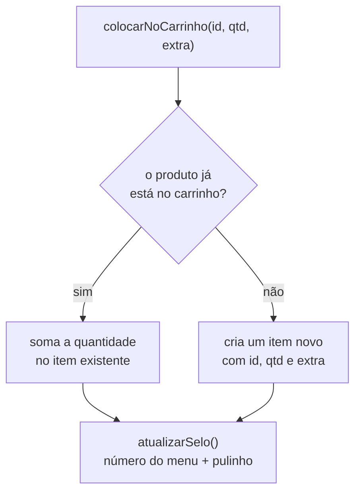

O ciclo do **carrossel automático**:

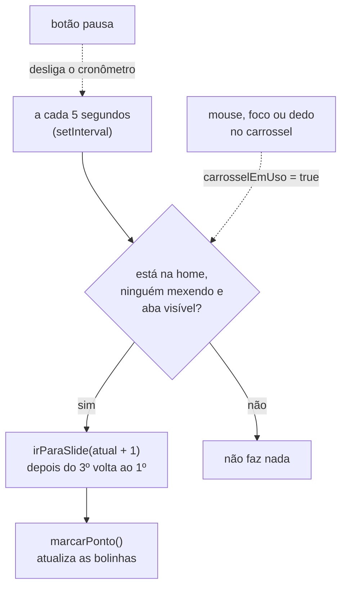

### Conceitos que você precisa dominar

- **Reaproveitar funções do Bloco 5.** `buscarProduto`, `criarCard`, `tagImagem`, `dinheiro`, `aviso` e `mostrarTela` são usadas aqui o tempo todo.
- **Carrinho guarda só o id.** O item é `{ id, qtd, extra }`. Nome, preço e foto são buscados na lista `produtos` na hora de desenhar, então não há dado repetido.
- **Redesenhar tudo.** Toda mudança no carrinho (+, −, remover) altera a lista e chama `mostrarCarrinho()`, que redesenha a tela inteira e recalcula o subtotal. Simples e sem erro de sincronização.
- **`this`.** Em `onclick="escolherOpcao(this)"`, `this` é **o próprio botão** clicado.
- **Evento e `stopPropagation`.** Um clique "sobe" do botão para os elementos de fora. `stopPropagation()` impede que o "+" também abra o produto.
- **`splice`.** Remove itens de uma lista por posição.
- **`addEventListener`.** "Escuta" eventos (tecla, rolagem, mouse, toque) sem precisar de `onclick` no HTML.
- **`setInterval` x `setTimeout`.** O primeiro **repete** (carrossel a cada 5 s); o segundo roda **uma vez** (esperar a rolagem parar).
- **Operador `%` (resto).** Faz o índice do carrossel "dar a volta": `3 % 3 = 0`.
- **Reiniciar animação CSS.** Tirar a classe, ler `offsetWidth` (força o navegador a recalcular) e colocar a classe de novo.
- **Inicialização.** Até a L485 só se **definem** funções. As 4 últimas linhas são as que **rodam** quando a página abre.

### Roteiro para apresentar

1. "Ao clicar num card, `abrirProduto` busca o produto e preenche foto, nome, preço, descrição, opções e relacionados. Depois mostra a tela."
2. "As **opções** são botões criados pelo JS. Ao clicar, `escolherOpcao` desmarca os irmãos e marca o clicado."
3. "O **favorito** e o **contador** são simples: um inverte o `aria-pressed`, o outro soma ou subtrai, nunca abaixo de 1."
4. "O coração do carrinho é `colocarNoCarrinho`: se o produto já está lá, soma a quantidade; senão, cria um item novo. Depois atualiza o selo do menu."
5. "`mostrarCarrinho` redesenha tudo: percorre os itens, monta o HTML, soma o subtotal e escreve os totais. Se estiver vazio, mostra a mensagem e esconde o resumo."
6. "O **carrossel** troca a cada 5 segundos, mas pausa se alguém está mexendo, se não está na home ou se a aba do navegador está escondida. Tem botão de pausa e funciona com as setas do teclado."
7. "No final, 4 linhas ligam o site: prepara o carrossel, desenha a home, desenha o carrinho e mostra a tela Início."

### Perguntas que podem aparecer

<details>
<summary><b>Por que o "+" do card não abre a página do produto?</b></summary>

Porque `adicionarRapido` chama `evento.stopPropagation()`, que impede o clique de chegar ao card. Além disso, no CSS o "+" tem `z-index: 1`, ficando acima da área clicável do card.
</details>

<details>
<summary><b>Por que o carrinho guarda só o <code>id</code> e não o produto inteiro?</b></summary>

Para não ter dado duplicado. Se o preço mudar na lista `produtos`, o carrinho já mostra o preço novo, porque busca na hora de desenhar.
</details>

<details>
<summary><b>Como o subtotal é calculado?</b></summary>

Dentro do `for` de `mostrarCarrinho`: para cada item, `subtotal = subtotal + preço × quantidade`. O total é igual ao subtotal porque o frete é grátis.
</details>

<details>
<summary><b>Por que o carrossel para quando o mouse está em cima?</b></summary>

Para não trocar o slide enquanto a pessoa está lendo ou prestes a clicar. É uma recomendação de acessibilidade, assim como o botão de pausa e começar parado para quem pediu menos movimento.
</details>

<details>
<summary><b>O que é o <code>void botao.offsetWidth</code>?</b></summary>

Um truque para **reiniciar uma animação CSS**. Tirar e colocar a mesma classe na mesma hora não reinicia nada, porque o navegador junta as duas mudanças. Ler `offsetWidth` obriga o navegador a processar a primeira mudança antes da segunda.
</details>

<details>
<summary><b>O que roda primeiro quando o site abre?</b></summary>

As 4 últimas linhas: `configurarCarrossel()`, `mostrarHome()`, `mostrarCarrinho()` (que já deixa o selo em "3" por causa dos itens de exemplo) e `mostrarTela("home")`.
</details>

### Código linha por linha

#### 12.1 Abrir a tela de produto (L186–L220)

| Linha | Código | O que faz |
|---|---|---|
| L186–L188 | `// ------------------------------------------------------------` | Comentário de seção: tela de detalhes do produto. |
| L189 | `function abrirProduto(id) {` | Função `abrirProduto`: chamada ao clicar num card (ou no slide 2 do carrossel). |
| L190 | `produtoAtual = buscarProduto(id);` | Busca o produto e guarda como produto atual. |
| L191 | `qtdDetalhe = 1;` | O contador volta para 1. |
| L192 | `var p = produtoAtual;` | `p` é só um apelido curto para `produtoAtual`. |
| L194 | `document.getElementById("det-foto").innerHTML = tagImagem(p) + '<span class="selo-vendas">Top Vendas</span>';` | Coloca a foto grande + o selo "Top Vendas". Aqui a foto **não** é decorativa: o `alt` é o nome do produto. |
| L195 | `document.getElementById("det-nome").innerText = p.nome;` | Escreve o nome (`innerText` = texto puro, mais seguro que `innerHTML`). |
| L196 | `document.getElementById("det-avaliacao").innerHTML = '<span class="estrelas">★★★★★</span> (' + p.nota.toFixed( …` | Escreve as estrelas fixas ★★★★★, a nota e "240 avaliações" (número fixo). |
| L197 | `document.getElementById("det-preco").innerText = dinheiro(p.preco);` | Escreve o preço. |
| L198 | `document.getElementById("det-preco-antigo").innerText = p.antigo ? dinheiro(p.antigo) : "";` | Escreve o preço antigo **se existir**; senão, deixa vazio (ternário). |
| L199 | `document.getElementById("det-descricao").innerText = p.descricao;` | Escreve a descrição. |
| L200 | `document.getElementById("det-qtd").innerText = 1;` | Contador mostra 1. |
| L201 | `document.getElementById("btn-favorito").setAttribute("aria-pressed", "false");` | O favorito volta a ficar desmarcado. |
| L203 | `// tamanhos e sabores só aparecem nos suplementos` | Comentário: tamanhos e sabores só aparecem nos produtos com opções. |
| L204 | `var opcoes = document.getElementById("det-opcoes");` | Pega o bloco de opções. |
| L205 | `opcoes.style.display = p.opcoes ? "block" : "none";` | Mostra (`block`) se o produto tem `opcoes: true`; esconde (`none`) se não tem. |
| L206 | `criarOpcoes("det-tamanhos", ["450g", "900g (Recomendado)", "1.8kg"], 1);` | Cria os 3 botões de tamanho, com o de índice **1** ("900g (Recomendado)") já marcado. |
| L207 | `criarOpcoes("det-sabores", ["Baunilha Divina", "Chocolate Suíço", "Morango Silvestre"], 1);` | Cria os 3 botões de sabor, com o de índice 1 ("Chocolate Suíço") já marcado. |
| L209 | `// "Frequentemente comprados juntos"` | Comentário: "Frequentemente comprados juntos". |
| L210 | `var html = "";` | HTML vazio. |
| L211 | `var juntos = ["creatina", "coqueteleira"];` | Os produtos sugeridos: creatina e coqueteleira. |
| L212 | `for (var i = 0; i < juntos.length; i++) {` | Para cada um... |
| L213 | `if (juntos[i] != p.id) {` | ...se **não** for o próprio produto aberto (`!=` = diferente)... |
| L214 | `html += criarCard(buscarProduto(juntos[i]));` | ...soma o card. |
| L215 | `}` | Fecha o `if`. |
| L216 | `}` | Fecha o laço. |
| L217 | `document.getElementById("lista-relacionados").innerHTML = html;` | Coloca os cards em `#lista-relacionados`. |
| L219 | `mostrarTela("produto");` | Por último, mostra a tela do produto. |
| L220 | `}` | Fecha a função. |

#### 12.2 Opções, favorito, quantidade e adicionar (L222–L263)

| Linha | Código | O que faz |
|---|---|---|
| L222 | `function criarOpcoes(idCaixa, lista, marcado) {` | Função `criarOpcoes`: cria os botões de opção. Recebe o id da caixa, a lista de textos e qual índice começa marcado. |
| L223 | `var html = "";` | HTML vazio. |
| L224 | `for (var i = 0; i < lista.length; i++) {` | Para cada texto da lista... |
| L225 | `var classe = (i == marcado) ? "ativo" : "";` | ...se for o índice marcado, a classe é `ativo`; senão, vazia. |
| L226 | `html += '<button class="' + classe + '" aria-pressed="' + (i == marcado) + '" onclick="escolherOpcao(this)">' …` | Monta o botão com a classe, o `aria-pressed` (`true` no marcado) e `onclick="escolherOpcao(this)"`. O `this` envia **o próprio botão** clicado para a função. |
| L227 | `}` | Fecha o laço. |
| L228 | `document.getElementById(idCaixa).innerHTML = html;` | Coloca os botões na caixa. |
| L229 | `}` | Fecha a função. |
| L231 | `function escolherOpcao(botao) {` | Função `escolherOpcao`: marca a opção clicada e desmarca as outras do mesmo grupo. |
| L232 | `var irmaos = botao.parentNode.children;` | Pega os "irmãos": todos os filhos da mesma caixa (`parentNode` = pai, `children` = filhos). |
| L233 | `for (var i = 0; i < irmaos.length; i++) {` | Para cada irmão... |
| L234 | `irmaos[i].classList.remove("ativo");` | ...tira o `ativo`... |
| L235 | `irmaos[i].setAttribute("aria-pressed", "false");` | ...e marca como não pressionado. |
| L236 | `}` | Fecha o laço. |
| L237 | `botao.classList.add("ativo");` | Marca o botão clicado... |
| L238 | `botao.setAttribute("aria-pressed", "true");` | ...e diz ao leitor de tela que ele está pressionado. |
| L239 | `}` | Fecha a função. |
| L241 | `function favoritar() {` | Função `favoritar`: liga/desliga o coração. |
| L242 | `var botao = document.getElementById("btn-favorito");` | Pega o botão. |
| L243 | `var marcado = botao.getAttribute("aria-pressed") == "true";` | Lê se ele está marcado agora (`"true"` vira `true`). |
| L244 | `botao.setAttribute("aria-pressed", !marcado);` | Grava o **contrário** (`!` = "não"). O CSS pinta o coração conforme o `aria-pressed`. |
| L245 | `}` | Fecha a função. |
| L247 | `function mudarQtdDetalhe(valor) {` | Função `mudarQtdDetalhe`: recebe `+1` ou `-1`. |
| L248 | `qtdDetalhe = qtdDetalhe + valor;` | Soma o valor à quantidade. |
| L249 | `if (qtdDetalhe < 1) {` | Se ficou menor que 1... |
| L250 | `qtdDetalhe = 1;` | ...volta para 1 (não existe quantidade 0 ou negativa). |
| L251 | `}` | Fecha o `if`. |
| L252 | `document.getElementById("det-qtd").innerText = qtdDetalhe;` | Mostra o número novo. |
| L253 | `}` | Fecha a função. |
| L255 | `function adicionarDetalhe() {` | Função `adicionarDetalhe`: o botão "Adicionar ao carrinho" da tela de detalhes. |
| L256 | `var sabor = "";` | Começa sem sabor. |
| L257 | `if (produtoAtual.opcoes) {` | Se o produto tem opções... |
| L258 | `var escolhido = document.querySelector("#det-sabores .ativo");` | ...pega o botão de sabor marcado (`#det-sabores .ativo`)... |
| L259 | `sabor = "Sabor: " + escolhido.innerText;` | ...e monta o texto "Sabor: Chocolate Suíço". |
| L260 | `}` | Fecha o `if`. |
| L261 | `colocarNoCarrinho(produtoAtual.id, qtdDetalhe, sabor);` | Coloca no carrinho com a quantidade do contador e o sabor. |
| L262 | `aviso("Produto adicionado ao carrinho!");` | Mostra o aviso "Produto adicionado ao carrinho!". |
| L263 | `}` | Fecha a função. |

#### 12.3 Carrinho: adicionar, mudar e remover (L265–L311)

| Linha | Código | O que faz |
|---|---|---|
| L265–L267 | `// ------------------------------------------------------------` | Comentário de seção: carrinho. |
| L268 | `function adicionarRapido(evento, id) {` | Função `adicionarRapido`: o "+" dos cards. Recebe o **evento** do clique e o id. |
| L269 | `evento.stopPropagation(); // não abre a tela do produto` | `stopPropagation()` impede o clique de "subir" para o card. Assim ele **não abre** a tela do produto. |
| L270 | `colocarNoCarrinho(id, 1, "");` | Coloca 1 unidade no carrinho, sem sabor. |
| L272 | `// pequeno "pulo" no botão + aviso, para a pessoa saber que deu certo` | Comentário: um "pulo" no botão + aviso, para a pessoa saber que deu certo. |
| L273 | `var botao = evento.currentTarget;` | `currentTarget` = o botão que recebeu o clique. |
| L274 | `botao.classList.remove("ok");` | Tira a classe `ok` (caso tenha ficado do clique anterior). |
| L275 | `void botao.offsetWidth;` | Truque: ler `offsetWidth` obriga o navegador a recalcular o layout. Sem isso, tirar e colocar a classe na mesma hora **não reinicia** a animação. |
| L276 | `botao.classList.add("ok");` | Coloca a classe `ok` de novo: o botão dá o pulinho. |
| L277 | `aviso("Produto adicionado ao carrinho!");` | Mostra o aviso. |
| L278 | `}` | Fecha a função. |
| L280 | `function colocarNoCarrinho(id, qtd, extra) {` | Função `colocarNoCarrinho`: a função central de adicionar. Recebe id, quantidade e texto extra. |
| L281 | `for (var i = 0; i < carrinho.length; i++) {` | Procura no carrinho... |
| L282 | `if (carrinho[i].id == id) {` | ...se o produto **já está** lá... |
| L283 | `carrinho[i].qtd = carrinho[i].qtd + qtd;` | ...só soma a quantidade... |
| L284 | `atualizarSelo();` | ...atualiza o selo do menu... |
| L285 | `return;` | ...e sai da função (`return`), sem criar linha nova. |
| L286 | `}` | Fecha o `if`. |
| L287 | `}` | Fecha o laço. |
| L288 | `carrinho.push({ id: id, qtd: qtd, extra: extra });` | Se chegou aqui, o produto não estava no carrinho: cria um item novo no fim da lista. |
| L289 | `atualizarSelo();` | Atualiza o selo. |
| L290 | `}` | Fecha a função. |
| L292 | `function mudarQtdCarrinho(posicao, valor) {` | Função `mudarQtdCarrinho`: os botões −/+ dentro do carrinho. Recebe a **posição** do item na lista e `+1`/`-1`. |
| L293 | `carrinho[posicao].qtd = carrinho[posicao].qtd + valor;` | Soma o valor à quantidade do item. |
| L294 | `if (carrinho[posicao].qtd < 1) {` | Se ficou menor que 1... |
| L295 | `carrinho[posicao].qtd = 1;` | ...volta para 1 (para tirar o item, usa-se o X). |
| L296 | `}` | Fecha o `if`. |
| L297 | `mostrarCarrinho();` | Redesenha o carrinho. |
| L298 | `}` | Fecha a função. |
| L300 | `function removerItem(posicao) {` | Função `removerItem`: o X do item. |
| L301 | `carrinho.splice(posicao, 1);` | `splice(posicao, 1)` remove **1 item** a partir daquela posição. |
| L302 | `mostrarCarrinho();` | Redesenha o carrinho. |
| L303 | `}` | Fecha a função. |
| L305 | `function totalItens() {` | Função `totalItens`: soma as quantidades de todos os itens. |
| L306 | `var total = 0;` | Começa em 0. |
| L307 | `for (var i = 0; i < carrinho.length; i++) {` | Para cada item... |
| L308 | `total = total + carrinho[i].qtd;` | ...soma a quantidade. |
| L309 | `}` | Fecha o laço. |
| L310 | `return total;` | Devolve o total. |
| L311 | `}` | Fecha a função. |

#### 12.4 Carrinho: selo, desenho da tela e finalizar (L313–L370)

| Linha | Código | O que faz |
|---|---|---|
| L313 | `function atualizarSelo() {` | Função `atualizarSelo`: atualiza a bolinha do menu. |
| L314 | `var n = totalItens();` | Calcula o total. |
| L315 | `var selo = document.getElementById("selo");` | Pega o selo. |
| L316 | `var mudou = selo.innerText != String(n);` | Verifica se o número **mudou** (compara o texto atual com o novo). |
| L317 | `selo.innerText = n;` | Escreve o número. |
| L318 | `selo.style.display = (n > 0) ? "flex" : "none";` | Mostra o selo (`flex`) se tiver itens; esconde se for zero. |
| L319 | `document.getElementById("aba-carrinho").setAttribute("aria-label", "Carrinho, " + n + (n == 1 ? " item" : " it …` | Atualiza o nome da aba para o leitor de tela: "Carrinho, 3 itens" (ou "1 item" no singular). |
| L320 | `if (mudou) {` | Se o número mudou... |
| L321 | `selo.classList.remove("pulso");` | ...tira a classe `pulso`... |
| L322 | `void selo.offsetWidth;` | ...força o recálculo (mesmo truque da L275)... |
| L323 | `selo.classList.add("pulso");` | ...e coloca de novo: o selo dá o pulinho. |
| L324 | `}` | Fecha o `if`. |
| L325 | `}` | Fecha a função. |
| L327 | `function mostrarCarrinho() {` | Função `mostrarCarrinho`: desenha a tela do carrinho inteira. |
| L328 | `var html = "";` | HTML vazio. |
| L329 | `var subtotal = 0;` | Subtotal começa em 0. |
| L331 | `for (var i = 0; i < carrinho.length; i++) {` | Para cada item do carrinho... |
| L332 | `var item = carrinho[i];` | ...pega o item... |
| L333 | `var p = buscarProduto(item.id);` | ...busca o produto dele (para ter nome, preço e foto)... |
| L334 | `subtotal = subtotal + p.preco * item.qtd;` | ...e soma preço × quantidade ao subtotal. |
| L336 | `html += '<div class="item">' +` | Começa o HTML do item (`<div class="item">`). |
| L337 | `'<div class="item-foto">' + tagImagem(p, true) + '</div>' +` | A foto (decorativa, porque o nome está ao lado). |
| L338 | `'<div class="item-info">' +` | Abre a coluna de informações. |
| L339 | `'<div class="item-titulo"><h4>' + p.nome + '</h4>' +` | O nome do item... |
| L340 | `'<button class="remover" aria-label="Remover ' + p.nome + '" onclick="removerItem(' + i + ')">' + icone("fecha …` | ...e o botão X, que chama `removerItem(i)` com a posição do item. |
| L341 | `'<p>' + item.extra + '</p>' +` | O texto extra (sabor). |
| L342 | `'<div class="item-preco"><span>' + dinheiro(p.preco) + '</span>' +` | A linha de baixo: o preço unitário... |
| L343 | `'<div class="contador">' +` | ...e o contador. |
| L344 | `'<button aria-label="Diminuir quantidade de ' + p.nome + '" onclick="mudarQtdCarrinho(' + i + ', -1)">' + icon …` | Botão −: `mudarQtdCarrinho(i, -1)`. |
| L345 | `'<span aria-live="polite">' + item.qtd + '</span>' +` | A quantidade (`aria-live` para o leitor de tela anunciar a mudança). |
| L346 | `'<button class="mais" aria-label="Aumentar quantidade de ' + p.nome + '" onclick="mudarQtdCarrinho(' + i + ', …` | Botão +: `mudarQtdCarrinho(i, 1)`. |
| L347 | `'</div></div>' +` | Fecha o contador e a linha de preço. |
| L348 | `'</div>' +` | Fecha a coluna de informações. |
| L349 | `'</div>';` | Fecha o item. |
| L350 | `}` | Fecha o laço. |
| L352 | `var vazio = (carrinho.length == 0);` | `vazio` fica `true` se o carrinho não tem nenhum item. |
| L353 | `if (vazio) {` | Se estiver vazio... |
| L354 | `html = '<div class="carrinho-vazio">' + icone("carrinho") + '<p>Seu carrinho está vazio.</p>' +` | ...o HTML vira a mensagem "Seu carrinho está vazio." com o ícone de carrinho... |
| L355 | `'<button onclick="abrirCategoria(\'suplementos\')">Ver produtos</button></div>';` | ...e o botão "Ver produtos", que abre Suplementos. |
| L356 | `}` | Fecha o `if`. |
| L358 | `document.getElementById("lista-carrinho").innerHTML = html;` | Coloca o HTML na lista. |
| L359 | `document.getElementById("area-resumo").style.display = vazio ? "none" : "block";` | Esconde o resumo se estiver vazio; mostra se não. |
| L360 | `document.getElementById("carrinho-itens").innerText = totalItens() + (totalItens() == 1 ? " Item" : " Itens");` | Escreve "3 Itens" (ou "1 Item") no cabeçalho. |
| L361 | `document.getElementById("resumo-subtotal").innerText = dinheiro(subtotal);` | Escreve o subtotal. |
| L362 | `document.getElementById("resumo-total").innerText = dinheiro(subtotal);` | Escreve o total (igual ao subtotal, porque o frete é grátis). |
| L363 | `atualizarSelo();` | Atualiza o selo do menu. |
| L364 | `}` | Fecha a função. |
| L366 | `function finalizar() {` | Função `finalizar`: o botão "Finalizar compra". |
| L367 | `aviso("Pedido finalizado! Obrigado por comprar na C.F.G Force Store.");` | Mostra o aviso de agradecimento. |
| L368 | `carrinho = [];` | Esvazia o carrinho (lista vazia). |
| L369 | `mostrarCarrinho();` | Redesenha (agora aparece a mensagem de vazio). |
| L370 | `}` | Fecha a função. |

#### 12.5 Detalhes de interface: teclado e rolagem (L372–L387)

| Linha | Código | O que faz |
|---|---|---|
| L372–L374 | `// ------------------------------------------------------------` | Comentário de seção: detalhes de interface. |
| L375 | `// Elementos com role="button" (ex.: banner) também respondem a Enter e Espaço` | Comentário: elementos com `role="button"` (os banners) também respondem a Enter e Espaço. |
| L376 | `document.addEventListener("keydown", function (e) {` | "Escuta" **toda tecla apertada** na página. `e` é o evento (tem a tecla e o elemento). |
| L377 | `var alvo = e.target;` | `alvo` = o elemento que está com o foco. |
| L378 | `if (alvo.getAttribute && alvo.getAttribute("role") == "button" && (e.key == "Enter" \|\| e.key == " ")) {` | Se o alvo tem `role="button"` **e** (`&&`) a tecla é Enter **ou** (`\|\|`) Espaço... |
| L379 | `e.preventDefault();` | ...cancela o comportamento padrão (o Espaço rolaria a página)... |
| L380 | `alvo.click();` | ...e simula um clique no elemento. |
| L381 | `}` | Fecha o `if`. |
| L382 | `});` | Fecha a função anônima e a chamada do `addEventListener`. |
| L384 | `// Mostra a linha embaixo do cabeçalho só depois de rolar a página` | Comentário: a linha embaixo do cabeçalho só aparece depois de rolar. |
| L385 | `window.addEventListener("scroll", function () {` | "Escuta" a rolagem da janela. |
| L386 | `document.body.classList.toggle("rolou", window.scrollY > 4);` | `toggle("rolou", condição)`: coloca a classe `rolou` no `body` se rolou mais de 4px; tira se voltou ao topo. O CSS (L171) usa essa classe. |
| L387 | `}, { passive: true });` | `passive: true` avisa ao navegador que esta função não vai bloquear a rolagem (deixa rolar mais liso). |

#### 12.6 Carrossel de promoções (L389–L485)

| Linha | Código | O que faz |
|---|---|---|
| L389–L391 | `// ------------------------------------------------------------` | Comentário de seção: carrossel de promoções. |
| L392 | `var slideAtual = 0;` | `slideAtual`: índice do slide na tela (0, 1 ou 2). |
| L393 | `var timerCarrossel = null;` | `timerCarrossel`: o cronômetro que troca os slides sozinho. |
| L394 | `var carrosselPausado = false;   // pausado pelo botão` | `carrosselPausado`: `true` se a pessoa apertou pausa. |
| L395 | `var carrosselEmUso = false;     // mouse em cima / foco / dedo na tela` | `carrosselEmUso`: `true` enquanto o mouse está em cima, o foco está dentro ou o dedo está na tela. |
| L396 | `var menosMovimento = window.matchMedia("(prefers-reduced-motion: reduce)").matches;` | `menosMovimento`: `true` se a pessoa ativou "reduzir movimento" no sistema. `matchMedia` testa uma media query pelo JS. |
| L398 | `function slides() {` | Função `slides`: devolve todos os banners dentro do trilho. |
| L399 | `return document.querySelectorAll("#carrossel-trilho .banner");` | Busca `#carrossel-trilho .banner`. |
| L400 | `}` | Fecha a função. |
| L402 | `function irParaSlide(indice) {` | Função `irParaSlide`: vai para o slide de um índice. |
| L403 | `var lista = slides();` | Pega os slides. |
| L404 | `slideAtual = (indice + lista.length) % lista.length;` | Calcula o índice **dando a volta**: `%` é o resto da divisão. Depois do último (3 % 3 = 0) volta ao primeiro; antes do primeiro ((−1 + 3) % 3 = 2) vai para o último. |
| L405 | `var trilho = document.getElementById("carrossel-trilho");` | Pega o trilho. |
| L406 | `trilho.scrollTo({ left: lista[slideAtual].offsetLeft - lista[0].offsetLeft, behavior: menosMovimento ? "auto" …` | Rola o trilho até o slide: a posição do slide menos a do primeiro (por causa do padding). Rola suave (`smooth`), a não ser que a pessoa tenha pedido menos movimento (`auto` = pula direto). |
| L407 | `marcarPonto();` | Atualiza as bolinhas. |
| L408 | `}` | Fecha a função. |
| L410 | `function marcarPonto() {` | Função `marcarPonto`: pinta a bolinha do slide atual. |
| L411 | `var pontos = document.querySelectorAll("#carrossel-pontos button");` | Pega as bolinhas. |
| L412 | `for (var i = 0; i < pontos.length; i++) {` | Para cada uma... |
| L413 | `if (i == slideAtual) {` | ...se for a do slide atual... |
| L414 | `pontos[i].setAttribute("aria-current", "true");` | ...marca com `aria-current="true"` (o CSS desenha a pílula rosa). |
| L415 | `} else {` | Senão... |
| L416 | `pontos[i].removeAttribute("aria-current");` | ...tira a marcação. |
| L417 | `}` | Fecha o `if/else`. |
| L418 | `}` | Fecha o laço. |
| L419 | `}` | Fecha a função. |
| L421 | `function proximoSlide() {` | Função `proximoSlide`: chamada pelo cronômetro a cada 5 segundos. |
| L422 | `// só troca sozinho se a home estiver aberta e ninguém estiver mexendo` | Comentário: só troca sozinho se a home estiver aberta e ninguém estiver mexendo. |
| L423 | `var naHome = document.getElementById("tela-home").classList.contains("ativa");` | Verifica se a tela Início está ativa. |
| L424 | `if (naHome && !carrosselEmUso && !document.hidden) {` | Se está na home, **não** está em uso e a aba do navegador está visível (`document.hidden` = aba escondida)... |
| L425 | `irParaSlide(slideAtual + 1);` | ...vai para o próximo slide. |
| L426 | `}` | Fecha o `if`. |
| L427 | `}` | Fecha a função. |
| L429 | `function iniciarCarrossel() {` | Função `iniciarCarrossel`: liga o cronômetro. |
| L430 | `clearInterval(timerCarrossel);` | Desliga o cronômetro anterior (para não ter dois rodando). |
| L431 | `if (!carrosselPausado) {` | Se não estiver pausado... |
| L432 | `timerCarrossel = setInterval(proximoSlide, 5000);` | ...cria um cronômetro que chama `proximoSlide` a cada 5000 ms (5 segundos). `setInterval` repete; `setTimeout` (do aviso) roda uma vez só. |
| L433 | `}` | Fecha o `if`. |
| L434 | `}` | Fecha a função. |
| L436 | `function alternarPausa() {` | Função `alternarPausa`: o botão de pausa. |
| L437 | `carrosselPausado = !carrosselPausado;` | Inverte o estado (pausado ↔ rodando). |
| L438 | `var botao = document.getElementById("carrossel-pausa");` | Pega o botão. |
| L439 | `botao.setAttribute("aria-label", carrosselPausado ? "Continuar promoções" : "Pausar promoções");` | Troca o nome do botão para o leitor de tela ("Continuar" ou "Pausar"). |
| L440 | `botao.querySelector("use").setAttribute("href", carrosselPausado ? "#i-play" : "#i-pausa");` | Troca o ícone: o `<use>` passa a apontar para play ou pausa. |
| L441 | `if (carrosselPausado) {` | Se pausou... |
| L442 | `clearInterval(timerCarrossel);` | ...desliga o cronômetro. |
| L443 | `} else {` | Senão... |
| L444 | `iniciarCarrossel();` | ...liga de novo. |
| L445 | `}` | Fecha o `if/else`. |
| L446 | `}` | Fecha a função. |
| L448 | `function configurarCarrossel() {` | Função `configurarCarrossel`: prepara tudo, roda uma vez quando a página abre. |
| L449 | `var carrossel = document.getElementById("carrossel");` | Pega a caixa do carrossel. |
| L450 | `var trilho = document.getElementById("carrossel-trilho");` | Pega o trilho. |
| L452 | `// quando a pessoa arrasta, descobre qual slide ficou na tela` | Comentário: quando a pessoa arrasta, descobre qual slide ficou na tela. |
| L453 | `var esperaRolagem = null;` | Cronômetro de espera da rolagem. |
| L454 | `trilho.addEventListener("scroll", function () {` | "Escuta" a rolagem do trilho (acontece muitas vezes por segundo enquanto arrasta). |
| L455 | `clearTimeout(esperaRolagem);` | Cancela a espera anterior... |
| L456 | `esperaRolagem = setTimeout(function () {` | ...e espera 80 ms sem rolar (a rolagem "parou") para então: |
| L457 | `var largura = slides()[0].offsetWidth + 12; // 12 = gap do CSS` | calcular a largura de um slide + o espaço entre eles (12px, o `gap` do CSS)... |
| L458 | `slideAtual = Math.round(trilho.scrollLeft / largura);` | ...dividir quanto rolou pela largura e arredondar: esse é o índice do slide na tela... |
| L459 | `marcarPonto();` | ...e atualizar as bolinhas. |
| L460 | `}, 80);` | Fim da espera de 80 ms. |
| L461 | `}, { passive: true });` | Fecha o `addEventListener` (rolagem passiva). |
| L463 | `// pausa enquanto alguém está usando` | Comentário: pausa enquanto alguém está usando. |
| L464 | `function emUso() { carrosselEmUso = true; }` | Função curta `emUso`: marca como em uso. |
| L465 | `function livre() { carrosselEmUso = false; iniciarCarrossel(); }` | Função curta `livre`: marca como livre e reinicia o cronômetro (conta 5 s do zero). |
| L466 | `carrossel.addEventListener("mouseenter", emUso);` | Mouse entrou no carrossel → em uso. |
| L467 | `carrossel.addEventListener("mouseleave", livre);` | Mouse saiu → livre. |
| L468 | `carrossel.addEventListener("focusin", emUso);` | Foco do teclado entrou → em uso. |
| L469 | `carrossel.addEventListener("focusout", livre);` | Foco saiu → livre. |
| L470 | `trilho.addEventListener("touchstart", emUso, { passive: true });` | Dedo encostou no trilho → em uso. |
| L471 | `trilho.addEventListener("touchend", livre, { passive: true });` | Dedo soltou → livre. |
| L473 | `// setas do teclado trocam o slide` | Comentário: as setas do teclado trocam o slide. |
| L474 | `carrossel.addEventListener("keydown", function (e) {` | "Escuta" as teclas dentro do carrossel. |
| L475 | `if (e.key == "ArrowRight") { irParaSlide(slideAtual + 1); }` | Seta direita → próximo slide. |
| L476 | `if (e.key == "ArrowLeft")  { irParaSlide(slideAtual - 1); }` | Seta esquerda → slide anterior. |
| L477 | `});` | Fecha a função anônima e a chamada do `addEventListener`. |
| L479 | `// quem pediu menos movimento começa com o carrossel parado` | Comentário: quem pediu menos movimento começa com o carrossel parado. |
| L480 | `if (menosMovimento) {` | Se pediu menos movimento... |
| L481 | `alternarPausa();` | ...já começa pausado (o botão vira "play"). |
| L482 | `} else {` | Senão... |
| L483 | `iniciarCarrossel();` | ...liga o cronômetro. |
| L484 | `}` | Fecha o `if/else`. |
| L485 | `}` | Fecha a função. |

#### 12.7 Início do programa (L487–L493)

| Linha | Código | O que faz |
|---|---|---|
| L487–L489 | `// ------------------------------------------------------------` | Comentário de seção: começo. Até aqui só foram **criadas** funções; nada rodou. As linhas abaixo é que **executam** o site. |
| L490 | `configurarCarrossel();` | Prepara o carrossel. |
| L491 | `mostrarHome();` | Desenha os 4 cards da home. |
| L492 | `mostrarCarrinho();` | Desenha o carrinho (com os 2 itens de exemplo) e atualiza o selo para "3". |
| L493 | `mostrarTela("home");` | Mostra a tela Início e destaca a aba Início. |

---

## 13. Fluxos completos: o que acontece quando o usuário clica

Cada fluxo mostra **quais blocos trabalham juntos**. Bom para treinar respostas do tipo "e o que acontece quando...?".

### Abrir o site · Blocos 1, 5 e 6

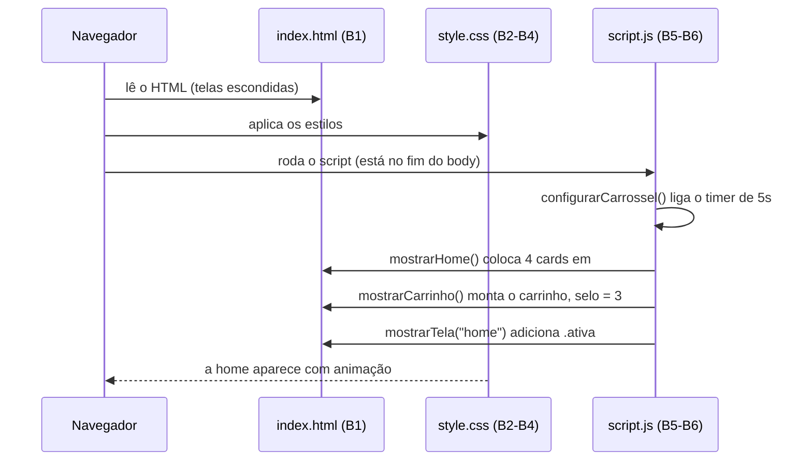

### Clicar num card e comprar · Blocos 2, 3, 5 e 6

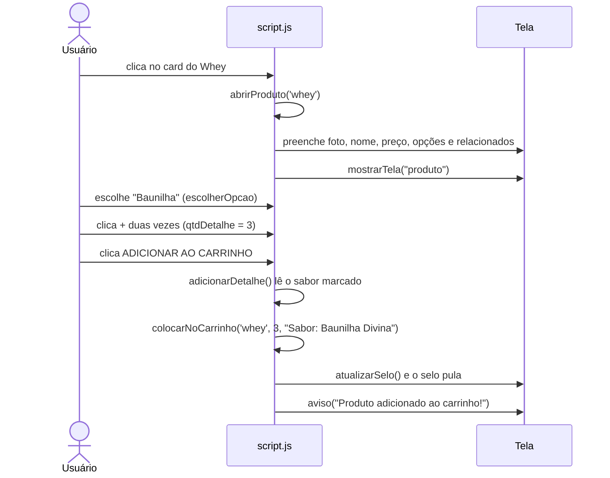

### Adicionar rápido pelo "+" · Blocos 2, 4 e 6

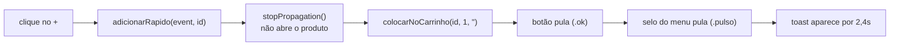

### Mudar o carrinho e finalizar · Blocos 3, 4 e 6

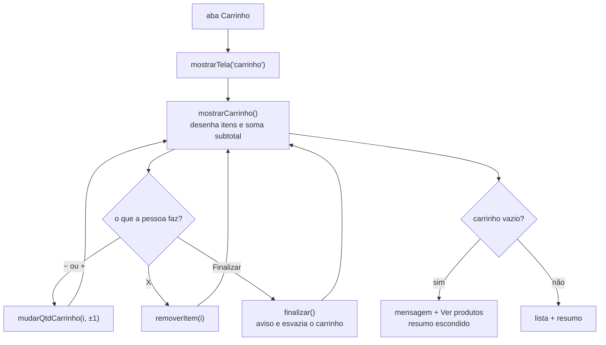

### Ordenar por preço · Blocos 1, 3 e 5

`ordenar('preco')` → `ordemAtual = "preco"` → `mostrarCategoria()` reordena do mais barato para o mais caro → o botão "Faixa de Preço" ganha a classe `ativo` (fica rosa) e `aria-pressed="true"`.

---

## 14. Perguntas gerais sobre o projeto

Qualquer integrante pode receber estas perguntas.

<details>
<summary><b>Quais tecnologias foram usadas?</b></summary>

HTML, CSS e JavaScript puros, sem framework e sem biblioteca. As únicas coisas externas são as fontes Outfit e Geist, do Google Fonts. O layout veio de um protótipo no Figma.
</details>

<details>
<summary><b>Por que não usaram React ou outro framework?</b></summary>

Para o projeto ser simples de abrir (dois cliques no `index.html`) e para mostrar os fundamentos: manipular o DOM, trocar classes, gerar HTML. Tudo o que um framework faz por baixo dos panos aparece aqui de forma explícita.
</details>

<details>
<summary><b>O que é uma SPA?</b></summary>

*Single Page Application*: um único HTML em que o JavaScript troca o conteúdo visível, sem recarregar a página. Aqui, as 5 telas existem desde o começo e só uma tem a classe `ativa`.
</details>

<details>
<summary><b>O site é acessível?</b></summary>

Tem vários cuidados: `aria-label` nos botões só com ícone, `aria-pressed` nos botões liga/desliga, `aria-live` nos textos que mudam, foco visível para teclado, área de toque mínima de 44px, estados que não dependem só da cor, suporte a movimento reduzido e o carrossel com pausa e setas do teclado.
</details>

<details>
<summary><b>Se eu recarregar a página, o carrinho continua?</b></summary>

Não. O carrinho fica na memória do JavaScript e volta para os 2 itens de exemplo ao recarregar. Para salvar, daria para usar `localStorage` (ver seção 15).
</details>

<details>
<summary><b>Como o site funciona no celular e no computador com o mesmo código?</b></summary>

Com media queries no CSS. A base é o celular, e a partir de 700px e 1024px o CSS acrescenta ajustes: mais colunas, menu no topo, layouts em duas colunas. O HTML e o JS são os mesmos.
</details>

---

## 15. Limitações conhecidas e ideias de melhoria

O que vale saber antes de mexer no código (e ótimas respostas para "o que vocês melhorariam?"):

| Limitação | Onde | Ideia de melhoria |
|---|---|---|
| **Nada é salvo.** Carrinho e favorito somem ao recarregar. | `script.js` L36 | Salvar o carrinho com `localStorage`. |
| **Sabores diferentes se juntam.** Adicionar Whey Baunilha depois de Whey Chocolate soma na mesma linha e mantém o primeiro sabor. | `colocarNoCarrinho`, L280 | Comparar `id` **e** `extra`. |
| **O tamanho escolhido não vai para o carrinho**, e o preço não muda com o tamanho. | `adicionarDetalhe`, L255 | Ler o tamanho marcado e ter preço por tamanho. |
| **Tamanhos e sabores são iguais** para todos os produtos com opções. | `abrirProduto`, L206–L207 | Guardar as opções dentro de cada produto. |
| **Avaliações fixas** (sempre ★★★★★ e "240 avaliações"). | `abrirProduto`, L196 | Gerar as estrelas pela nota e guardar o número de avaliações. |
| **O favorito não é por produto**: ao abrir outro produto, volta a desmarcado. | `abrirProduto`, L201 | Guardar uma lista de favoritos. |
| **Busca e notificações são simuladas.** A lupa abre Suplementos; o sino mostra um aviso. | `index.html` L46–L47 | Criar uma tela de busca. |
| **Perfil** é só um placeholder. | `index.html` L196–L204 | Implementar a tela. |
| **Equipamentos** não tem produtos. | lista `produtos` | Cadastrar produtos com `grupo: "equipamentos"`. |
| **Endereço fixo** no HTML. | `index.html` L181 | Formulário de endereço. |
| **`dinheiro()` sem separador de milhar** (R$ 1500,00). | `script.js` L48 | `valor.toLocaleString("pt-BR", { style: "currency", currency: "BRL" })`. |

---

## 16. Glossário

| Termo | Significado |
|---|---|
| **SPA** | *Single Page Application*: um só HTML, com as telas trocadas pelo JavaScript. |
| **DOM** | A "árvore" de elementos HTML que o JavaScript lê e altera. |
| **Tag semântica** | Tag que diz o que o conteúdo **é** (`header`, `nav`, `section`, `article`). |
| **Classe / id** | `class` se repete e é usada pelo CSS; `id` é único e é usado pelo JS. |
| **Token / variável CSS** | Valor com nome (`--rosa`) definido uma vez e usado com `var(--rosa)`. |
| **Seletor** | A parte do CSS que diz **quem** vai ser estilizado (`.card`, `#selo`, `button`). |
| **Pseudo-classe** | Estado de um elemento: `:active`, `:hover`, `:focus-visible`, `:has()`. |
| **Pseudo-elemento** | Elemento "falso" criado pelo CSS: `::before`, `::after`. |
| **Flexbox** | Layout em uma direção (linha ou coluna). |
| **Grid** | Layout em linhas **e** colunas. |
| **`fr`** | Fração do espaço livre numa grade. |
| **Media query** | Regras CSS que só valem em certas condições (largura, mouse, movimento reduzido). |
| **Mobile first** | Escrever o CSS para celular primeiro e acrescentar ajustes para telas maiores. |
| **`position: sticky`** | Rola normal até um ponto e depois gruda. |
| **`position: fixed`** | Preso na janela; não rola com a página. |
| **`position: absolute`** | Posicionado em relação ao ancestral `relative` mais próximo. |
| **`z-index`** | Ordem de empilhamento: quem fica por cima. |
| **Sprite SVG** | Vários ícones num só `<svg>`, reutilizados com `<use href="#id">`. |
| **ARIA** | Atributos (`aria-label`, `aria-pressed`, `aria-live`...) que dão informação para leitores de tela. |
| **Toast** | Aviso pequeno e temporário que aparece e some sozinho. |
| **Scroll snap** | Rolagem que encaixa em pontos definidos. |
| **Array / objeto** | `[ ]` = lista em ordem; `{ }` = conjunto de campos com nome. |
| **Função** | Bloco de código com nome que roda quando é chamado e pode devolver um valor. |
| **Estado** | Variáveis que mudam com o uso (carrinho, produto aberto, categoria). |
| **`innerHTML` / `innerText`** | Escreve dentro de um elemento como HTML / como texto puro. |
| **`classList.add` / `remove`** | Liga / desliga uma classe CSS de um elemento. |
| **`addEventListener`** | "Escuta" um evento (clique, tecla, rolagem) e roda uma função. |
| **`stopPropagation`** | Impede que um clique "suba" para os elementos de fora. |
| **`setTimeout` / `setInterval`** | Roda algo uma vez depois de um tempo / repete a cada intervalo. |
| **Operador ternário** | `condição ? seSim : seNão`. |
